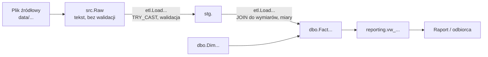
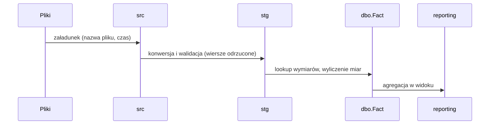
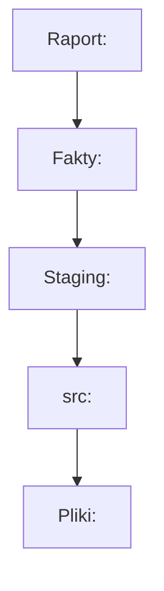

# Diagramy lineage: <obiekt> (<ID>)

## 1. Przepływ danych (od źródła do raportu)

Podpisz krawędzie transformacją lub filtrem. Zaznacz węzeł, w którym powstaje różnica, np. `style C fill:#fdd`.

## 2. Przebieg ładowania (sekwencja)

## 3. Ścieżka przypadku referencyjnego (opcjonalnie)

Wartości w węzłach pochodzą z bilansu w `lineage.md` (ID zapytań).
