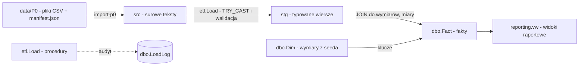
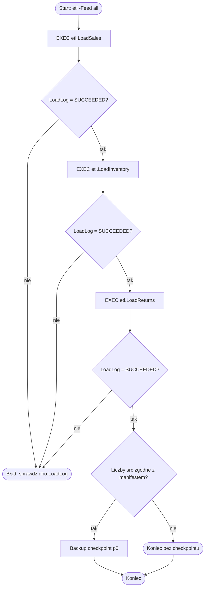
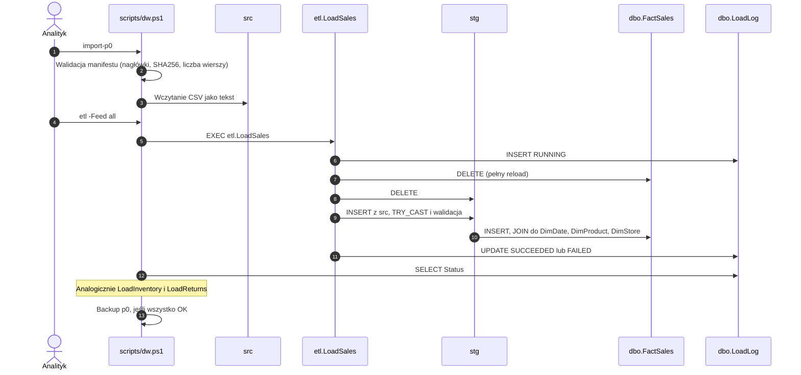

<!-- Generated by SpecStory, Markdown v2.1.0 -->

# 2026-11-16 11:14:42Z

<!-- Copilot CLI Session 4c7641f7-1258-4515-9a9b-642313c04cb0 (2026-11-16 11:14:42Z) -->

_**User (2026-11-16 11:14:42Z)**_

Chcemy szybciej wdrażać nowych doświadoczonych Analityków Danych do tego projektu

Przeanalizuj bazę RetailDW.

Opisz schemat i działanie
- Tabele/Widoki
- Procedury
- Proces ETL 
- Metryki

Czytelne skanowalne listy, tabelki, minumum prozy

dodaj diagramy mermaid - flow i sequence

zapisz do ./docs/analiza-bazy.md

---

_**Agent (claude-haiku-5.5 2026-11-16 11:14:45Z)**_

<think><details><summary>Thought Process</summary>
I'm going to analyze the RetailDW database and write the results in Polish to ./docs/analiza-bazy.md. To do that I'll read through the SQL files, and since there are many of them I'll open several at once rather than one by one.

I'm checking the remaining part of the plan, which mentions a deferred mssql tool, but I'll stick with reading the files directly.
</details></think>

Zacznę od odczytu definicji tabel, widoków, procedur i skryptów, żeby opisać bazę na podstawie kodu.

_**Agent (claude-haiku-5.5 2026-11-16 11:14:46Z)**_

<tool-use data-tool-type="search" data-tool-name="glob"><details>
<summary>Tool use: **glob**</summary>

RetailDW/**/*.sql

**Input:**

- pattern: `RetailDW/**/*.sql`

**Result:**

```
.\RetailDW\Views\reporting.vw_StoreScorecard.sql
.\RetailDW\Views\reporting.vw_StockAvailability.sql
.\RetailDW\Views\reporting.vw_SalesWeekly.sql
.\RetailDW\Views\reporting.vw_SalesDaily.sql
.\RetailDW\Views\reporting.vw_ProductPerformance.sql
.\RetailDW\Views\reporting.vw_MarginAnalysis.sql
.\RetailDW\Tables\stg.Sales.sql
.\RetailDW\Tables\stg.Returns.sql
.\RetailDW\Tables\stg.Inventory.sql
.\RetailDW\Tables\src.SalesRaw.sql
.\RetailDW\Tables\src.ReturnsRaw.sql
.\RetailDW\Tables\src.InventoryRaw.sql
.\RetailDW\Tables\dbo.LoadLog.sql
.\RetailDW\Tables\dbo.FactSales.sql
.\RetailDW\Tables\dbo.FactReturns.sql
.\RetailDW\Tables\dbo.FactInventoryDaily.sql
.\RetailDW\Tables\dbo.DimStore.sql
.\RetailDW\Tables\dbo.DimProduct.sql
.\RetailDW\Tables\dbo.DimDate.sql
.\RetailDW\Security\etl.sql
.\RetailDW\Security\src.sql
.\RetailDW\Security\reporting.sql
.\RetailDW\Security\stg.sql
.\RetailDW\Procedures\etl.LoadSales.sql
.\RetailDW\Procedures\etl.LoadReturns.sql
.\RetailDW\Procedures\etl.LoadInventory.sql
.\RetailDW\Scripts\PostDeployment.sql
.\RetailDW\Scripts\Seed\02-DimStore.sql
.\RetailDW\Scripts\Seed\01-DimProduct.sql
.\RetailDW\Scripts\Seed\00-DimDate.sql
```
</details></tool-use>

_**Agent (claude-haiku-5.5 2026-11-16 11:14:45Z)**_

<tool-use data-tool-type="read" data-tool-name="view"><details>
<summary>Tool use: **view**</summary>

view the file at C:\Users\teamsharq\Desktop\infoshare-silkycoders-sql-ai-4\RetailDW\RetailDW.sqlproj.

**Input:**

- path: `C:\Users\teamsharq\Desktop\infoshare-silkycoders-sql-ai-4\RetailDW\RetailDW.sqlproj`

**Result:**

```
<?xml version="1.0" encoding="utf-8"?>
<Project DefaultTargets="Build">
  <Sdk Name="Microsoft.Build.Sql" Version="2.2.0" />
  <PropertyGroup>
    <Name>RetailDW</Name>
    <DSP>Microsoft.Data.Tools.Schema.Sql.Sql160DatabaseSchemaProvider</DSP>
    <ModelCollation>1045, CI</ModelCollation>
  </PropertyGroup>
  <ItemGroup>
    <Build Remove="Scripts\**\*.sql" />
    <PostDeploy Include="Scripts\PostDeployment.sql" />
    <None Include="Scripts\Seed\*.sql" />
  </ItemGroup>
</Project>
```
</details></tool-use>

_**Agent (claude-haiku-5.5 2026-11-16 11:14:45Z)**_

<tool-use data-tool-type="read" data-tool-name="view"><details>
<summary>Tool use: **view**</summary>

view the file at C:\Users\teamsharq\Desktop\infoshare-silkycoders-sql-ai-4\RetailDW\Scripts\PostDeployment.sql.

**Input:**

- path: `C:\Users\teamsharq\Desktop\infoshare-silkycoders-sql-ai-4\RetailDW\Scripts\PostDeployment.sql`

**Result:**

```
PRINT N'Starting RetailDW dimension seed.';
GO
:r .\Seed\00-DimDate.sql
GO
:r .\Seed\01-DimProduct.sql
GO
:r .\Seed\02-DimStore.sql
GO
PRINT N'RetailDW dimensions are ready. Import P0 and run ETL separately with scripts/dw.ps1.';
GO
```
</details></tool-use>

_**Agent (claude-haiku-5.5 2026-11-16 11:14:45Z)**_

<tool-use data-tool-type="read" data-tool-name="view"><details>
<summary>Tool use: **view**</summary>

view the file at C:\Users\teamsharq\Desktop\infoshare-silkycoders-sql-ai-4\RetailDW\Security\etl.sql.

**Input:**

- path: `C:\Users\teamsharq\Desktop\infoshare-silkycoders-sql-ai-4\RetailDW\Security\etl.sql`

**Result:**

```
CREATE SCHEMA [etl];
```
</details></tool-use>

_**Agent (claude-haiku-5.5 2026-11-16 11:14:45Z)**_

<tool-use data-tool-type="read" data-tool-name="view"><details>
<summary>Tool use: **view**</summary>

view the file at C:\Users\teamsharq\Desktop\infoshare-silkycoders-sql-ai-4\RetailDW\Security\reporting.sql.

**Input:**

- path: `C:\Users\teamsharq\Desktop\infoshare-silkycoders-sql-ai-4\RetailDW\Security\reporting.sql`

**Result:**

```
CREATE SCHEMA [reporting] AUTHORIZATION [dbo];
```
</details></tool-use>

_**Agent (claude-haiku-5.5 2026-11-16 11:14:45Z)**_

<tool-use data-tool-type="read" data-tool-name="view"><details>
<summary>Tool use: **view**</summary>

view the file at C:\Users\teamsharq\Desktop\infoshare-silkycoders-sql-ai-4\RetailDW\Security\src.sql.

**Input:**

- path: `C:\Users\teamsharq\Desktop\infoshare-silkycoders-sql-ai-4\RetailDW\Security\src.sql`

**Result:**

```
CREATE SCHEMA [src];
```
</details></tool-use>

_**Agent (claude-haiku-5.5 2026-11-16 11:14:46Z)**_

<tool-use data-tool-type="read" data-tool-name="view"><details>
<summary>Tool use: **view**</summary>

view the file at C:\Users\teamsharq\Desktop\infoshare-silkycoders-sql-ai-4\RetailDW\Security\stg.sql.

**Input:**

- path: `C:\Users\teamsharq\Desktop\infoshare-silkycoders-sql-ai-4\RetailDW\Security\stg.sql`

**Result:**

```
CREATE SCHEMA [stg];
```
</details></tool-use>

_**Agent (claude-haiku-5.5 2026-11-16 11:14:48Z)**_

<tool-use data-tool-type="read" data-tool-name="view"><details>
<summary>Tool use: **view**</summary>

view the file at C:\Users\teamsharq\Desktop\infoshare-silkycoders-sql-ai-4\RetailDW\Tables\dbo.DimDate.sql.

**Input:**

- path: `C:\Users\teamsharq\Desktop\infoshare-silkycoders-sql-ai-4\RetailDW\Tables\dbo.DimDate.sql`

**Result:**

```
/*
    Calendar dimension. One row per day.

    [YearWeek] uses the ISO-8601 week numbering, which is what the trading
    calendar in the weekly reports is based on - note that the ISO year can
    differ from the calendar year around 1 January.
*/
CREATE TABLE [dbo].[DimDate]
(
    [DateKey]    INT           NOT NULL, -- yyyymmdd
    [Date]       DATE          NOT NULL,
    [Year]       SMALLINT      NOT NULL,
    [Quarter]    TINYINT       NOT NULL,
    [Month]      TINYINT       NOT NULL,
    [MonthName]  NVARCHAR (20) NOT NULL,
    [YearMonth]  NVARCHAR (7)  NOT NULL, -- '2026-09'
    [IsoYear]    SMALLINT      NOT NULL,
    [IsoWeek]    TINYINT       NOT NULL,
    [YearWeek]   NVARCHAR (8)  NOT NULL, -- '2026-W38'
    [DayOfWeek]  TINYINT       NOT NULL, -- 1 = Monday
    [DayName]    NVARCHAR (20) NOT NULL,
    [IsWeekend]  BIT           NOT NULL,
    [Season]     NVARCHAR (10) NOT NULL, -- retail season the day belongs to
    CONSTRAINT [PK_DimDate] PRIMARY KEY CLUSTERED ([DateKey] ASC)
);
GO

CREATE UNIQUE NONCLUSTERED INDEX [UX_DimDate_Date]
    ON [dbo].[DimDate] ([Date] ASC);
GO

CREATE NONCLUSTERED INDEX [IX_DimDate_YearWeek]
    ON [dbo].[DimDate] ([YearWeek] ASC);
```
</details></tool-use>

_**Agent (claude-haiku-5.5 2026-11-16 11:14:48Z)**_

<tool-use data-tool-type="read" data-tool-name="view"><details>
<summary>Tool use: **view**</summary>

view the file at C:\Users\teamsharq\Desktop\infoshare-silkycoders-sql-ai-4\RetailDW\Tables\dbo.DimProduct.sql.

**Input:**

- path: `C:\Users\teamsharq\Desktop\infoshare-silkycoders-sql-ai-4\RetailDW\Tables\dbo.DimProduct.sql`

**Result:**

```
/*
    Product dimension at SKU grain.

    A SKU is one size/colour variant of a style, e.g. style W-JKT-001 sold as
    W-JKT-001-CZA-M. Reporting by "model" means grouping on [StyleCode];
    reporting by "product" usually means the SKU.

    [ListPrice] is the current catalogue price including VAT. [UnitCost] is the
    landed cost of one unit.
*/
CREATE TABLE [dbo].[DimProduct]
(
    [ProductKey]  INT             IDENTITY (1, 1) NOT NULL,
    [SKU]         NVARCHAR (40)   NOT NULL,
    [StyleCode]   NVARCHAR (20)   NOT NULL,
    [StyleName]   NVARCHAR (100)  NOT NULL,
    [Department]  NVARCHAR (20)   NOT NULL,
    [Category]    NVARCHAR (30)   NOT NULL,
    [Color]       NVARCHAR (20)   NOT NULL,
    [Size]        NVARCHAR (5)    NOT NULL,
    [ListPrice]   DECIMAL (10, 2) NOT NULL,
    [UnitCost]    DECIMAL (10, 2) NOT NULL,
    [IsActive]    BIT             NOT NULL CONSTRAINT [DF_DimProduct_IsActive] DEFAULT (1),
    CONSTRAINT [PK_DimProduct] PRIMARY KEY CLUSTERED ([ProductKey] ASC)
);
GO

CREATE UNIQUE NONCLUSTERED INDEX [UX_DimProduct_SKU]
    ON [dbo].[DimProduct] ([SKU] ASC);
GO

CREATE NONCLUSTERED INDEX [IX_DimProduct_StyleCode]
    ON [dbo].[DimProduct] ([StyleCode] ASC)
    INCLUDE ([Category], [Department], [Size]);
```
</details></tool-use>

_**Agent (claude-haiku-5.5 2026-11-16 11:14:48Z)**_

<tool-use data-tool-type="read" data-tool-name="view"><details>
<summary>Tool use: **view**</summary>

view the file at C:\Users\teamsharq\Desktop\infoshare-silkycoders-sql-ai-4\RetailDW\Tables\dbo.DimStore.sql.

**Input:**

- path: `C:\Users\teamsharq\Desktop\infoshare-silkycoders-sql-ai-4\RetailDW\Tables\dbo.DimStore.sql`

**Result:**

```
/*
    Store dimension. Covers physical stores and the online shop, which is
    modelled as a store so that every sale has a selling location.

    [SalesAreaM2] is the current selling floor area and is NULL for the online
    shop. [RemodelDate] is the date of the last floor-area change; the area
    stored here is always the current one, not the one in force on a past
    trading day.
*/
CREATE TABLE [dbo].[DimStore]
(
    [StoreKey]    INT            IDENTITY (1, 1) NOT NULL,
    [StoreCode]   NVARCHAR (20)  NOT NULL,
    [StoreName]   NVARCHAR (100) NOT NULL,
    [City]        NVARCHAR (50)  NOT NULL,
    [Region]      NVARCHAR (50)  NOT NULL,
    [Channel]     NVARCHAR (10)  NOT NULL,
    [Format]      NVARCHAR (20)  NOT NULL,
    [SalesAreaM2] INT            NULL,
    [OpenedDate]  DATE           NOT NULL,
    [RemodelDate] DATE           NULL,
    CONSTRAINT [PK_DimStore] PRIMARY KEY CLUSTERED ([StoreKey] ASC),
    CONSTRAINT [CK_DimStore_Channel] CHECK ([Channel] IN (N'STORE', N'ONLINE'))
);
GO

CREATE UNIQUE NONCLUSTERED INDEX [UX_DimStore_StoreCode]
    ON [dbo].[DimStore] ([StoreCode] ASC);
```
</details></tool-use>

_**Agent (claude-haiku-5.5 2026-11-16 11:14:48Z)**_

<tool-use data-tool-type="read" data-tool-name="view"><details>
<summary>Tool use: **view**</summary>

view the file at C:\Users\teamsharq\Desktop\infoshare-silkycoders-sql-ai-4\RetailDW\Tables\dbo.FactSales.sql.

**Input:**

- path: `C:\Users\teamsharq\Desktop\infoshare-silkycoders-sql-ai-4\RetailDW\Tables\dbo.FactSales.sql`

**Result:**

```
/*
    Sales fact. Grain: one row per sold line of a transaction
    (one SKU within one receipt).

    [GrossAmount] = [Quantity] * [UnitPrice] - [DiscountAmount], VAT included.
    [NetAmount]   = [GrossAmount] / 1.23, VAT excluded.
    [UnitCost]    is copied from the product dimension at load time so that
                  margin can be recalculated without re-joining the dimension.
*/
CREATE TABLE [dbo].[FactSales]
(
    [SalesKey]       BIGINT          IDENTITY (1, 1) NOT NULL,
    [DateKey]        INT             NOT NULL,
    [ProductKey]     INT             NOT NULL,
    [StoreKey]       INT             NOT NULL,
    [TransactionNo]  NVARCHAR (30)   NOT NULL,
    [LineNumber]         INT             NOT NULL,
    [Quantity]       INT             NOT NULL,
    [UnitPrice]      DECIMAL (10, 2) NOT NULL,
    [DiscountAmount] DECIMAL (10, 2) NOT NULL,
    [GrossAmount]    DECIMAL (12, 2) NOT NULL,
    [NetAmount]      DECIMAL (12, 2) NOT NULL,
    [UnitCost]       DECIMAL (10, 2) NOT NULL,
    [LoadId]         INT             NOT NULL,
    CONSTRAINT [PK_FactSales] PRIMARY KEY CLUSTERED ([SalesKey] ASC),
    CONSTRAINT [FK_FactSales_DimDate] FOREIGN KEY ([DateKey]) REFERENCES [dbo].[DimDate] ([DateKey]),
    CONSTRAINT [FK_FactSales_DimProduct] FOREIGN KEY ([ProductKey]) REFERENCES [dbo].[DimProduct] ([ProductKey]),
    CONSTRAINT [FK_FactSales_DimStore] FOREIGN KEY ([StoreKey]) REFERENCES [dbo].[DimStore] ([StoreKey])
);
GO

CREATE NONCLUSTERED INDEX [IX_FactSales_DateKey]
    ON [dbo].[FactSales] ([DateKey] ASC)
    INCLUDE ([ProductKey], [StoreKey], [Quantity], [GrossAmount], [NetAmount]);
GO

CREATE NONCLUSTERED INDEX [IX_FactSales_ProductKey]
    ON [dbo].[FactSales] ([ProductKey] ASC);
GO

CREATE NONCLUSTERED INDEX [IX_FactSales_TransactionNo]
    ON [dbo].[FactSales] ([TransactionNo] ASC);
```
</details></tool-use>

_**Agent (claude-haiku-5.5 2026-11-16 11:14:48Z)**_

<tool-use data-tool-type="read" data-tool-name="view"><details>
<summary>Tool use: **view**</summary>

view the file at C:\Users\teamsharq\Desktop\infoshare-silkycoders-sql-ai-4\RetailDW\Tables\dbo.FactReturns.sql.

**Input:**

- path: `C:\Users\teamsharq\Desktop\infoshare-silkycoders-sql-ai-4\RetailDW\Tables\dbo.FactReturns.sql`

**Result:**

```
/*
    Returns fact. Grain: one row per returned line.

    [ReturnAmount] is the refunded amount, VAT included, and is stored as a
    positive number.
*/
CREATE TABLE [dbo].[FactReturns]
(
    [ReturnKey]     BIGINT          IDENTITY (1, 1) NOT NULL,
    [DateKey]       INT             NOT NULL,
    [ProductKey]    INT             NOT NULL,
    [StoreKey]      INT             NOT NULL,
    [ReturnNo]      NVARCHAR (30)   NOT NULL,
    [TransactionNo] NVARCHAR (30)   NOT NULL,
    [Quantity]      INT             NOT NULL,
    [ReturnAmount]  DECIMAL (12, 2) NOT NULL,
    [ReturnReason]  NVARCHAR (30)   NULL,
    [LoadId]        INT             NOT NULL,
    CONSTRAINT [PK_FactReturns] PRIMARY KEY CLUSTERED ([ReturnKey] ASC),
    CONSTRAINT [FK_FactReturns_DimDate] FOREIGN KEY ([DateKey]) REFERENCES [dbo].[DimDate] ([DateKey]),
    CONSTRAINT [FK_FactReturns_DimProduct] FOREIGN KEY ([ProductKey]) REFERENCES [dbo].[DimProduct] ([ProductKey]),
    CONSTRAINT [FK_FactReturns_DimStore] FOREIGN KEY ([StoreKey]) REFERENCES [dbo].[DimStore] ([StoreKey])
);
GO

CREATE NONCLUSTERED INDEX [IX_FactReturns_DateKey]
    ON [dbo].[FactReturns] ([DateKey] ASC)
    INCLUDE ([ProductKey], [StoreKey], [Quantity], [ReturnAmount]);
```
</details></tool-use>

_**Agent (claude-haiku-5.5 2026-11-16 11:14:48Z)**_

<tool-use data-tool-type="read" data-tool-name="view"><details>
<summary>Tool use: **view**</summary>

view the file at C:\Users\teamsharq\Desktop\infoshare-silkycoders-sql-ai-4\RetailDW\Tables\dbo.FactInventoryDaily.sql.

**Input:**

- path: `C:\Users\teamsharq\Desktop\infoshare-silkycoders-sql-ai-4\RetailDW\Tables\dbo.FactInventoryDaily.sql`

**Result:**

```
/*
    Stock fact. Grain: one row per day / SKU / store, holding the stock level
    at the close of that trading day.

    This is a snapshot, not a movement log - two consecutive rows describe two
    states, and the difference between them is not a transaction.

    Stock is only collected for the current season; there are no rows for dates
    before the start of the feed.
*/
CREATE TABLE [dbo].[FactInventoryDaily]
(
    [InventoryKey]  BIGINT NOT NULL IDENTITY (1, 1),
    [DateKey]       INT    NOT NULL,
    [ProductKey]    INT    NOT NULL,
    [StoreKey]      INT    NOT NULL,
    [StockQuantity] INT    NOT NULL,
    [LoadId]        INT    NOT NULL,
    CONSTRAINT [PK_FactInventoryDaily] PRIMARY KEY CLUSTERED ([InventoryKey] ASC),
    CONSTRAINT [FK_FactInventoryDaily_DimDate] FOREIGN KEY ([DateKey]) REFERENCES [dbo].[DimDate] ([DateKey]),
    CONSTRAINT [FK_FactInventoryDaily_DimProduct] FOREIGN KEY ([ProductKey]) REFERENCES [dbo].[DimProduct] ([ProductKey]),
    CONSTRAINT [FK_FactInventoryDaily_DimStore] FOREIGN KEY ([StoreKey]) REFERENCES [dbo].[DimStore] ([StoreKey])
);
GO

CREATE NONCLUSTERED INDEX [IX_FactInventoryDaily_DateKey]
    ON [dbo].[FactInventoryDaily] ([DateKey] ASC)
    INCLUDE ([ProductKey], [StoreKey], [StockQuantity]);
```
</details></tool-use>

_**Agent (claude-haiku-5.5 2026-11-16 11:14:48Z)**_

<tool-use data-tool-type="read" data-tool-name="view"><details>
<summary>Tool use: **view**</summary>

view the file at C:\Users\teamsharq\Desktop\infoshare-silkycoders-sql-ai-4\RetailDW\Tables\dbo.LoadLog.sql.

**Input:**

- path: `C:\Users\teamsharq\Desktop\infoshare-silkycoders-sql-ai-4\RetailDW\Tables\dbo.LoadLog.sql`

**Result:**

```
/*
    Audit trail: one row per run of an [etl].[Load*] procedure.
*/
CREATE TABLE [dbo].[LoadLog]
(
    [LoadId]       INT             IDENTITY (1, 1) NOT NULL,
    [PackageName]  NVARCHAR (100)  NOT NULL,
    [StartedAt]    DATETIME2 (3)   NOT NULL CONSTRAINT [DF_LoadLog_StartedAt] DEFAULT (SYSUTCDATETIME()),
    [FinishedAt]   DATETIME2 (3)   NULL,
    [Status]       NVARCHAR (20)   NOT NULL CONSTRAINT [DF_LoadLog_Status] DEFAULT (N'RUNNING'),
    [RowsRead]     INT             NULL,
    [RowsLoaded]   INT             NULL,
    [RowsRejected] INT             NULL,
    [ErrorMessage] NVARCHAR (4000) NULL,
    CONSTRAINT [PK_LoadLog] PRIMARY KEY CLUSTERED ([LoadId] ASC),
    CONSTRAINT [CK_LoadLog_Status] CHECK ([Status] IN (N'RUNNING', N'SUCCEEDED', N'FAILED'))
);
```
</details></tool-use>

_**Agent (claude-haiku-5.5 2026-11-16 11:14:52Z)**_

<tool-use data-tool-type="read" data-tool-name="view"><details>
<summary>Tool use: **view**</summary>

view the file at C:\Users\teamsharq\Desktop\infoshare-silkycoders-sql-ai-4\RetailDW\Tables\src.SalesRaw.sql.

**Input:**

- path: `C:\Users\teamsharq\Desktop\infoshare-silkycoders-sql-ai-4\RetailDW\Tables\src.SalesRaw.sql`

**Result:**

```
/*
    Landing zone for the daily POS / e-commerce sales extract.

    Every column arrives as text exactly as the source system wrote it. Nothing
    is validated here - conversion and validation happen in [etl].[LoadSales].
*/
CREATE TABLE [src].[SalesRaw]
(
    [RawId]          BIGINT         IDENTITY (1, 1) NOT NULL,
    [TransactionNo]  NVARCHAR (30)  NULL,
    [LineNumber]         NVARCHAR (10)  NULL,
    [SalesDate]      NVARCHAR (20)  NULL,
    [SKU]            NVARCHAR (40)  NULL,
    [StoreCode]      NVARCHAR (20)  NULL,
    [Quantity]       NVARCHAR (20)  NULL,
    [UnitPrice]      NVARCHAR (20)  NULL,
    [DiscountAmount] NVARCHAR (20)  NULL,
    [SourceFile]     NVARCHAR (100) NULL,
    [ExtractedAt]    DATETIME2 (3)  NOT NULL CONSTRAINT [DF_src_SalesRaw_ExtractedAt] DEFAULT (SYSUTCDATETIME()),
    CONSTRAINT [PK_src_SalesRaw] PRIMARY KEY CLUSTERED ([RawId] ASC)
);
GO

CREATE NONCLUSTERED INDEX [IX_src_SalesRaw_SourceFile]
    ON [src].[SalesRaw] ([SourceFile] ASC);
```
</details></tool-use>

_**Agent (claude-haiku-5.5 2026-11-16 11:14:52Z)**_

<tool-use data-tool-type="read" data-tool-name="view"><details>
<summary>Tool use: **view**</summary>

view the file at C:\Users\teamsharq\Desktop\infoshare-silkycoders-sql-ai-4\RetailDW\Tables\src.ReturnsRaw.sql.

**Input:**

- path: `C:\Users\teamsharq\Desktop\infoshare-silkycoders-sql-ai-4\RetailDW\Tables\src.ReturnsRaw.sql`

**Result:**

```
/*
    Landing zone for customer returns registered in stores and in the online
    returns portal.
*/
CREATE TABLE [src].[ReturnsRaw]
(
    [RawId]         BIGINT         IDENTITY (1, 1) NOT NULL,
    [ReturnNo]      NVARCHAR (30)  NULL,
    [TransactionNo] NVARCHAR (30)  NULL,
    [ReturnDate]    NVARCHAR (20)  NULL,
    [SKU]           NVARCHAR (40)  NULL,
    [StoreCode]     NVARCHAR (20)  NULL,
    [Quantity]      NVARCHAR (20)  NULL,
    [ReturnAmount]  NVARCHAR (20)  NULL,
    [ReturnReason]  NVARCHAR (30)  NULL,
    [SourceFile]    NVARCHAR (100) NULL,
    [ExtractedAt]   DATETIME2 (3)  NOT NULL CONSTRAINT [DF_src_ReturnsRaw_ExtractedAt] DEFAULT (SYSUTCDATETIME()),
    CONSTRAINT [PK_src_ReturnsRaw] PRIMARY KEY CLUSTERED ([RawId] ASC)
);
```
</details></tool-use>

_**Agent (claude-haiku-5.5 2026-11-16 11:14:52Z)**_

<tool-use data-tool-type="read" data-tool-name="view"><details>
<summary>Tool use: **view**</summary>

view the file at C:\Users\teamsharq\Desktop\infoshare-silkycoders-sql-ai-4\RetailDW\Tables\src.InventoryRaw.sql.

**Input:**

- path: `C:\Users\teamsharq\Desktop\infoshare-silkycoders-sql-ai-4\RetailDW\Tables\src.InventoryRaw.sql`

**Result:**

```
/*
    Landing zone for the nightly stock feed sent by the warehouse system (WMS).

    The daily export can include multiple stores. One row represents a
    store / SKU / day observation of the closing stock level.
*/
CREATE TABLE [src].[InventoryRaw]
(
    [RawId]         BIGINT         IDENTITY (1, 1) NOT NULL,
    [SnapshotDate]  NVARCHAR (20)  NULL,
    [SKU]           NVARCHAR (40)  NULL,
    [StoreCode]     NVARCHAR (20)  NULL,
    [StockQuantity] NVARCHAR (20)  NULL,
    [SourceFile]    NVARCHAR (100) NULL,
    [ExtractedAt]   DATETIME2 (3)  NOT NULL CONSTRAINT [DF_src_InventoryRaw_ExtractedAt] DEFAULT (SYSUTCDATETIME()),
    CONSTRAINT [PK_src_InventoryRaw] PRIMARY KEY CLUSTERED ([RawId] ASC)
);
```
</details></tool-use>

_**Agent (claude-haiku-5.5 2026-11-16 11:14:52Z)**_

<tool-use data-tool-type="read" data-tool-name="view"><details>
<summary>Tool use: **view**</summary>

view the file at C:\Users\teamsharq\Desktop\infoshare-silkycoders-sql-ai-4\RetailDW\Tables\stg.Sales.sql.

**Input:**

- path: `C:\Users\teamsharq\Desktop\infoshare-silkycoders-sql-ai-4\RetailDW\Tables\stg.Sales.sql`

**Result:**

```
/*
    Typed, validated sales rows. Populated by [etl].[LoadSales] from
    [src].[SalesRaw]; rows that fail conversion never reach this table.
*/
CREATE TABLE [stg].[Sales]
(
    [StagingRowId]   BIGINT          IDENTITY (1, 1) NOT NULL,
    [TransactionNo]  NVARCHAR (30)   NOT NULL,
    [LineNumber]         INT             NOT NULL,
    [SalesDate]      DATE            NOT NULL,
    [SKU]            NVARCHAR (40)   NOT NULL,
    [StoreCode]      NVARCHAR (20)   NOT NULL,
    [Quantity]       INT             NOT NULL,
    [UnitPrice]      DECIMAL (10, 2) NOT NULL,
    [DiscountAmount] DECIMAL (10, 2) NOT NULL,
    [SourceFile]     NVARCHAR (100)  NULL,
    [LoadId]         INT             NOT NULL,
    CONSTRAINT [PK_stg_Sales] PRIMARY KEY CLUSTERED ([StagingRowId] ASC)
);
GO

CREATE NONCLUSTERED INDEX [IX_stg_Sales_SalesDate]
    ON [stg].[Sales] ([SalesDate] ASC);
```
</details></tool-use>

_**Agent (claude-haiku-5.5 2026-11-16 11:14:52Z)**_

<tool-use data-tool-type="read" data-tool-name="view"><details>
<summary>Tool use: **view**</summary>

view the file at C:\Users\teamsharq\Desktop\infoshare-silkycoders-sql-ai-4\RetailDW\Tables\stg.Returns.sql.

**Input:**

- path: `C:\Users\teamsharq\Desktop\infoshare-silkycoders-sql-ai-4\RetailDW\Tables\stg.Returns.sql`

**Result:**

```
/*
    Typed, validated returns. Populated by [etl].[LoadReturns] from
    [src].[ReturnsRaw].
*/
CREATE TABLE [stg].[Returns]
(
    [StagingRowId]  BIGINT          IDENTITY (1, 1) NOT NULL,
    [ReturnNo]      NVARCHAR (30)   NOT NULL,
    [TransactionNo] NVARCHAR (30)   NOT NULL,
    [ReturnDate]    DATE            NOT NULL,
    [SKU]           NVARCHAR (40)   NOT NULL,
    [StoreCode]     NVARCHAR (20)   NOT NULL,
    [Quantity]      INT             NOT NULL,
    [ReturnAmount]  DECIMAL (10, 2) NOT NULL,
    [ReturnReason]  NVARCHAR (30)   NULL,
    [SourceFile]    NVARCHAR (100)  NULL,
    [LoadId]        INT             NOT NULL,
    CONSTRAINT [PK_stg_Returns] PRIMARY KEY CLUSTERED ([StagingRowId] ASC)
);
```
</details></tool-use>

_**Agent (claude-haiku-5.5 2026-11-16 11:14:52Z)**_

<tool-use data-tool-type="read" data-tool-name="view"><details>
<summary>Tool use: **view**</summary>

view the file at C:\Users\teamsharq\Desktop\infoshare-silkycoders-sql-ai-4\RetailDW\Tables\stg.Inventory.sql.

**Input:**

- path: `C:\Users\teamsharq\Desktop\infoshare-silkycoders-sql-ai-4\RetailDW\Tables\stg.Inventory.sql`

**Result:**

```
/*
    Typed, validated stock levels. Populated by [etl].[LoadInventory] from
    [src].[InventoryRaw].
*/
CREATE TABLE [stg].[Inventory]
(
    [StagingRowId]  BIGINT         IDENTITY (1, 1) NOT NULL,
    [SnapshotDate]  DATE           NOT NULL,
    [SKU]           NVARCHAR (40)  NOT NULL,
    [StoreCode]     NVARCHAR (20)  NOT NULL,
    [StockQuantity] INT            NOT NULL,
    [SourceFile]    NVARCHAR (100) NULL,
    [LoadId]        INT            NOT NULL,
    CONSTRAINT [PK_stg_Inventory] PRIMARY KEY CLUSTERED ([StagingRowId] ASC)
);
GO

CREATE NONCLUSTERED INDEX [IX_stg_Inventory_SnapshotDate]
    ON [stg].[Inventory] ([SnapshotDate] ASC);
```
</details></tool-use>

_**Agent (claude-haiku-5.5 2026-11-16 11:14:52Z)**_

<tool-use data-tool-type="read" data-tool-name="view"><details>
<summary>Tool use: **view**</summary>

view the file at C:\Users\teamsharq\Desktop\infoshare-silkycoders-sql-ai-4\RetailDW\Procedures\etl.LoadSales.sql.

**Input:**

- path: `C:\Users\teamsharq\Desktop\infoshare-silkycoders-sql-ai-4\RetailDW\Procedures\etl.LoadSales.sql`

**Result:**

```
/*
    Loads sales from the landing zone into the warehouse.

    Step 1: [src].[SalesRaw] -> [stg].[Sales]      (type conversion, validation)
    Step 2: [stg].[Sales]    -> [dbo].[FactSales]  (dimension lookup, measures)

    Full reload: both targets are truncated first, so the procedure can be
    re-run at any time and always reflects the current content of the landing
    zone.
*/
CREATE PROCEDURE [etl].[LoadSales]
AS
BEGIN
    SET NOCOUNT ON;
    SET XACT_ABORT ON;

    DECLARE @LoadId INT, @RowsRead INT, @RowsLoaded INT, @RowsRejected INT;

    INSERT INTO [dbo].[LoadLog] ([PackageName]) VALUES (N'etl.LoadSales');
    SET @LoadId = CAST(SCOPE_IDENTITY() AS INT);

    BEGIN TRY
        SELECT @RowsRead = COUNT(*) FROM [src].[SalesRaw];

        DELETE FROM [dbo].[FactSales];
        DELETE FROM [stg].[Sales];

        -- Step 1: convert text to typed columns. A row that cannot be converted
        -- is dropped here and shows up in the rejected count below.
        INSERT INTO [stg].[Sales]
            ([TransactionNo], [LineNumber], [SalesDate], [SKU], [StoreCode],
             [Quantity], [UnitPrice], [DiscountAmount], [SourceFile], [LoadId])
        SELECT  r.[TransactionNo],
                TRY_CAST(r.[LineNumber] AS INT),
                TRY_CAST(r.[SalesDate] AS DATE),
                r.[SKU],
                r.[StoreCode],
                TRY_CAST(r.[Quantity] AS INT),
                TRY_CAST(r.[UnitPrice] AS DECIMAL (10, 2)),
                ISNULL(TRY_CAST(r.[DiscountAmount] AS DECIMAL (10, 2)), 0),
                r.[SourceFile],
                @LoadId
        FROM    [src].[SalesRaw] AS r
        WHERE   r.[TransactionNo]                       IS NOT NULL
            AND TRY_CAST(r.[LineNumber]    AS INT)          IS NOT NULL
            AND TRY_CAST(r.[SalesDate] AS DATE)         IS NOT NULL
            AND r.[SKU]                                 IS NOT NULL
            AND r.[StoreCode]            
… (output truncated)
```
</details></tool-use>

_**Agent (claude-haiku-5.5 2026-11-16 11:14:52Z)**_

<tool-use data-tool-type="read" data-tool-name="view"><details>
<summary>Tool use: **view**</summary>

view the file at C:\Users\teamsharq\Desktop\infoshare-silkycoders-sql-ai-4\RetailDW\Procedures\etl.LoadReturns.sql.

**Input:**

- path: `C:\Users\teamsharq\Desktop\infoshare-silkycoders-sql-ai-4\RetailDW\Procedures\etl.LoadReturns.sql`

**Result:**

```
/*
    Loads customer returns from the landing zone into the warehouse.

    Step 1: [src].[ReturnsRaw] -> [stg].[Returns]
    Step 2: [stg].[Returns]    -> [dbo].[FactReturns]

    Full reload, same pattern as [etl].[LoadSales].
*/
CREATE PROCEDURE [etl].[LoadReturns]
AS
BEGIN
    SET NOCOUNT ON;
    SET XACT_ABORT ON;

    DECLARE @LoadId INT, @RowsRead INT, @RowsLoaded INT, @RowsRejected INT;

    INSERT INTO [dbo].[LoadLog] ([PackageName]) VALUES (N'etl.LoadReturns');
    SET @LoadId = CAST(SCOPE_IDENTITY() AS INT);

    BEGIN TRY
        SELECT @RowsRead = COUNT(*) FROM [src].[ReturnsRaw];

        DELETE FROM [dbo].[FactReturns];
        DELETE FROM [stg].[Returns];

        INSERT INTO [stg].[Returns]
            ([ReturnNo], [TransactionNo], [ReturnDate], [SKU], [StoreCode],
             [Quantity], [ReturnAmount], [ReturnReason], [SourceFile], [LoadId])
        SELECT  r.[ReturnNo],
                r.[TransactionNo],
                TRY_CAST(r.[ReturnDate] AS DATE),
                r.[SKU],
                r.[StoreCode],
                TRY_CAST(r.[Quantity] AS INT),
                TRY_CAST(r.[ReturnAmount] AS DECIMAL (10, 2)),
                r.[ReturnReason],
                r.[SourceFile],
                @LoadId
        FROM    [src].[ReturnsRaw] AS r
        WHERE   r.[ReturnNo]                                IS NOT NULL
            AND r.[TransactionNo]                           IS NOT NULL
            AND TRY_CAST(r.[ReturnDate]   AS DATE)          IS NOT NULL
            AND r.[SKU]                                     IS NOT NULL
            AND r.[StoreCode]                               IS NOT NULL
            AND TRY_CAST(r.[Quantity]     AS INT)           IS NOT NULL
            AND TRY_CAST(r.[ReturnAmount] AS DECIMAL (10, 2)) IS NOT NULL;

        INSERT INTO [dbo].[FactReturns]
            ([DateKey], [ProductKey], [StoreKey], [ReturnNo], [TransactionNo],
             [Quantity], [ReturnAmount
… (output truncated)
```
</details></tool-use>

_**Agent (claude-haiku-5.5 2026-11-16 11:14:52Z)**_

<tool-use data-tool-type="read" data-tool-name="view"><details>
<summary>Tool use: **view**</summary>

view the file at C:\Users\teamsharq\Desktop\infoshare-silkycoders-sql-ai-4\RetailDW\Procedures\etl.LoadInventory.sql.

**Input:**

- path: `C:\Users\teamsharq\Desktop\infoshare-silkycoders-sql-ai-4\RetailDW\Procedures\etl.LoadInventory.sql`

**Result:**

```
/*
    Loads stock levels from the landing zone into the warehouse.

    Step 1: [src].[InventoryRaw] -> [stg].[Inventory]
    Step 2: [stg].[Inventory]    -> [dbo].[FactInventoryDaily]

    Full reload, same pattern as [etl].[LoadSales].
*/
CREATE PROCEDURE [etl].[LoadInventory]
AS
BEGIN
    SET NOCOUNT ON;
    SET XACT_ABORT ON;

    DECLARE @LoadId INT, @RowsRead INT, @RowsLoaded INT, @RowsRejected INT;

    INSERT INTO [dbo].[LoadLog] ([PackageName]) VALUES (N'etl.LoadInventory');
    SET @LoadId = CAST(SCOPE_IDENTITY() AS INT);

    BEGIN TRY
        SELECT @RowsRead = COUNT(*) FROM [src].[InventoryRaw];

        DELETE FROM [dbo].[FactInventoryDaily];
        DELETE FROM [stg].[Inventory];

        INSERT INTO [stg].[Inventory]
            ([SnapshotDate], [SKU], [StoreCode], [StockQuantity], [SourceFile], [LoadId])
        SELECT  TRY_CAST(r.[SnapshotDate] AS DATE),
                r.[SKU],
                r.[StoreCode],
                TRY_CAST(r.[StockQuantity] AS INT),
                r.[SourceFile],
                @LoadId
        FROM    [src].[InventoryRaw] AS r
        WHERE   TRY_CAST(r.[SnapshotDate]  AS DATE) IS NOT NULL
            AND r.[SKU]                             IS NOT NULL
            AND r.[StoreCode]                       IS NOT NULL
            AND TRY_CAST(r.[StockQuantity] AS INT)  IS NOT NULL;

        INSERT INTO [dbo].[FactInventoryDaily]
            ([DateKey], [ProductKey], [StoreKey], [StockQuantity], [LoadId])
        SELECT  d.[DateKey],
                p.[ProductKey],
                st.[StoreKey],
                i.[StockQuantity],
                @LoadId
        FROM    [stg].[Inventory]  AS i
        JOIN    [dbo].[DimDate]    AS d  ON d.[Date]       = i.[SnapshotDate]
        JOIN    [dbo].[DimProduct] AS p  ON p.[SKU]        = i.[SKU]
        JOIN    [dbo].[DimStore]   AS st ON st.[StoreCode] = i.[StoreCode];

        SET @RowsLoaded = @@ROWCOUNT;
        SET @RowsReje
… (output truncated)
```
</details></tool-use>

_**Agent (claude-haiku-5.5 2026-11-16 11:14:57Z)**_

<think><details><summary>Thought Process</summary>
I'm checking the ETL procedures, where the rejected count is RowsRead minus RowsLoaded, which may be off since the dimension joins can also drop rows. I also see the inventory has no dedupe step, and I'm looking at how LoadLog's SCOPE_IDENTITY interacts with the DELETE that runs outside the transaction.

I'm noting that the full-reload procedure truncates the fact tables while the source tables are left alone, since the PowerShell script presumably loads those. I also need to keep in mind that TRY_CAST to DATE depends on language and DATEFORMAT settings, and that FactReturns has no uniqueness on ReturnNo.
</details></think>

Procedury są jasne. Teraz widoki, skrypty seed, skrypt `dw.ps1` oraz dane P0, żeby opisać proces ładowania end-to-end.

_**Agent (claude-haiku-5.5 2026-11-16 11:14:57Z)**_

<tool-use data-tool-type="read" data-tool-name="view"><details>
<summary>Tool use: **view**</summary>

view the file at C:\Users\teamsharq\Desktop\infoshare-silkycoders-sql-ai-4\RetailDW\Views\reporting.vw_SalesDaily.sql.

**Input:**

- path: `C:\Users\teamsharq\Desktop\infoshare-silkycoders-sql-ai-4\RetailDW\Views\reporting.vw_SalesDaily.sql`

**Result:**

```
/*
    Daily sales, one row per trading day / store / product category.

    The base view for day-level questions; roll it up on [YearMonth] or
    [YearWeek] for longer periods.
*/
CREATE VIEW [reporting].[vw_SalesDaily]
AS
SELECT  d.[Date]                            AS [SalesDate],
        d.[YearMonth],
        d.[YearWeek],
        st.[StoreCode],
        st.[StoreName],
        st.[Channel],
        st.[Region],
        p.[Department],
        p.[Category],
        SUM(f.[Quantity])                   AS [Units],
        COUNT(DISTINCT f.[TransactionNo])   AS [Transactions],
        SUM(f.[GrossAmount])                AS [GrossAmount],
        SUM(f.[DiscountAmount])             AS [DiscountAmount],
        SUM(f.[NetAmount])                  AS [NetAmount],
        SUM(f.[Quantity] * f.[UnitCost])    AS [CostAmount]
FROM    [dbo].[FactSales]   AS f
JOIN    [dbo].[DimDate]     AS d  ON d.[DateKey]    = f.[DateKey]
JOIN    [dbo].[DimStore]    AS st ON st.[StoreKey]  = f.[StoreKey]
JOIN    [dbo].[DimProduct]  AS p  ON p.[ProductKey] = f.[ProductKey]
GROUP BY d.[Date], d.[YearMonth], d.[YearWeek],
         st.[StoreCode], st.[StoreName], st.[Channel], st.[Region],
         p.[Department], p.[Category];
```
</details></tool-use>

_**Agent (claude-haiku-5.5 2026-11-16 11:14:57Z)**_

<tool-use data-tool-type="read" data-tool-name="view"><details>
<summary>Tool use: **view**</summary>

view the file at C:\Users\teamsharq\Desktop\infoshare-silkycoders-sql-ai-4\RetailDW\Views\reporting.vw_SalesWeekly.sql.

**Input:**

- path: `C:\Users\teamsharq\Desktop\infoshare-silkycoders-sql-ai-4\RetailDW\Views\reporting.vw_SalesWeekly.sql`

**Result:**

```
/*
    Weekly trading numbers by channel, region and category. Weeks follow the
    ISO-8601 calendar (Monday-Sunday), which is the trading week used in the
    Monday report.
*/
CREATE VIEW [reporting].[vw_SalesWeekly]
AS
SELECT  d.[IsoYear],
        d.[IsoWeek],
        d.[YearWeek],
        MIN(d.[Date])                       AS [WeekStart],
        MAX(d.[Date])                       AS [WeekEnd],
        st.[Channel],
        st.[Region],
        p.[Department],
        p.[Category],
        SUM(f.[Quantity])                   AS [Units],
        COUNT(DISTINCT f.[TransactionNo])   AS [Transactions],
        SUM(f.[GrossAmount])                AS [GrossAmount],
        SUM(f.[DiscountAmount])             AS [DiscountAmount],
        SUM(f.[NetAmount])                  AS [NetAmount],
        SUM(f.[Quantity] * f.[UnitCost])    AS [CostAmount]
FROM    [dbo].[FactSales]   AS f
JOIN    [dbo].[DimDate]     AS d  ON d.[DateKey]    = f.[DateKey]
JOIN    [dbo].[DimStore]    AS st ON st.[StoreKey]  = f.[StoreKey]
JOIN    [dbo].[DimProduct]  AS p  ON p.[ProductKey] = f.[ProductKey]
GROUP BY d.[IsoYear], d.[IsoWeek], d.[YearWeek],
         st.[Channel], st.[Region], p.[Department], p.[Category];
```
</details></tool-use>

_**Agent (claude-haiku-5.5 2026-11-16 11:14:57Z)**_

<tool-use data-tool-type="read" data-tool-name="view"><details>
<summary>Tool use: **view**</summary>

view the file at C:\Users\teamsharq\Desktop\infoshare-silkycoders-sql-ai-4\RetailDW\Views\reporting.vw_MarginAnalysis.sql.

**Input:**

- path: `C:\Users\teamsharq\Desktop\infoshare-silkycoders-sql-ai-4\RetailDW\Views\reporting.vw_MarginAnalysis.sql`

**Result:**

```
/*
    Margin by style and month, calculated from the sold lines.

    Used by the merchandising margin review.
*/
CREATE VIEW [reporting].[vw_MarginAnalysis]
AS
SELECT  d.[YearMonth],
        p.[StyleCode],
        p.[StyleName],
        p.[Department],
        p.[Category],
        SUM(f.[Quantity])                   AS [Units],
        SUM(f.[NetAmount])                  AS [NetRevenue],
        SUM(f.[Quantity] * f.[UnitCost])    AS [CostAmount],
        SUM(f.[NetAmount]) - SUM(f.[Quantity] * f.[UnitCost]) AS [GrossMargin],
        CASE WHEN SUM(f.[NetAmount]) = 0 THEN NULL
             ELSE CAST(100.0 * (SUM(f.[NetAmount]) - SUM(f.[Quantity] * f.[UnitCost]))
                       / SUM(f.[NetAmount]) AS DECIMAL (5, 2))
        END                                 AS [GrossMarginPct]
FROM    [dbo].[FactSales]  AS f
JOIN    [dbo].[DimDate]    AS d ON d.[DateKey]    = f.[DateKey]
JOIN    [dbo].[DimProduct] AS p ON p.[ProductKey] = f.[ProductKey]
GROUP BY d.[YearMonth], p.[StyleCode], p.[StyleName], p.[Department], p.[Category];
```
</details></tool-use>

_**Agent (claude-haiku-5.5 2026-11-16 11:14:57Z)**_

<tool-use data-tool-type="read" data-tool-name="view"><details>
<summary>Tool use: **view**</summary>

view the file at C:\Users\teamsharq\Desktop\infoshare-silkycoders-sql-ai-4\RetailDW\Views\reporting.vw_ProductPerformance.sql.

**Input:**

- path: `C:\Users\teamsharq\Desktop\infoshare-silkycoders-sql-ai-4\RetailDW\Views\reporting.vw_ProductPerformance.sql`

**Result:**

```
/*
    Product scorecard at SKU level.

    [UnitsSoldSeason] and [SellThroughPct] cover the current season only, i.e.
    the period for which the stock feed has data - sell-through compares what
    was sold with what is still on the shelf, so both sides have to describe
    the same intake.
*/
CREATE VIEW [reporting].[vw_ProductPerformance]
AS
WITH [SeasonStart] AS
(
    SELECT MIN([DateKey]) AS [DateKey] FROM [dbo].[FactInventoryDaily]
),
[StockNow] AS
(
    SELECT  i.[ProductKey],
            SUM(i.[StockQuantity]) AS [StockQuantity]
    FROM    [dbo].[FactInventoryDaily] AS i
    WHERE   i.[DateKey] = (SELECT MAX([DateKey]) FROM [dbo].[FactInventoryDaily])
    GROUP BY i.[ProductKey]
),
[SoldTotal] AS
(
    SELECT  f.[ProductKey],
            SUM(f.[Quantity])  AS [Units],
            SUM(f.[NetAmount]) AS [NetAmount]
    FROM    [dbo].[FactSales] AS f
    GROUP BY f.[ProductKey]
),
[SoldSeason] AS
(
    SELECT  f.[ProductKey],
            SUM(f.[Quantity]) AS [Units]
    FROM    [dbo].[FactSales] AS f
    WHERE   f.[DateKey] >= (SELECT [DateKey] FROM [SeasonStart])
    GROUP BY f.[ProductKey]
),
[Returned] AS
(
    SELECT  r.[ProductKey],
            SUM(r.[Quantity])     AS [Units],
            SUM(r.[ReturnAmount]) AS [ReturnAmount]
    FROM    [dbo].[FactReturns] AS r
    GROUP BY r.[ProductKey]
)
SELECT  p.[SKU],
        p.[StyleCode],
        p.[StyleName],
        p.[Department],
        p.[Category],
        p.[Color],
        p.[Size],
        p.[ListPrice],
        ISNULL(t.[Units], 0)            AS [UnitsSoldTotal],
        ISNULL(t.[NetAmount], 0)        AS [NetRevenueTotal],
        ISNULL(ss.[Units], 0)           AS [UnitsSoldSeason],
        ISNULL(rt.[Units], 0)           AS [UnitsReturned],
        ISNULL(rt.[ReturnAmount], 0)    AS [ReturnAmount],
        ISNULL(sn.[StockQuantity], 0)   AS [StockOnHand],
        CASE WHEN ISNULL(ss.[Units], 0) + ISNULL(sn.[StockQuantity], 0) = 0
   
… (output truncated)
```
</details></tool-use>

_**Agent (claude-haiku-5.5 2026-11-16 11:14:57Z)**_

<tool-use data-tool-type="read" data-tool-name="view"><details>
<summary>Tool use: **view**</summary>

view the file at C:\Users\teamsharq\Desktop\infoshare-silkycoders-sql-ai-4\RetailDW\Views\reporting.vw_StockAvailability.sql.

**Input:**

- path: `C:\Users\teamsharq\Desktop\infoshare-silkycoders-sql-ai-4\RetailDW\Views\reporting.vw_StockAvailability.sql`

**Result:**

```
/*
    Stock availability by snapshot date, store and product category.
    Based on recorded inventory snapshots.
*/
CREATE VIEW [reporting].[vw_StockAvailability]
AS
SELECT  d.[Date]        AS [SnapshotDate],
        d.[YearMonth],
        d.[YearWeek],
        st.[StoreCode],
        st.[StoreName],
        p.[Department],
        p.[Category],
        COUNT(*)                                                    AS [SkuCount],
        SUM(CASE WHEN i.[StockQuantity] > 0 THEN 1 ELSE 0 END)      AS [SkuInStock],
        CAST(100.0 * SUM(CASE WHEN i.[StockQuantity] > 0 THEN 1 ELSE 0 END) / COUNT(*)
             AS DECIMAL (5, 2))                                     AS [AvailabilityPct],
        SUM(i.[StockQuantity])                                      AS [StockQuantity]
FROM    [dbo].[FactInventoryDaily] AS i
JOIN    [dbo].[DimDate]            AS d  ON d.[DateKey]    = i.[DateKey]
JOIN    [dbo].[DimStore]           AS st ON st.[StoreKey]  = i.[StoreKey]
JOIN    [dbo].[DimProduct]         AS p  ON p.[ProductKey] = i.[ProductKey]
GROUP BY d.[Date], d.[YearMonth], d.[YearWeek],
         st.[StoreCode], st.[StoreName], p.[Department], p.[Category];
```
</details></tool-use>

_**Agent (claude-haiku-5.5 2026-11-16 11:14:57Z)**_

<tool-use data-tool-type="read" data-tool-name="view"><details>
<summary>Tool use: **view**</summary>

view the file at C:\Users\teamsharq\Desktop\infoshare-silkycoders-sql-ai-4\RetailDW\Views\reporting.vw_StoreScorecard.sql.

**Input:**

- path: `C:\Users\teamsharq\Desktop\infoshare-silkycoders-sql-ai-4\RetailDW\Views\reporting.vw_StoreScorecard.sql`

**Result:**

```
/*
    Monthly store scorecard: the productivity measures the area managers get
    every month - revenue, average basket, units per transaction and revenue
    per square metre.
*/
CREATE VIEW [reporting].[vw_StoreScorecard]
AS
SELECT  st.[StoreCode],
        st.[StoreName],
        st.[City],
        st.[Region],
        st.[Channel],
        st.[Format],
        st.[SalesAreaM2],
        d.[YearMonth],
        SUM(f.[NetAmount])                                  AS [NetRevenue],
        SUM(f.[Quantity])                                   AS [Units],
        COUNT(DISTINCT f.[TransactionNo])                   AS [Transactions],
        CAST(SUM(f.[NetAmount]) / COUNT(DISTINCT f.[TransactionNo]) AS DECIMAL (10, 2))
                                                            AS [AvgBasketValue],
        CAST(1.0 * SUM(f.[Quantity]) / COUNT(DISTINCT f.[TransactionNo]) AS DECIMAL (10, 2))
                                                            AS [UnitsPerTransaction],
        CAST(SUM(f.[NetAmount]) / st.[SalesAreaM2] AS DECIMAL (10, 2))
                                                            AS [NetRevenuePerM2]
FROM    [dbo].[FactSales] AS f
JOIN    [dbo].[DimStore]  AS st ON st.[StoreKey] = f.[StoreKey]
JOIN    [dbo].[DimDate]   AS d  ON d.[DateKey]   = f.[DateKey]
WHERE   st.[SalesAreaM2] > 0
GROUP BY st.[StoreCode], st.[StoreName], st.[City], st.[Region], st.[Channel],
         st.[Format], st.[SalesAreaM2], d.[YearMonth];
```
</details></tool-use>

_**Agent (claude-haiku-5.5 2026-11-16 11:14:57Z)**_

<tool-use data-tool-type="read" data-tool-name="view"><details>
<summary>Tool use: **view**</summary>

view the file at C:\Users\teamsharq\Desktop\infoshare-silkycoders-sql-ai-4\scripts\dw.ps1.

**Input:**

- path: `C:\Users\teamsharq\Desktop\infoshare-silkycoders-sql-ai-4\scripts\dw.ps1`

**Result:**

```
File too large to read at once (25.2 KB). Consider using the grep tool to search within the file, or view with view_range to read specific sections.
```
</details></tool-use>

_**Agent (claude-haiku-5.5 2026-11-16 11:14:57Z)**_

<tool-use data-tool-type="read" data-tool-name="view"><details>
<summary>Tool use: **view**</summary>

view the file at C:\Users\teamsharq\Desktop\infoshare-silkycoders-sql-ai-4\data\P0\manifest.json.

**Input:**

- path: `C:\Users\teamsharq\Desktop\infoshare-silkycoders-sql-ai-4\data\P0\manifest.json`

**Result:**

```
{
  "pack": "P0",
  "contract": "raw-v1",
  "files": [
    {
      "path": "sales.csv",
      "table": "src.SalesRaw",
      "contract": "sales-raw-v1",
      "rows": 191225,
      "sha256": "a9dd8923b8c8cc7b617d3948ba1918e7d68f54e369e986a004694ecd6e5da4ec",
      "columns": [
        "TransactionNo",
        "LineNumber",
        "SalesDate",
        "SKU",
        "StoreCode",
        "Quantity",
        "UnitPrice",
        "DiscountAmount",
        "SourceFile"
      ]
    },
    {
      "path": "inventory.csv",
      "table": "src.InventoryRaw",
      "contract": "inventory-raw-v1",
      "rows": 82956,
      "sha256": "4f441b0a53417adabaabadbc44129183b810a06d2059d0df77191a5d077979ea",
      "columns": [
        "SnapshotDate",
        "SKU",
        "StoreCode",
        "StockQuantity",
        "SourceFile"
      ]
    },
    {
      "path": "returns.csv",
      "table": "src.ReturnsRaw",
      "contract": "returns-raw-v1",
      "rows": 13750,
      "sha256": "2c2cc36e2b3e0b675eb28dbbf9b3de02fd950d9ad0bae59cdc0bac3f64846218",
      "columns": [
        "ReturnNo",
        "TransactionNo",
        "ReturnDate",
        "SKU",
        "StoreCode",
        "Quantity",
        "ReturnAmount",
        "ReturnReason",
        "SourceFile"
      ]
    }
  ]
}
```
</details></tool-use>

_**Agent (claude-haiku-5.5 2026-11-16 11:15:08Z)**_

<think><details><summary>Thought Process</summary>
I'm going to grep dw.ps1 for its function names and key lines rather than read the whole 25KB file, and I'll check the seed files and the SQL best practices docs too. I also want to flag a possible issue in vw_StoreScorecard, where the division by SalesAreaM2 looks guarded by the WHERE clause.

I'm checking the rest of the views for logic problems: the rollups in vw_SalesDaily may double count transactions that span categories, and vw_ProductPerformance's StockNow relies on the global latest snapshot, so SKUs missing from it would show zero.

I'm checking the ETL logic next: the rejected-row count probably includes dimension lookup misses from the inner joins, and duplicate rows in SalesRaw aren't deduplicated since FactSales has no unique constraint on the transaction and line number. I also want to look at how DimDate.Season is computed in seed 00 and whether the ReturnsRaw handling has the same gaps.

I'm also checking whether the DELETE on FactSales runs outside any transaction, since with no explicit BEGIN TRANSACTION it would autocommit and a failure partway through the load could leave the fact table empty or partly loaded.

I'm verifying the DELETE-then-insert sequence: with XACT_ABORT on but no explicit transaction, each statement autocommits, so a failure partway through could leave the fact table empty until a rerun. I also want to note that ReturnsRaw has no uniqueness on ReturnNo, and then grep dw.ps1 for its function and invoke structure, plus the seed files for Season and date logic.

I'm checking the seed files for how the season and date logic works, so I can see if the view ranges are manageable before searching for the key pieces.
</details></think>

Widoki i procedury są przeczytane. Teraz sprawdzę skrypt orkiestracji `dw.ps1` (duży plik, więc przez grep), seedy dat/sklepów oraz README.

_**Agent (claude-haiku-5.5 2026-11-16 11:15:08Z)**_

<tool-use data-tool-type="search" data-tool-name="grep"><details>
<summary>Tool use: **grep**</summary>

function |param\(|Invoke-Sqlcmd|sqlcmd|bcp|EXEC|exec |\.csv|manifest|sha256|Get-FileHash|Write-Host "|Season|Stop|throw

**Input:**

- -n: `true`
- head_limit: `120`
- output_mode: `content`
- paths:

```
[
  "C:\\Users\\teamsharq\\Desktop\\infoshare-silkycoders-sql-ai-4\\scripts\\dw.ps1"
]
```

- pattern: `function |param\(|Invoke-Sqlcmd|sqlcmd|bcp|EXEC|exec |\.csv|manifest|sha256|Get-FileHash|Write-Host "|Season|Stop|throw`

**Result:**

```
[grep content: 91 matches across 1 file(s) under C:/Users/teamsharq/Desktop/infoshare-silkycoders-sql-ai-4/scripts; delimited groups]

dw.ps1 (91 match(es)):
  3: param(
  15: $ErrorActionPreference = 'Stop'
  20: $P0ManifestPath = Join-Path $Root 'data/P0/manifest.json'
  27: function Show-Help {
  33:   import-pack -PackPath   Import a validated participant manifest into src only.
  48: function Read-LocalSettings {
  49:     if (-not (Test-Path -LiteralPath $EnvPath)) { throw 'Missing .env. Restore the workshop file from the starter package.' }
  55:         throw 'MSSQL_SA_PASSWORD is missing from .env.'
  57:     if ($settings.MSSQL_SA_PASSWORD -match 'replace-with|your-password|CHANGE_ME') { throw 'Replace the placeholder in .env with a local workshop value.' }
  59:     if ($script:Port -lt 1024 -or $script:Port -gt 65535) { throw 'MSSQL_PORT must be between 1024 and 65535.' }
  63: function New-SqlConnection([string]$Catalog = 'master') {
  76: function Invoke-Scalar([string]$Catalog, [string]$SqlText) {
  87: function Invoke-NonQuery([string]$Catalog, [string]$SqlText, [int]$Timeout = 600) {
  98: function Invoke-DataTable([string]$Catalog, [string]$SqlText) {
  112: function Resolve-RepoFile([string]$Candidate) {
  113:     if ([string]::IsNullOrWhiteSpace($Candidate)) { throw 'A file path is required.' }
  116:     if (-not $resolved.StartsWith($prefix, [StringComparison]::OrdinalIgnoreCase)) { throw 'File paths must stay inside this repository.' }
  117:     if (-not (Test-Path -LiteralPath $resolved -PathType Leaf)) { throw "File not found inside repository: $Candidate" }
  121: function Invoke-SqlFile([string]$FilePath, [string]$Catalog = $DatabaseName) {
  123:     if ([IO.Path]::GetExtension($resolved) -ine '.sql') { throw 'apply-sql accepts one .sql file.' }
  128:         if ($line -match '^\s*:r\b|^\s*:setvar\b') { throw 'SQLCMD includes/directives such as :r are not supported.' }
  145:     Write-Host "Applied $([IO.Path]::GetRelativePath($Root, 
… (output truncated)
```
</details></tool-use>

_**Agent (claude-haiku-5.5 2026-11-16 11:15:08Z)**_

<tool-use data-tool-type="search" data-tool-name="grep"><details>
<summary>Tool use: **grep**</summary>

Season|Format|Region|Channel|Department|Category|DateKey|Start|END|GO$

**Input:**

- -n: `true`
- head_limit: `60`
- output_mode: `content`
- paths:

```
[
  "C:\\Users\\teamsharq\\Desktop\\infoshare-silkycoders-sql-ai-4\\RetailDW\\Scripts\\Seed\\00-DimDate.sql"
]
```

- pattern: `Season|Format|Region|Channel|Department|Category|DateKey|Start|END|GO$`

**Result:**

```
C:\Users\teamsharq\Desktop\infoshare-silkycoders-sql-ai-4\RetailDW\Scripts\Seed\00-DimDate.sql:20:        ([DateKey], [Date], [Year], [Quarter], [Month], [MonthName], [YearMonth],
C:\Users\teamsharq\Desktop\infoshare-silkycoders-sql-ai-4\RetailDW\Scripts\Seed\00-DimDate.sql:21:         [IsoYear], [IsoWeek], [YearWeek], [DayOfWeek], [DayName], [IsWeekend], [Season])
C:\Users\teamsharq\Desktop\infoshare-silkycoders-sql-ai-4\RetailDW\Scripts\Seed\00-DimDate.sql:41:        CASE WHEN ((DATEPART(WEEKDAY, c.[Date]) + @@DATEFIRST - 2) % 7) + 1 >= 6 THEN 1 ELSE 0 END,
C:\Users\teamsharq\Desktop\infoshare-silkycoders-sql-ai-4\RetailDW\Scripts\Seed\00-DimDate.sql:48:        END
C:\Users\teamsharq\Desktop\infoshare-silkycoders-sql-ai-4\RetailDW\Scripts\Seed\00-DimDate.sql:52:END
```
</details></tool-use>

_**Agent (claude-haiku-5.5 2026-11-16 11:15:08Z)**_

<tool-use data-tool-type="read" data-tool-name="view"><details>
<summary>Tool use: **view**</summary>

view the file at C:\Users\teamsharq\Desktop\infoshare-silkycoders-sql-ai-4\RetailDW\Scripts\Seed\02-DimStore.sql.

**Input:**

- path: `C:\Users\teamsharq\Desktop\infoshare-silkycoders-sql-ai-4\RetailDW\Scripts\Seed\02-DimStore.sql`

**Result:**

```
PRINT N'  seeding [dbo].[DimStore]';

IF NOT EXISTS (SELECT 1 FROM [dbo].[DimStore])
BEGIN
    INSERT INTO [dbo].[DimStore]
        ([StoreCode], [StoreName], [City], [Region], [Channel], [Format],
         [SalesAreaM2], [OpenedDate], [RemodelDate])
    VALUES
        (N'S-WAW-01', N'Warszawa Arkadia',      N'Warszawa', N'Mazowieckie',   N'STORE',  N'Galeria',      420,  '2016-04-15', NULL),
        (N'S-WAW-02', N'Warszawa Mokotow',      N'Warszawa', N'Mazowieckie',   N'STORE',  N'Galeria',      260,  '2019-09-01', NULL),
        (N'S-KRK-01', N'Krakow Rynek',          N'Krakow',   N'Malopolskie',   N'STORE',  N'Ulica',        320,  '2017-11-20', '2026-04-01'),
        (N'S-POZ-01', N'Poznan Stary Browar',   N'Poznan',   N'Wielkopolskie', N'STORE',  N'Galeria',      300,  '2018-03-10', NULL),
        (N'S-GDA-01', N'Gdansk Forum',          N'Gdansk',   N'Pomorskie',     N'STORE',  N'Galeria',      240,  '2021-10-05', NULL),
        (N'S-ONL-01', N'Sklep internetowy',     N'-',        N'Online',        N'ONLINE', N'E-commerce',   NULL, '2015-01-01', NULL);

    PRINT N'    ' + CAST(@@ROWCOUNT AS NVARCHAR (10)) + N' stores';
END
```
</details></tool-use>

_**Agent (claude-haiku-5.5 2026-11-16 11:15:08Z)**_

<tool-use data-tool-type="read" data-tool-name="view"><details>
<summary>Tool use: **view**</summary>

view the file at C:\Users\teamsharq\Desktop\infoshare-silkycoders-sql-ai-4\README.md.

**Input:**

- path: `C:\Users\teamsharq\Desktop\infoshare-silkycoders-sql-ai-4\README.md`

**Result:**

```
# infoshare-silkycoders-sql-ai-4

https://github.com/ev45ive/infoshare-silkycoders-sql-ai-4.git
```
</details></tool-use>

_**Agent (claude-haiku-5.5 2026-11-16 11:15:11Z)**_

<think><details><summary>Thought Process</summary>
I need the Season logic in the DimDate seed, around lines 30 to 50. I also want the Run-ETL order in dw.ps1 from lines 381 to 400, and the Show-Verification section at 413 to 440. Then I'll view 00-DimDate.sql in full, since it's probably small, and the dw.ps1 range from 381 to 445.
</details></think>

Brakuje mi jeszcze logiki sezonu w seedzie dat, kolejności ETL w `dw.ps1` i weryfikacji.

_**Agent (claude-haiku-5.5 2026-11-16 11:15:11Z)**_

<tool-use data-tool-type="read" data-tool-name="view"><details>
<summary>Tool use: **view**</summary>

view the file at C:\Users\teamsharq\Desktop\infoshare-silkycoders-sql-ai-4\RetailDW\Scripts\Seed\00-DimDate.sql.

**Input:**

- path: `C:\Users\teamsharq\Desktop\infoshare-silkycoders-sql-ai-4\RetailDW\Scripts\Seed\00-DimDate.sql`

**Result:**

```
PRINT N'  seeding [dbo].[DimDate]';

IF NOT EXISTS (SELECT 1 FROM [dbo].[DimDate])
BEGIN
    DECLARE @CalendarFrom DATE = '2024-12-01',
            @CalendarTo   DATE = '2026-12-31';

    ;WITH [Sequence] AS
    (
        SELECT TOP (DATEDIFF(DAY, @CalendarFrom, @CalendarTo) + 1)
               ROW_NUMBER() OVER (ORDER BY (SELECT NULL)) - 1 AS [Offset]
        FROM   sys.all_objects AS a
        CROSS JOIN sys.all_objects AS b
    ),
    [Calendar] AS
    (
        SELECT DATEADD(DAY, [Offset], @CalendarFrom) AS [Date] FROM [Sequence]
    )
    INSERT INTO [dbo].[DimDate]
        ([DateKey], [Date], [Year], [Quarter], [Month], [MonthName], [YearMonth],
         [IsoYear], [IsoWeek], [YearWeek], [DayOfWeek], [DayName], [IsWeekend], [Season])
    SELECT
        CONVERT(INT, CONVERT(CHAR (8), c.[Date], 112)),
        c.[Date],
        DATEPART(YEAR, c.[Date]),
        DATEPART(QUARTER, c.[Date]),
        DATEPART(MONTH, c.[Date]),
        CHOOSE(DATEPART(MONTH, c.[Date]),
               N'Styczen', N'Luty', N'Marzec', N'Kwiecien', N'Maj', N'Czerwiec',
               N'Lipiec', N'Sierpien', N'Wrzesien', N'Pazdziernik', N'Listopad', N'Grudzien'),
        CONVERT(CHAR (7), c.[Date], 126),
        -- The ISO year is the year that owns the ISO week, which is not always
        -- the calendar year: 2025-12-29 belongs to ISO week 1 of 2026.
        DATEPART(YEAR, DATEADD(DAY, 26 - DATEPART(ISO_WEEK, c.[Date]), c.[Date])),
        DATEPART(ISO_WEEK, c.[Date]),
        CONCAT(DATEPART(YEAR, DATEADD(DAY, 26 - DATEPART(ISO_WEEK, c.[Date]), c.[Date])),
               N'-W', RIGHT(N'0' + CAST(DATEPART(ISO_WEEK, c.[Date]) AS NVARCHAR (2)), 2)),
        ((DATEPART(WEEKDAY, c.[Date]) + @@DATEFIRST - 2) % 7) + 1,
        CHOOSE(((DATEPART(WEEKDAY, c.[Date]) + @@DATEFIRST - 2) % 7) + 1,
               N'Poniedzialek', N'Wtorek', N'Sroda', N'Czwartek', N'Piatek', N'Sobota', N'Niedziela'),
        CASE WHEN ((DATEPART(WEEKDAY, c.[Date]) + @@DATEFIR
… (output truncated)
```
</details></tool-use>

_**Agent (claude-haiku-5.5 2026-11-16 11:15:11Z)**_

<tool-use data-tool-type="read" data-tool-name="view"><details>
<summary>Tool use: **view**</summary>

view the file at C:\Users\teamsharq\Desktop\infoshare-silkycoders-sql-ai-4\scripts\dw.ps1.

**Input:**

- path: `C:\Users\teamsharq\Desktop\infoshare-silkycoders-sql-ai-4\scripts\dw.ps1`
- view_range: `[380,442]`

**Result:**

```

function Run-ETL([string]$SelectedFeed) {
    $procedures = switch ($SelectedFeed) {
        'sales' { @('etl.LoadSales') }
        'inventory' { @('etl.LoadInventory') }
        'returns' { @('etl.LoadReturns') }
        default { @('etl.LoadSales','etl.LoadInventory','etl.LoadReturns') }
    }
    foreach ($procedure in $procedures) {
        $parts = $procedure.Split('.')
        Invoke-NonQuery $DatabaseName "EXEC [$($parts[0])].[$($parts[1])];" 1200
        $status = [string](Invoke-Scalar $DatabaseName "SELECT TOP (1) Status FROM dbo.LoadLog WHERE PackageName=N'$procedure' ORDER BY LoadId DESC;")
        if ($status -cne 'SUCCEEDED') { throw "$procedure did not finish with SUCCEEDED (LoadLog status=$status). Inspect dbo.LoadLog before retrying." }
        Write-Host "$procedure SUCCEEDED."
    }
    if ($SelectedFeed -ceq 'all' -and (Test-P0SourceCounts)) {
        if (-not (Test-BackupExists 'p0')) { [void](Save-Backup -BackupName 'p0') }
        else { Write-Host "Checkpoint 'p0' already exists and was left unchanged." }
    }
}

function Test-P0SourceCounts {
    if (-not (Test-Path -LiteralPath $P0ManifestPath)) { return $false }
    $pack = Read-PackManifest 'data/P0/manifest.json'
    if ([string]$pack.Manifest.pack -cne 'P0') { return $false }
    foreach ($item in $pack.Files) {
        $tableName = [string]$item.resolvedTable
        $count = [int](Invoke-Scalar $DatabaseName "SELECT COUNT_BIG(*) FROM [src].[$tableName];")
        if ($count -ne [int]$item.rows) { return $false }
    }
    return $true
}

function Show-Verification {
    $summary = Invoke-DataTable $DatabaseName @"
SELECT N'src.SalesRaw' AS ObjectName, COUNT_BIG(*) AS Rows FROM src.SalesRaw
UNION ALL SELECT N'src.InventoryRaw', COUNT_BIG(*) FROM src.InventoryRaw
UNION ALL SELECT N'src.ReturnsRaw', COUNT_BIG(*) FROM src.ReturnsRaw
UNION ALL SELECT N'stg.Sales', COUNT_BIG(*) FROM stg.Sales
UNION ALL SELECT N'stg.Inventory', COUNT_BIG(*) FROM stg.I
… (output truncated)
```
</details></tool-use>

_**Agent (claude-haiku-5.5 2026-11-16 11:15:11Z)**_

<tool-use data-tool-type="search" data-tool-name="grep"><details>
<summary>Tool use: **grep**</summary>

INSERT|VALUES|IF NOT|Department|Category

**Input:**

- -n: `true`
- head_limit: `15`
- output_mode: `content`
- paths:

```
[
  "C:\\Users\\teamsharq\\Desktop\\infoshare-silkycoders-sql-ai-4\\RetailDW\\Scripts\\Seed\\01-DimProduct.sql"
]
```

- pattern: `INSERT|VALUES|IF NOT|Department|Category`

**Result:**

```
C:\Users\teamsharq\Desktop\infoshare-silkycoders-sql-ai-4\RetailDW\Scripts\Seed\01-DimProduct.sql:3:IF NOT EXISTS (SELECT 1 FROM [dbo].[DimProduct])
C:\Users\teamsharq\Desktop\infoshare-silkycoders-sql-ai-4\RetailDW\Scripts\Seed\01-DimProduct.sql:9:        [Department] NVARCHAR (20)   NOT NULL,
C:\Users\teamsharq\Desktop\infoshare-silkycoders-sql-ai-4\RetailDW\Scripts\Seed\01-DimProduct.sql:10:        [Category]   NVARCHAR (30)   NOT NULL,
C:\Users\teamsharq\Desktop\infoshare-silkycoders-sql-ai-4\RetailDW\Scripts\Seed\01-DimProduct.sql:20:    INSERT INTO @Styles VALUES
C:\Users\teamsharq\Desktop\infoshare-silkycoders-sql-ai-4\RetailDW\Scripts\Seed\01-DimProduct.sql:37:    INSERT INTO @Sizes VALUES (N'XS', 1), (N'S', 1), (N'M', 1), (N'L', 1), (N'XL', 1), (N'ONE', 0);
C:\Users\teamsharq\Desktop\infoshare-silkycoders-sql-ai-4\RetailDW\Scripts\Seed\01-DimProduct.sql:39:    INSERT INTO [dbo].[DimProduct]
C:\Users\teamsharq\Desktop\infoshare-silkycoders-sql-ai-4\RetailDW\Scripts\Seed\01-DimProduct.sql:40:        ([SKU], [StyleCode], [StyleName], [Department], [Category], [Color], [Size],
C:\Users\teamsharq\Desktop\infoshare-silkycoders-sql-ai-4\RetailDW\Scripts\Seed\01-DimProduct.sql:45:            s.[Department],
C:\Users\teamsharq\Desktop\infoshare-silkycoders-sql-ai-4\RetailDW\Scripts\Seed\01-DimProduct.sql:46:            s.[Category],
C:\Users\teamsharq\Desktop\infoshare-silkycoders-sql-ai-4\RetailDW\Scripts\Seed\01-DimProduct.sql:53:    CROSS APPLY (VALUES (s.[Color1], s.[Code1]), (s.[Color2], s.[Code2])) AS c ([Color], [Code])
```
</details></tool-use>

_**Agent (claude-haiku-5.5 2026-11-16 11:15:15Z)**_

<think><details><summary>Thought Process</summary>
I'm checking that dw.ps1's Install-V0 and Get-SourceTables expect the 13 tables, which they do. I have the row counts for sales (191,225), inventory (82,956), and returns (13,750). I'd like the date ranges from the CSVs too, so I'm going to peek at the first few lines of each file.

Next I'm checking the date formats in the CSVs, since the ETL's TRY_CAST on dates depends on them, so I'll view the first few lines of each file. I also want to confirm there's no transaction wrapping in the procs and that the stock snapshot has no uniqueness constraint, which could double-count stock if InventoryRaw has duplicates.
</details></think>

Mam kompletny obraz kodu. Zanim napiszę dokument, sprawdzę nagłówki i pierwsze wiersze danych P0 (format dat i liczb wpływa na ETL).

_**Agent (claude-haiku-5.5 2026-11-16 11:15:15Z)**_

<tool-use data-tool-type="read" data-tool-name="view"><details>
<summary>Tool use: **view**</summary>

view the file at C:\Users\teamsharq\Desktop\infoshare-silkycoders-sql-ai-4\data\P0\sales.csv.

**Input:**

- path: `C:\Users\teamsharq\Desktop\infoshare-silkycoders-sql-ai-4\data\P0\sales.csv`
- view_range: `[1,4]`

**Result:**

```
TransactionNo,LineNumber,SalesDate,SKU,StoreCode,Quantity,UnitPrice,DiscountAmount,SourceFile
T-S-GDA-01-20250101-0001,1,2025-01-01,A-BAG-001-CZA-ONE,S-GDA-01,1,249.00,0.00,POS_20250101.csv
T-S-GDA-01-20250101-0001,2,2025-01-01,A-BAG-001-KON-ONE,S-GDA-01,1,249.00,0.00,POS_20250101.csv
T-S-GDA-01-20250101-0001,3,2025-01-01,A-SCF-001-BOR-ONE,S-GDA-01,1,89.00,0.00,POS_20250101.csv
```
</details></tool-use>

_**Agent (claude-haiku-5.5 2026-11-16 11:15:15Z)**_

<tool-use data-tool-type="read" data-tool-name="view"><details>
<summary>Tool use: **view**</summary>

view the file at C:\Users\teamsharq\Desktop\infoshare-silkycoders-sql-ai-4\data\P0\inventory.csv.

**Input:**

- path: `C:\Users\teamsharq\Desktop\infoshare-silkycoders-sql-ai-4\data\P0\inventory.csv`
- view_range: `[1,3]`

**Result:**

```
SnapshotDate,SKU,StoreCode,StockQuantity,SourceFile
2026-06-01,A-BAG-001-CZA-ONE,S-GDA-01,179,WMS_20260601.csv
2026-06-02,A-BAG-001-CZA-ONE,S-GDA-01,178,WMS_20260602.csv
```
</details></tool-use>

_**Agent (claude-haiku-5.5 2026-11-16 11:15:15Z)**_

<tool-use data-tool-type="read" data-tool-name="view"><details>
<summary>Tool use: **view**</summary>

view the file at C:\Users\teamsharq\Desktop\infoshare-silkycoders-sql-ai-4\data\P0\returns.csv.

**Input:**

- path: `C:\Users\teamsharq\Desktop\infoshare-silkycoders-sql-ai-4\data\P0\returns.csv`
- view_range: `[1,3]`

**Result:**

```
ReturnNo,TransactionNo,ReturnDate,SKU,StoreCode,Quantity,ReturnAmount,ReturnReason,SourceFile
R-20250104-000001,T-S-GDA-01-20250101-0007,2025-01-04,W-DRS-001-BOR-L,S-GDA-01,1,199.00,WRONG_SIZE,RET_202501.csv
R-20250104-000002,T-S-KRK-01-20250101-0007,2025-01-04,W-JKT-001-CZA-M,S-KRK-01,1,399.00,WRONG_SIZE,RET_202501.csv
```
</details></tool-use>

_**Agent (claude-haiku-5.5 2026-11-16 11:15:26Z)**_

<think><details><summary>Thought Process</summary>
I'm moving on to writing the doc now, in Polish, kept scannable with mermaid flow and sequence diagrams and very little prose. I'll add a "Metryki" section built from the view formulas, and an "Obserwacje / pułapki" section for analysts, covering the double counting of Transactions across categories, NetRevenuePerM2 using current area, the flat 1.23 VAT, the non-transactional DELETE in the ETL, and the rejected count.

I'm checking the remaining observations for the doc: the missing unique constraint on FactSales, the lack of dedupe in InventoryRaw, and the global MAX date in StockNow. Looking at the ETL, the load runs its deletes and inserts as separate autocommit steps with no explicit transaction, so a failure partway leaves FactSales empty. I'll note that as an observation rather than change anything, since the task is documentation only.

Next I'm checking the season logic: SS runs February to July and AW runs August to January, with January belonging to the AW of the previous year. The view's "SeasonStart" is actually the first date of the inventory feed, not the DimDate season, which is a naming trap worth flagging. I'm also listing the core metric formulas: units as the sum of quantity, transactions as distinct transaction numbers, gross as quantity times price less discount with VAT included, net as gross divided by 1.23, and cost as quantity times unit cost.

Now I'm listing the remaining metrics for the doc: availability as the share of SKUs in stock per store, day and category, and sell-through as units sold divided by units sold plus stock on hand. I'm also noting that the views don't define a return rate, and that the margin view doesn't deduct returns.

I'm settling the output path as the docs folder, and I'll write the file with the create tool. Since the document only describes things, I don't need to run any validation, though I want to double-check the mermaid labels so that anything with parentheses gets quoted.

I'm checking the sequence diagram labels so that participant names have no spaces, and I'm confirming the DimDate range from 2024-12-01 to 2026-12-31, which comes to 761 days. I'll add the store count, six, and leave out an exact SKU count since I haven't verified it.

I'm laying out the doc's sections: a quick-start summary, architecture and layers, schemas, tables, reporting views, procedures, the ETL flow, metrics, pitfalls for analysts, and finally how to run it with the dw.ps1 commands.

I'm going to check the dw.ps1 help text first so I only name commands that actually exist, since I'm not sure of the ETL command's name yet.
</details></think>

Mam wszystkie potrzebne informacje. Ostatnie sprawdzenie: komendy z pomocy `dw.ps1`, żeby opis uruchomienia był dokładny.

_**Agent (claude-haiku-5.5 2026-11-16 11:15:26Z)**_

<tool-use data-tool-type="read" data-tool-name="view"><details>
<summary>Tool use: **view**</summary>

view the file at C:\Users\teamsharq\Desktop\infoshare-silkycoders-sql-ai-4\scripts\dw.ps1.

**Input:**

- path: `C:\Users\teamsharq\Desktop\infoshare-silkycoders-sql-ai-4\scripts\dw.ps1`
- view_range: `[27,46]`

**Result:**

```
function Show-Help {
    @"
RetailDW local workshop commands (PowerShell 7, Docker Desktop)

  setup                  Start local SQL Server; create V0 and seed dimensions.
  import-p0              Import the three P0 CSV files into src only.
  import-pack -PackPath   Import a validated participant manifest into src only.
  etl -Feed all|sales|inventory|returns
                         Run the selected full-load procedure(s) separately.
  verify                 Print V0 objects, seed counts, data counts and latest loads.
  backup -Name p0 -Force Save a named SQL Server backup in the Docker data volume.
  restore -Name p0 -Force Replace the workshop database from a named backup.
  apply-sql -Path file.sql
                         Apply one repository SQL file, splitting on GO; :r is refused.
  build                  Optional SQL project compile check; needs .NET SDK/package access.

P0 import never runs ETL. P0 and V0 backups are kept in the Docker volume.
Restore replaces RetailDW_Workshop. Git commands do not change this database.
"@ | Write-Host
}
```
</details></tool-use>

_**Agent (claude-haiku-5.5 2026-11-16 11:16:09Z)**_

<think><details><summary>Thought Process</summary>
I'm writing the doc now and need to get the mermaid flowchart syntax right. The diagram starts from the CSV files in data/P0, which get imported into raw source tables, and then loaded into typed staging tables with casting and validation.

Still writing the Mermaid diagrams...

Still working through the Mermaid sequence diagram, checking that the message text avoids arrow characters, and noting that the import step only needs to load rows into the empty src tables.

Now I'm listing the pitfalls I confirmed in the ETL code, starting with the lack of a transaction around the delete and insert steps.

I'm checking the uniqueness rules next: FactSales, FactInventoryDaily and FactReturns have no constraint on their natural keys, so duplicate feed rows would load silently and inflate the totals. Then there's the fixed 23% VAT used to derive net amounts, which would be wrong for any products taxed at a different rate, if the range has any. Last, the rollup counts of transactions use COUNT DISTINCT per group, so the category totals won't add up to the overall count.

Next I'm going through the remaining pitfalls: the Store scorecard drops stores without sales area, so Online never shows up there, and NetRevenuePerM2 uses the current area for historical sales. The "season" in the product performance view is really the period since the first inventory snapshot, not the season from DimDate. StockOnHand takes the globally latest date, so any SKU missing a row on that day shows zero. Finally, the margin analysis view doesn't account for returns, which I still need to check.

Now I'm listing the remaining points: the unit cost is copied when rows load, so a full reload gives the cost at the time of the ETL run rather than the historical one, and date casting depends on language and DATEFORMAT settings, though the P0 files use ISO dates. I also need to check that every SKU exists in DimProduct, since missing ones are dropped silently.

Now I'm checking the date range in DimDate, which runs from 2024-12-01 to 2026-12-31, so any dates outside it would drop out at the join. Returns are the last thing to confirm: ReturnAmount is stored without a sign, so it's summed as positive in the report.

Now I'm laying out the database objects in a table, noting each one's layer, grain, and key columns, and I'll cover the schemas and the seed data sizes too.

I'm noting the row counts from the manifest for the sales, inventory and returns feeds, and planning to link the document's files in markdown in a concise final answer.
</details></think>

Mam pełny obraz. Piszę dokument.

_**Agent (claude-haiku-5.5 2026-11-16 11:16:09Z)**_

<tool-use data-tool-type="write" data-tool-name="create"><details>
<summary>Tool use: **create**</summary>

create a new file at C:\Users\teamsharq\Desktop\infoshare-silkycoders-sql-ai-4\docs\analiza-bazy.md.

Path: `C:\Users\teamsharq\Desktop\infoshare-silkycoders-sql-ai-4\docs\analiza-bazy.md`

````markdown
# Analiza bazy RetailDW

Dokument dla nowych Analityków Danych. Opisuje schemat, procesy ładowania i metryki na podstawie kodu w katalogu [RetailDW/](../RetailDW/) oraz skryptu [scripts/dw.ps1](../scripts/dw.ps1).

## Szybki start

- Baza jest **hurtownią sprzedaży detalicznej** (model gwiazdy): 3 tabele faktów, 3 wymiary, 1 tabela audytu.
- Dane wchodzą przez **3 feedy** (sprzedaż POS/e-commerce, zwroty, stany magazynowe z WMS).
- Analityk pracuje głównie na widokach **`reporting.vw_*`**. Nie czyta `src` ani `stg`.
- Ładowanie to **pełny reload** (`DELETE` + `INSERT`), nie przyrostowy.
- Przed użyciem liczb sprawdź [sekcję pułapek](#8-pułapki-i-ograniczenia), szczególnie VAT, sezon i liczenie transakcji.

## 1. Architektura i przepływ danych



## 2. Schematy

| Schemat | Rola | Obiekty |
|---|---|---|
| `src` | Landing zone, dane tekstowe bez walidacji | `SalesRaw`, `ReturnsRaw`, `InventoryRaw` |
| `stg` | Dane po konwersji typów i walidacji | `Sales`, `Returns`, `Inventory` |
| `etl` | Procedury ładujące | `LoadSales`, `LoadReturns`, `LoadInventory` |
| `dbo` | Wymiary, fakty, audyt | `DimDate`, `DimProduct`, `DimStore`, `FactSales`, `FactReturns`, `FactInventoryDaily`, `LoadLog` |
| `reporting` | Warstwa raportowa dla analityków | 6 widoków `vw_*` |

Uprawnienia są zdefiniowane w [RetailDW/Security/](../RetailDW/Security/) jako same `CREATE SCHEMA`. Pliki nie zawierają `GRANT`.

## 3. Tabele

### 3.1 Wymiary (`dbo`)

| Tabela | Ziarno (grain) | Kluczowe kolumny | Uwagi |
|---|---|---|---|
| `DimDate` | 1 wiersz = 1 dzień | `DateKey` (yyyymmdd, PK), `Date`, `YearMonth`, `IsoYear`, `IsoWeek`, `YearWeek`, `Season`, `IsWeekend` | Kalendarz ISO. `Season` to sezon handlowy (patrz niżej). Zakres: 2024-12-01 do 2026-12-31 (761 dni). |
| `DimProduct` | 1 wiersz = 1 SKU | `ProductKey` (PK), `SKU` (unikalny), `StyleCode`, `StyleName`, `Department`, `Category`, `Color`, `Size`, `ListPrice`, `UnitCost`, `IsActive` | SKU to wariant styl + kolor + rozmiar. Model liczysz po `StyleCode`. |
| `DimStore` | 1 wiersz = 1 sklep lub kanał online | `StoreKey` (PK), `StoreCode` (unikalny), `City`, `Region`, `Channel` (STORE/ONLINE), `Format`, `SalesAreaM2`, `OpenedDate`, `RemodelDate` | 6 wierszy z seeda (5 sklepów + `S-ONL-01`). `SalesAreaM2` to powierzchnia **bieżąca**, NULL dla online. |

Seedy są w [RetailDW/Scripts/Seed/](../RetailDW/Scripts/Seed/). Są uruchamiane przez `setup`, nie przez ETL.

Sezony w `DimDate.Season`:

| Miesiące | Sezon | Przykład |
|---|---|---|
| luty - lipiec | `SS` + rok (SS = wiosna/lato) | `SS26` |
| sierpień - grudzień | `AW` + rok (AW = jesień/zima) | `AW26` |
| styczeń | `AW` + **poprzedni** rok | 2026-01-15 → `AW25` |

### 3.2 Fakty (`dbo`)

| Tabela | Ziarno | Miary | Klucze obce | Indeksy |
|---|---|---|---|---|
| `FactSales` | 1 wiersz = 1 linia paragonu (SKU w transakcji) | `Quantity`, `UnitPrice`, `DiscountAmount`, `GrossAmount`, `NetAmount`, `UnitCost` | DateKey, ProductKey, StoreKey | po `DateKey` (INCLUDE), `ProductKey`, `TransactionNo` |
| `FactReturns` | 1 wiersz = 1 linia zwrotu | `Quantity`, `ReturnAmount` (dodatnia, brutto), `ReturnReason` | DateKey, ProductKey, StoreKey | po `DateKey` |
| `FactInventoryDaily` | 1 wiersz = dzień / SKU / sklep, stan na koniec dnia | `StockQuantity` | DateKey, ProductKey, StoreKey | po `DateKey` |

`FactInventoryDaily` to **snapshot**, nie log ruchów. Dwa kolejne wiersze to dwa stany, a ich różnica nie jest transakcją.

Miary w `FactSales`:

- `GrossAmount = Quantity * UnitPrice - DiscountAmount` (brutto, z VAT)
- `NetAmount = GrossAmount / 1.23` (netto, bez VAT)
- `UnitCost` jest kopiowany z `DimProduct` w czasie ładowania.

### 3.3 Audyt (`dbo`)

| Tabela | Rola |
|---|---|
| `LoadLog` | 1 wiersz na każde uruchomienie procedury `etl.Load*`. Kolumny: `PackageName`, `StartedAt`, `FinishedAt`, `Status` (RUNNING / SUCCEEDED / FAILED), `RowsRead`, `RowsLoaded`, `RowsRejected`, `ErrorMessage`. |

### 3.4 Tabele pośrednie

| Warstwa | Tabela | Ziarno | Różnica względem źródła |
|---|---|---|---|
| `src` | `SalesRaw`, `ReturnsRaw`, `InventoryRaw` | 1 wiersz = 1 wiersz pliku | Wszystkie kolumny to `NVARCHAR`. Brak walidacji. Kolumny `SourceFile` i `ExtractedAt` (audyt pochodzenia). |
| `stg` | `Sales`, `Returns`, `Inventory` | 1 wiersz = poprawny wiersz źródła | Typy są poprawne (`INT`, `DATE`, `DECIMAL`). Wiersze, których nie da się przekonwertować, nie trafiają tu wcale. |

Ładowanie P0 zapisuje do `src`, a `stg` jest wypełniany dopiero przez procedury.

## 4. Widoki raportowe (`reporting`)

| Widok | Ziarno | Do czego | Źródło |
|---|---|---|---|
| `vw_SalesDaily` | dzień / sklep / dział / kategoria | Bazowy widok dzienny. Rollup po `YearMonth` lub `YearWeek`. | FactSales |
| `vw_SalesWeekly` | tydzień ISO / kanał / region / dział / kategoria | Raport poniedziałkowy (tydzień Pn-Nd). | FactSales |
| `vw_MarginAnalysis` | miesiąc / styl | Przegląd marży merchandisingu. | FactSales |
| `vw_StoreScorecard` | miesiąc / sklep (bez online) | Wyniki sklepów: przychód, koszyk, produktywność na m2. | FactSales |
| `vw_StockAvailability` | dzień / sklep / dział / kategoria | Dostępność asortymentu. | FactInventoryDaily |
| `vw_ProductPerformance` | SKU (cały okres) | Scorecard SKU: sprzedaż, zwroty, stan, sell-through. | FactSales, FactReturns, FactInventoryDaily |

## 5. Procedury

| Procedura | Wejście | Wyjście | Kroki |
|---|---|---|---|
| `etl.LoadSales` | `src.SalesRaw` | `stg.Sales` → `dbo.FactSales` | 1) Konwersja i walidacja. 2) Lookup kluczy w wymiarach i wyliczenie miar. |
| `etl.LoadReturns` | `src.ReturnsRaw` | `stg.Returns` → `dbo.FactReturns` | Ten sam wzorzec. |
| `etl.LoadInventory` | `src.InventoryRaw` | `stg.Inventory` → `dbo.FactInventoryDaily` | Ten sam wzorzec. |

Wspólne cechy wszystkich trzech procedur:

- Wpis w `LoadLog` na początku i aktualizacja na końcu (`SUCCEEDED` albo `FAILED` z `ERROR_MESSAGE()`).
- Pełny reload: najpierw `DELETE` z faktu i z `stg`, potem `INSERT`. Procedura jest idempotentna w sensie wyniku.
- Odrzucone wiersze: `RowsRejected = RowsRead - RowsLoaded`.
- Warunki walidacji w `stg`: wymagane pola nie są NULL i konwersje (`TRY_CAST`) się udają. Dla sprzedaży dodatkowo `LineNumber`, `Quantity`, `UnitPrice`.
- Lookup w wymiarach to `INNER JOIN`. Wiersz bez pasującej daty, SKU lub sklepu znika po cichu i trafia tylko do liczby odrzuconych.

## 6. Proces ETL

### 6.1 Kolejność uruchamiania

1. `setup`: uruchamia lokalny SQL Server, tworzy schemat V0 (13 tabel) i seeduje wymiary.
2. `import-p0`: wczytuje 3 pliki CSV z [data/P0/](../data/P0/) do `src`. Przed importem sprawdza manifest: nagłówki, liczbę wierszy i SHA256. Wymaga pustych tabel `src`. **Nie uruchamia ETL.**
3. `etl -Feed all`: uruchamia `etl.LoadSales`, `etl.LoadInventory`, `etl.LoadReturns` w tej kolejności. Każda procedura musi zakończyć się `SUCCEEDED` w `LoadLog`, inaczej skrypt przerywa.
4. Po udanym `all` skrypt tworzy checkpoint `p0` (backup), jeśli liczby wierszy w `src` zgadzają się z manifestem.
5. `verify`: wypisuje liczby obiektów, wymiarów, wierszy w warstwach i ostatnie uruchomienia.

Dane P0 (z [manifest.json](../data/P0/manifest.json)):

| Plik | Tabela źródłowa | Wiersze |
|---|---|---|
| `sales.csv` | `src.SalesRaw` | 191 225 |
| `inventory.csv` | `src.InventoryRaw` | 82 956 |
| `returns.csv` | `src.ReturnsRaw` | 13 750 |

### 6.2 Diagram przepływu (flow)



### 6.3 Diagram sekwencji (sequence)



## 7. Metryki

Wszystkie metryki liczone są w widokach `reporting`. Nie ma w bazie metryk zwrotów w ujęciu procentowym (np. stopy zwrotów).

| Metryka | Definicja | Gdzie |
|---|---|---|
| Units | `SUM(Quantity)` | vw_Sales*, vw_MarginAnalysis, vw_ProductPerformance |
| Transactions | `COUNT(DISTINCT TransactionNo)` | vw_SalesDaily, vw_SalesWeekly, vw_StoreScorecard |
| GrossAmount | `SUM(GrossAmount)`, z VAT i po rabacie | vw_SalesDaily, vw_SalesWeekly |
| DiscountAmount | `SUM(DiscountAmount)` | vw_SalesDaily, vw_SalesWeekly |
| NetRevenue / NetAmount | `SUM(NetAmount)`, netto (= brutto / 1,23) | wszystkie widoki sprzedaży |
| CostAmount | `SUM(Quantity * UnitCost)` | vw_SalesDaily, vw_SalesWeekly, vw_MarginAnalysis |
| GrossMargin | `NetAmount - CostAmount` | vw_MarginAnalysis |
| GrossMarginPct | `100 * GrossMargin / NetAmount` (NULL, gdy NetAmount = 0) | vw_MarginAnalysis |
| AvgBasketValue | `NetRevenue / Transactions` | vw_StoreScorecard |
| UnitsPerTransaction | `Units / Transactions` | vw_StoreScorecard |
| NetRevenuePerM2 | `NetRevenue / SalesAreaM2` | vw_StoreScorecard |
| SkuCount | `COUNT(*)` wierszy stanu | vw_StockAvailability |
| SkuInStock | liczba wierszy z `StockQuantity > 0` | vw_StockAvailability |
| AvailabilityPct | `100 * SkuInStock / SkuCount` | vw_StockAvailability |
| UnitsReturned / ReturnAmount | `SUM(Quantity)`, `SUM(ReturnAmount)` | vw_ProductPerformance |
| StockOnHand | stan z ostatniego dnia snapshotu (`MAX(DateKey)`) | vw_ProductPerformance |
| UnitsSoldSeason | sprzedaż od pierwszego dnia feedu stanów | vw_ProductPerformance |
| SellThroughPct | `100 * UnitsSoldSeason / (UnitsSoldSeason + StockOnHand)` | vw_ProductPerformance |

## 8. Pułapki i ograniczenia

Lista rzeczy, które najczęściej prowadzą do błędnych wniosków.

### Ładowanie i jakość danych

- **Brak transakcji w procedurach ETL.** `DELETE` i `INSERT` są wykonywane osobno. Gdy krok 2 się nie powiedzie, fakt może zostać pusty albo częściowy, a `LoadLog` ma `FAILED`. Przed raportowaniem zawsze sprawdź status w `LoadLog`.
- **`RowsRejected` nie mówi, dlaczego.** Liczba łączy błędy konwersji (wiersz nie wchodzi do `stg`) i brak dopasowania w wymiarach (wiersz odpada w JOIN). Przyczyny trzeba sprawdzić samemu w `src`.
- **Brak unikalności w faktach.** `FactSales` nie ma unikalności na (`TransactionNo`, `LineNumber`). `FactInventoryDaily` nie ma unikalności na (dzień, SKU, sklep). Duplikaty w feedzie przechodzą bez błędu i zawyżają sumy.
- **Brak SKU w `DimProduct`** oznacza, że cały wiersz sprzedaży znika z raportu. Wymiary są uzupełniane z seeda, a nie z feedu.

### Miary i interpretacja

- **Stała stawka VAT 23%.** `NetAmount = GrossAmount / 1.23` dla wszystkich pozycji. Jeśli w asortymencie są inne stawki, netto będzie zaniżone lub zawyżone.
- **`Transactions` nie sumuje się w rollupach.** Transakcja z dwoma działami jest liczona w obu. Suma po kategoriach jest większa niż liczba transakcji. Liczbę transakcji licz na poziomie, na którym jej potrzebujesz.
- **`NetRevenuePerM2` używa bieżącej powierzchni.** `DimStore.SalesAreaM2` to stan obecny, więc wyniki historyczne po remodelingu (np. `S-KRK-01`, `RemodelDate` 2026-04-01) są przeliczone na nową powierzchnię.
- **`CostAmount` używa kosztu z momentu ładowania.** Pełny reload przelicza `UnitCost` na aktualny koszt z `DimProduct`, więc koszt historyczny nie jest zachowany.
- **`vw_MarginAnalysis` nie odejmuje zwrotów.** Marża jest brutto ze sprzedaży. Zwroty nie są powiązane z liniami sprzedaży (łączą się tylko tekstem `TransactionNo`).
- **Słowo „sezon” w `vw_ProductPerformance` znaczy co innego niż `DimDate.Season`.** Tam „sezon” to okres od pierwszego dnia feedu stanów (`MIN(DateKey)` z `FactInventoryDaily`). Stany są zbierane tylko od tego momentu, więc `SellThroughPct` liczy sprzedaż w tym samym okresie, co stan.
- **`StockOnHand` to stan z jednego dnia.** Bierzemy `MAX(DateKey)` z całego feedu. SKU bez wiersza w tym dniu ma 0, nawet jeśli wcześniej miało stan.
- **`FactInventoryDaily` to snapshot.** Nie sumuj stanów w czasie, bo otrzymasz wielokrotność tego samego towaru. Do stanu używaj wartości z konkretnego dnia.

### Zakres danych

- `DimDate` obejmuje 2024-12-01 do 2026-12-31. Daty spoza tego zakresu odpadną w ETL.
- Stany magazynowe są tylko dla bieżącego sezonu. Dla wcześniejszych dat nie ma wierszy, więc brak dostępności nie oznacza braku asortymentu.

## 9. Szybkie zapytania startowe

```sql
-- Sprzedaż netto i marża per miesiąc
SELECT YearMonth, SUM(NetRevenue) AS NetRevenue, SUM(GrossMargin) AS GrossMargin
FROM reporting.vw_MarginAnalysis
GROUP BY YearMonth
ORDER BY YearMonth;

-- Ostatnie uruchomienia ETL
SELECT TOP (10) LoadId, PackageName, Status, RowsRead, RowsLoaded, RowsRejected
FROM dbo.LoadLog
ORDER BY LoadId DESC;
```

Uruchamianie lokalnie: `scripts/dw.ps1` (np. `verify`, `etl -Feed all`). Pełna lista komend: `scripts/dw.ps1` bez parametrów pokazuje pomoc.
````

**Result:**

```
Created file C:\Users\teamsharq\Desktop\infoshare-silkycoders-sql-ai-4\docs\analiza-bazy.md with 14357 characters
```
</details></tool-use>

_**Agent (claude-haiku-5.5 2026-11-16 11:16:18Z)**_

<think><details><summary>Thought Process</summary>
I'm double-checking a few of my earlier claims. The idempotency point about the procedure's result holds up, and the sample query against vw_MarginAnalysis is fine since it does have both NetRevenue and GrossMargin. I'm also confirming that the src tables need to be empty, and I'm reviewing the setup step that creates the V0 schema.

I'm checking the remaining details against the document: the 13-table V0 install, the load step writing to src, the validation fields for sales, and the dimension lookups. The mermaid labels and sequence syntax also look fine to me, though I'm still looking over the flowchart's CSV node, which is cut off.

I'm verifying the last few details: the Season mapping for January 2026 correctly yields AW25 via the year offset, and the vw_StoreScorecard filter on SalesAreaM2 is what excludes online stores. The markdown links use relative paths, which is what I want.

I'll answer in Polish and cover the main findings: the ETL isn't transactional, there are no unique constraints, and there's the VAT question. Since this is documentation only, no validation run is needed. I haven't rendered the mermaid diagrams, so I'll say that plainly.
</details></think>

Dokument jest w [docs/analiza-bazy.md](/C:/Users/teamsharq/Desktop/infoshare-silkycoders-sql-ai-4/docs/analiza-bazy.md). Opisuje 3 warstwy (`src` → `stg` → `dbo`), 6 widoków `reporting`, 3 procedury `etl.Load*`, proces ładowania z diagramami flow i sequence (Mermaid) oraz tabelę metryk z definicjami. Zawiera też sekcję pułapek i kilka zapytań startowych.

Najważniejsze rzeczy, na które nowi analitycy powinni uważać:

- **ETL nie jest transakcyjny.** `DELETE` i `INSERT` są osobnymi zapisami. Jeśli krok się nie powiedzie, fakt może być pusty lub częściowy. Status trzeba sprawdzać w `dbo.LoadLog`.
- **`RowsRejected` łączy dwie przyczyny.** Odrzucenia przez konwersję typów i brak dopasowania w wymiarach dają jedną liczbę.
- **Brak unikalności w faktach.** Duplikaty w feedzie przechodzą cicho i zawyżają sumy.
- **Stała stawka VAT 23%.** `NetAmount = Gross / 1.23` dla wszystkich pozycji.
- **`Transactions` nie sumuje się w rollupach.** Transakcja z dwoma działami liczy się w obu.
- **„Sezon” w `vw_ProductPerformance` to nie `DimDate.Season`.** To okres od pierwszego dnia feedu stanów.
- **`NetRevenuePerM2` używa bieżącej powierzchni sklepu**, więc wyniki historyczne po remodelingu są przeliczone.

Dokument jest oparty wyłącznie na kodzie i plikach P0, nie na zapytaniach do działającej bazy. Diagramów Mermaid nie renderowałem, więc warto je podejrzeć w podglądzie Markdown. Zmian w kodzie nie wprowadzałem.
