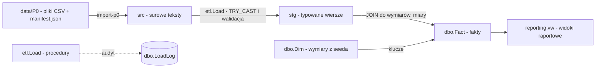

<!-- Generated by SpecStory, Markdown v2.1.0 -->

# 2026-11-16 11:24:58Z

<!-- Copilot CLI Session 44dbbce6-8d89-4d64-9618-426fbbdde9fb (2026-11-16 11:24:58Z) -->

_**User (2026-11-16 11:24:58Z)**_

czy na podstawie wiedzy bazie jesteś w stanie odpowiedzieć na emaila?

jak rozumiesz?
co wiesz?
czego nie wiesz, o co zapytać?

---

_**Agent (claude-haiku-5.5 2026-11-16 11:25:00Z)**_

<think><details><summary>Thought Process</summary>
I'm reading the two tagged files, docs/analiza-bazy.md and inbox/alert-karty-produktu.md, to see whether the database knowledge is enough to answer the Polish email and what I'd still need to ask about.
</details></think>

Przeczytam pliki, które wskazałeś: analizę bazy i wiadomość e-mail.

_**Agent (claude-haiku-5.5 2026-11-16 11:25:00Z)**_

<tool-use data-tool-type="read" data-tool-name="view"><details>
<summary>Tool use: **view**</summary>

view the file at c:\Users\teamsharq\Desktop\infoshare-silkycoders-sql-ai-4\inbox\alert-karty-produktu.md.

**Input:**

- path: `c:\Users\teamsharq\Desktop\infoshare-silkycoders-sql-ai-4\inbox\alert-karty-produktu.md`

**Result:**

```
# Pytanie o kartę produktu

**Od:** Zespół merchandisingu  
**Do:** Zespół hurtowni danych  
**Temat:** Różne wartości na karcie produktu i w raporcie tygodniowym

Dzień dobry,

Na karcie produktu widzimy liczbę zwróconych sztuk, a raport tygodniowej sprzedaży nie zmienia się po przyjęciu zwrotu. Proszę wyjaśnić, co pokazują oba raporty i jak dane sprzedaży oraz zwrotów trafiają do hurtowni.

Zależy nam na krótkiej odpowiedzi opartej na aktualnych definicjach projektu.

Pozdrawiamy,  
Zespół merchandisingu
```
</details></tool-use>

_**Agent (claude-haiku-5.5 2026-11-16 11:25:00Z)**_

<tool-use data-tool-type="read" data-tool-name="view"><details>
<summary>Tool use: **view**</summary>

view the file at c:\Users\teamsharq\Desktop\infoshare-silkycoders-sql-ai-4\docs\analiza-bazy.md.

**Input:**

- path: `c:\Users\teamsharq\Desktop\infoshare-silkycoders-sql-ai-4\docs\analiza-bazy.md`

**Result:**

````
# Analiza bazy RetailDW

Dokument dla nowych Analityków Danych. Opisuje schemat, procesy ładowania i metryki na podstawie kodu w katalogu [RetailDW/](../RetailDW/) oraz skryptu [scripts/dw.ps1](../scripts/dw.ps1).

## Szybki start

- Baza jest **hurtownią sprzedaży detalicznej** (model gwiazdy): 3 tabele faktów, 3 wymiary, 1 tabela audytu.
- Dane wchodzą przez **3 feedy** (sprzedaż POS/e-commerce, zwroty, stany magazynowe z WMS).
- Analityk pracuje głównie na widokach **`reporting.vw_*`**. Nie czyta `src` ani `stg`.
- Ładowanie to **pełny reload** (`DELETE` + `INSERT`), nie przyrostowy.
- Przed użyciem liczb sprawdź [sekcję pułapek](#8-pułapki-i-ograniczenia), szczególnie VAT, sezon i liczenie transakcji.

## 1. Architektura i przepływ danych



## 2. Schematy

| Schemat | Rola | Obiekty |
|---|---|---|
| `src` | Landing zone, dane tekstowe bez walidacji | `SalesRaw`, `ReturnsRaw`, `InventoryRaw` |
| `stg` | Dane po konwersji typów i walidacji | `Sales`, `Returns`, `Inventory` |
| `etl` | Procedury ładujące | `LoadSales`, `LoadReturns`, `LoadInventory` |
| `dbo` | Wymiary, fakty, audyt | `DimDate`, `DimProduct`, `DimStore`, `FactSales`, `FactReturns`, `FactInventoryDaily`, `LoadLog` |
| `reporting` | Warstwa raportowa dla analityków | 6 widoków `vw_*` |

Uprawnienia są zdefiniowane w [RetailDW/Security/](../RetailDW/Security/) jako same `CREATE SCHEMA`. Pliki nie zawierają `GRANT`.

## 3. Tabele

### 3.1 Wymiary (`dbo`)

| Tabela | Ziarno (grain) | Kluczowe kolumny | Uwagi |
|---|---|---|---|
| `DimDate` | 1 w
… (output truncated)
````
</details></tool-use>

_**Agent (claude-haiku-5.5 2026-11-16 11:25:05Z)**_

<think><details><summary>Thought Process</summary>
I'm checking what the email asks: what both reports show, and how sales and returns data get to the warehouse. FactReturns is kept separate from FactSales, and vw_SalesWeekly only draws from FactSales, so it won't change when something is returned. vw_ProductPerformance does pull UnitsReturned from FactReturns, which fits. There's also something odd in the docs about vw_ProductPerform

I'm going to check the actual view definitions in RetailDW/Views, since the docs might be out of date. I'll grep for vw_SalesWeekly and vw_ProductPerformance, and also look at the FactReturns ETL.
</details></think>

Mail pyta, dlaczego karta produktu pokazuje zwroty, a tygodniowy raport sprzedaży się nie zmienia. Dokumentacja opisuje to pośrednio, więc sprawdzę definicje widoków w kodzie, zanim odpowiem.

_**Agent (claude-haiku-5.5 2026-11-16 11:25:05Z)**_

<tool-use data-tool-type="search" data-tool-name="grep"><details>
<summary>Tool use: **grep**</summary>

FROM|JOIN|UnitsReturned|ReturnAmount

**Input:**

- -n: `true`
- output_mode: `content`
- paths:

```
[
  "c:\\Users\\teamsharq\\Desktop\\infoshare-silkycoders-sql-ai-4\\RetailDW\\Views"
]
```

- pattern: `FROM|JOIN|UnitsReturned|ReturnAmount`

**Result:**

```
[grep content: 33 matches across 6 file(s) under c:/Users/teamsharq/Desktop/infoshare-silkycoders-sql-ai-4/RetailDW/Views; delimited groups]

reporting.vw_ProductPerformance.sql (15 match(es)):
  13:     SELECT MIN([DateKey]) AS [DateKey] FROM [dbo].[FactInventoryDaily]
  19:     FROM    [dbo].[FactInventoryDaily] AS i
  20:     WHERE   i.[DateKey] = (SELECT MAX([DateKey]) FROM [dbo].[FactInventoryDaily])
  28:     FROM    [dbo].[FactSales] AS f
  35:     FROM    [dbo].[FactSales] AS f
  36:     WHERE   f.[DateKey] >= (SELECT [DateKey] FROM [SeasonStart])
  43:             SUM(r.[ReturnAmount]) AS [ReturnAmount]
  44:     FROM    [dbo].[FactReturns] AS r
  58:         ISNULL(rt.[Units], 0)           AS [UnitsReturned],
  59:         ISNULL(rt.[ReturnAmount], 0)    AS [ReturnAmount],
  66: FROM    [dbo].[DimProduct] AS p
  67: LEFT JOIN [SoldTotal]  AS t  ON t.[ProductKey]  = p.[ProductKey]
  68: LEFT JOIN [SoldSeason] AS ss ON ss.[ProductKey] = p.[ProductKey]
  69: LEFT JOIN [Returned]   AS rt ON rt.[ProductKey] = p.[ProductKey]
  70: LEFT JOIN [StockNow]   AS sn ON sn.[ProductKey] = p.[ProductKey];

reporting.vw_StockAvailability.sql (4 match(es)):
  19: FROM    [dbo].[FactInventoryDaily] AS i
  20: JOIN    [dbo].[DimDate]            AS d  ON d.[DateKey]    = i.[DateKey]
  21: JOIN    [dbo].[DimStore]           AS st ON st.[StoreKey]  = i.[StoreKey]
  22: JOIN    [dbo].[DimProduct]         AS p  ON p.[ProductKey] = i.[ProductKey]

reporting.vw_MarginAnalysis.sql (3 match(es)):
  21: FROM    [dbo].[FactSales]  AS f
  22: JOIN    [dbo].[DimDate]    AS d ON d.[DateKey]    = f.[DateKey]
  23: JOIN    [dbo].[DimProduct] AS p ON p.[ProductKey] = f.[ProductKey]

reporting.vw_SalesDaily.sql (4 match(es)):
  24: FROM    [dbo].[FactSales]   AS f
  25: JOIN    [dbo].[DimDate]     AS d  ON d.[DateKey]    = f.[DateKey]
  26: JOIN    [dbo].[DimStore]    AS st ON st.[StoreKey]  = f.[StoreKey]
  27: JOIN    [dbo].[DimProduct]  AS p  ON p.[ProductKey] = f.[ProductKey]

reporting.vw
… (output truncated)
```
</details></tool-use>

_**Agent (claude-haiku-5.5 2026-11-16 11:25:05Z)**_

<tool-use data-tool-type="search" data-tool-name="grep"><details>
<summary>Tool use: **grep**</summary>

INSERT INTO dbo\.FactReturns|FROM stg\.Returns|DELETE

**Input:**

- -n: `true`
- output_mode: `content`
- paths:

```
[
  "c:\\Users\\teamsharq\\Desktop\\infoshare-silkycoders-sql-ai-4\\RetailDW\\Procedures"
]
```

- pattern: `INSERT INTO dbo\.FactReturns|FROM stg\.Returns|DELETE`

**Result:**

```
c:\Users\teamsharq\Desktop\infoshare-silkycoders-sql-ai-4\RetailDW\Procedures\etl.LoadInventory.sql:23:        DELETE FROM [dbo].[FactInventoryDaily];
c:\Users\teamsharq\Desktop\infoshare-silkycoders-sql-ai-4\RetailDW\Procedures\etl.LoadInventory.sql:24:        DELETE FROM [stg].[Inventory];
c:\Users\teamsharq\Desktop\infoshare-silkycoders-sql-ai-4\RetailDW\Procedures\etl.LoadReturns.sql:23:        DELETE FROM [dbo].[FactReturns];
c:\Users\teamsharq\Desktop\infoshare-silkycoders-sql-ai-4\RetailDW\Procedures\etl.LoadReturns.sql:24:        DELETE FROM [stg].[Returns];
c:\Users\teamsharq\Desktop\infoshare-silkycoders-sql-ai-4\RetailDW\Procedures\etl.LoadSales.sql:25:        DELETE FROM [dbo].[FactSales];
c:\Users\teamsharq\Desktop\infoshare-silkycoders-sql-ai-4\RetailDW\Procedures\etl.LoadSales.sql:26:        DELETE FROM [stg].[Sales];
```
</details></tool-use>

_**Agent (claude-haiku-5.5 2026-11-16 11:25:14Z)**_

<think><details><summary>Thought Process</summary>
I'm confirming that the weekly report draws only from FactSales, which matches the doc's Monday-to-Sunday definition. The doc also says the weekly report doesn't change, and that checks out. I'm noting one caveat: ProductPerformance's SellThroughPct is based on gross sales and doesn't subtract returns. I'm also checking whether the "karta produktu" mentioned in the email refers to vw_ProductPerformance.

I'm checking whether the merchandising team's "karta produktu" really means vw_ProductPerformance, since I can't confirm that from what I have. I'm also noting that ReturnAmount in FactReturns is recorded as a positive gross figure and that returns are loaded separately with no link back to sales lines. Given that, I'm planning a reply in Polish that's concise, covers what I can answer and what I can't, and includes a short draft.
</details></think>

Tak, na podstawie dokumentacji i kodu mogę przygotować odpowiedź. Wymaga ona jednak potwierdzenia kilku rzeczy od zespołu.

**Co wiem (zweryfikowane w kodzie)**

- **Zwroty są osobnym faktem.** Zwroty trafiają do [dbo.FactReturns](c:/Users/teamsharq/Desktop/infoshare-silkycoders-sql-ai-4/RetailDW/Procedures/etl.LoadReturns.sql), a nie do `FactSales`. Procedura `etl.LoadReturns` czyści i ładuje tabelę od nowa.
- **Tygodniowy raport nie uwzględnia zwrotów.** [reporting.vw_SalesWeekly](c:/Users/teamsharq/Desktop/infoshare-silkycoders-sql-ai-4/RetailDW/Views/reporting.vw_SalesWeekly.sql) czyta wyłącznie z `FactSales`. Dlatego zwrot nie zmienia tego raportu. Jest to zgodne z definicją, ale może wymagać jasnego opisu dla merchandisingu.
- **Karta produktu pokazuje zwroty.** [reporting.vw_ProductPerformance](c:/Users/teamsharq/Desktop/infoshare-silkycoders-sql-ai-4/RetailDW/Views/reporting.vw_ProductPerformance.sql) łączy `FactSales`, `FactReturns` i `FactInventoryDaily`. Zwraca `UnitsReturned` i `ReturnAmount`.
- **Przepływ danych:** CSV z `data/P0` → `src` (tekst) → `stg` (typy i walidacja) → fakty przez JOIN do wymiarów. Ładowanie jest pełnym przeładowaniem, a nie przyrostowym.

**Czego nie wiem / o co zapytać**

1. Czy „karta produktu” to `reporting.vw_ProductPerformance`, czy inny system (np. BI albo PIM)?
2. Czy „raport tygodniowej sprzedaży” to `reporting.vw_SalesWeekly`?
3. Czy merchandising oczekuje, że zwroty pomniejszą raport tygodniowy (netto)? Obecna definicja tego nie robi, a zwroty nie są powiązane z liniami sprzedaży, więc netto po zwrotach wymagałoby nowej logiki.
4. Czy `ReturnAmount` powinien być brutto, jak w `FactReturns`? Wartość jest dodatnia i brutto, co trzeba zweryfikować przed użyciem w karcie.
5. Czy `SellThroughPct` na karcie powinien uwzględniać zwroty? Obecnie liczy sprzedaż brutto, bez odjęcia zwrotów.
6. Czy w ogóle dane zwrotów z tego feedu są już aktualne względem sprzedaży?

**Szkic odpowiedzi do zespołu merchandisingu**

> Dzień dobry,
>
> Na karcie produktu liczba zwróconych sztuk pochodzi z tabeli zwrotów (`FactReturns`), która jest ładowana osobno od sprzedaży. Tygodniowy raport sprzedaży czyta wyłącznie linie sprzedaży (`FactSales`), więc przyjęcie zwrotu nie zmienia jego wartości. Zwroty nie są powiązane z liniami sprzedaży, dlatego raport nie pokazuje sprzedaży netto po zwrotach.
>
> Dane sprzedaży i zwrotów trafiają do hurtowni z plików CSV, przez warstwę surową i walidację, do tabel faktów. Ładowanie jest pełnym przeładowaniem. Jeśli potrzebujecie sprzedaży po zwrotach w raporcie tygodniowym, to wymaga to zmiany definicji i możemy to zaplanować.
>
> Pozdrawiamy,
> Zespół hurtowni danych

Przed wysłaniem potwierdź punkty 1–3 z listy powyżej.
