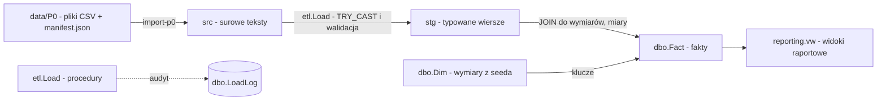

<!-- Generated by SpecStory, Markdown v2.1.0 -->

# 2026-11-16 11:43:03Z

<!-- VS Code Copilot IDE Session 82f4c17d-898e-46d4-87a5-c3aad0f2a3b3 (2026-11-16 11:43:03Z) -->

_**User (2026-11-16 11:43:03Z)**_

napisz odpowiedź na emial

---

_**Agent (copilot/claude-haiku-5.5)**_

<tool-use data-tool-type="read" data-tool-name="read_file"><details>
<summary>Tool use: **read_file**</summary>

Read `reporting.vw_SalesWeekly.sql`

**Input:**

- endLine: `200`
- filePath: `c:\Users\teamsharq\Desktop\infoshare-silkycoders-sql-ai-4\RetailDW\Views\reporting.vw_SalesWeekly.sql`
- startLine: `1`

**Result:**

```
/*
    Weekly trading numbers by channel, region and category. Weeks follow the
    ISO-8601 calendar (Monday-Sunday), which is the trading week used in the
    Monday report.
*/
CREATE VIEW [reporting].[vw_SalesWeekly]
AS
SELECT  d.[IsoYear],
        d.[IsoWeek],
        d.[YearWeek],
        MIN(d.[Date])                       AS [WeekStart],
        MAX(d.[Date])                       AS [WeekEnd],
        st.[Channel],
        st.[Region],
        p.[Department],
        p.[Category],
        SUM(f.[Quantity])                   AS [Units],
        COUNT(DISTINCT f.[TransactionNo])   AS [Transactions],
        SUM(f.[GrossAmount])                AS [GrossAmount],
        SUM(f.[DiscountAmount])             AS [DiscountAmount],
        SUM(f.[NetAmount])                  AS [NetAmount],
        SUM(f.[Quantity] * f.[UnitCost])    AS [CostAmount]
FROM    [dbo].[FactSales]   AS f
JOIN    [dbo].[DimDate]     AS d  ON d.[DateKey]    = f.[DateKey]
JOIN    [dbo].[DimStore]    AS st ON st.[StoreKey]  = f.[StoreKey]
JOIN    [dbo].[DimProduct]  AS p  ON p.[ProductKey] = f.[ProductKey]
GROUP BY d.[IsoYear], d.[IsoWeek], d.[YearWeek],
         st.[Channel], st.[Region], p.[Department], p.[Category];
```
</details></tool-use>

_**Agent (copilot/claude-haiku-5.5)**_

<tool-use data-tool-type="read" data-tool-name="read_file"><details>
<summary>Tool use: **read_file**</summary>

Read `reporting.vw_ProductPerformance.sql`

**Input:**

- endLine: `200`
- filePath: `c:\Users\teamsharq\Desktop\infoshare-silkycoders-sql-ai-4\RetailDW\Views\reporting.vw_ProductPerformance.sql`
- startLine: `1`

**Result:**

```
/*
    Product scorecard at SKU level.

    [UnitsSoldSeason] and [SellThroughPct] cover the current season only, i.e.
    the period for which the stock feed has data - sell-through compares what
    was sold with what is still on the shelf, so both sides have to describe
    the same intake.
*/
CREATE VIEW [reporting].[vw_ProductPerformance]
AS
WITH [SeasonStart] AS
(
    SELECT MIN([DateKey]) AS [DateKey] FROM [dbo].[FactInventoryDaily]
),
[StockNow] AS
(
    SELECT  i.[ProductKey],
            SUM(i.[StockQuantity]) AS [StockQuantity]
    FROM    [dbo].[FactInventoryDaily] AS i
    WHERE   i.[DateKey] = (SELECT MAX([DateKey]) FROM [dbo].[FactInventoryDaily])
    GROUP BY i.[ProductKey]
),
[SoldTotal] AS
(
    SELECT  f.[ProductKey],
            SUM(f.[Quantity])  AS [Units],
            SUM(f.[NetAmount]) AS [NetAmount]
    FROM    [dbo].[FactSales] AS f
    GROUP BY f.[ProductKey]
),
[SoldSeason] AS
(
    SELECT  f.[ProductKey],
            SUM(f.[Quantity]) AS [Units]
    FROM    [dbo].[FactSales] AS f
    WHERE   f.[DateKey] >= (SELECT [DateKey] FROM [SeasonStart])
    GROUP BY f.[ProductKey]
),
[Returned] AS
(
    SELECT  r.[ProductKey],
            SUM(r.[Quantity])     AS [Units],
            SUM(r.[ReturnAmount]) AS [ReturnAmount]
    FROM    [dbo].[FactReturns] AS r
    GROUP BY r.[ProductKey]
)
SELECT  p.[SKU],
        p.[StyleCode],
        p.[StyleName],
        p.[Department],
        p.[Category],
        p.[Color],
        p.[Size],
        p.[ListPrice],
        ISNULL(t.[Units], 0)            AS [UnitsSoldTotal],
        ISNULL(t.[NetAmount], 0)        AS [NetRevenueTotal],
        ISNULL(ss.[Units], 0)           AS [UnitsSoldSeason],
        ISNULL(rt.[Units], 0)           AS [UnitsReturned],
        ISNULL(rt.[ReturnAmount], 0)    AS [ReturnAmount],
        ISNULL(sn.[StockQuantity], 0)   AS [StockOnHand],
        CASE WHEN ISNULL(ss.[Units], 0) + ISNULL(sn.[StockQuantity], 0) = 0
   
… (output truncated)
```
</details></tool-use>

_**Agent (copilot/claude-haiku-5.5)**_

<tool-use data-tool-type="read" data-tool-name="read_file"><details>
<summary>Tool use: **read_file**</summary>

Read `etl.LoadReturns.sql`

**Input:**

- endLine: `200`
- filePath: `c:\Users\teamsharq\Desktop\infoshare-silkycoders-sql-ai-4\RetailDW\Procedures\etl.LoadReturns.sql`
- startLine: `1`

**Result:**

```
/*
    Loads customer returns from the landing zone into the warehouse.

    Step 1: [src].[ReturnsRaw] -> [stg].[Returns]
    Step 2: [stg].[Returns]    -> [dbo].[FactReturns]

    Full reload, same pattern as [etl].[LoadSales].
*/
CREATE PROCEDURE [etl].[LoadReturns]
AS
BEGIN
    SET NOCOUNT ON;
    SET XACT_ABORT ON;

    DECLARE @LoadId INT, @RowsRead INT, @RowsLoaded INT, @RowsRejected INT;

    INSERT INTO [dbo].[LoadLog] ([PackageName]) VALUES (N'etl.LoadReturns');
    SET @LoadId = CAST(SCOPE_IDENTITY() AS INT);

    BEGIN TRY
        SELECT @RowsRead = COUNT(*) FROM [src].[ReturnsRaw];

        DELETE FROM [dbo].[FactReturns];
        DELETE FROM [stg].[Returns];

        INSERT INTO [stg].[Returns]
            ([ReturnNo], [TransactionNo], [ReturnDate], [SKU], [StoreCode],
             [Quantity], [ReturnAmount], [ReturnReason], [SourceFile], [LoadId])
        SELECT  r.[ReturnNo],
                r.[TransactionNo],
                TRY_CAST(r.[ReturnDate] AS DATE),
                r.[SKU],
                r.[StoreCode],
                TRY_CAST(r.[Quantity] AS INT),
                TRY_CAST(r.[ReturnAmount] AS DECIMAL (10, 2)),
                r.[ReturnReason],
                r.[SourceFile],
                @LoadId
        FROM    [src].[ReturnsRaw] AS r
        WHERE   r.[ReturnNo]                                IS NOT NULL
            AND r.[TransactionNo]                           IS NOT NULL
            AND TRY_CAST(r.[ReturnDate]   AS DATE)          IS NOT NULL
            AND r.[SKU]                                     IS NOT NULL
            AND r.[StoreCode]                               IS NOT NULL
            AND TRY_CAST(r.[Quantity]     AS INT)           IS NOT NULL
            AND TRY_CAST(r.[ReturnAmount] AS DECIMAL (10, 2)) IS NOT NULL;

        INSERT INTO [dbo].[FactReturns]
            ([DateKey], [ProductKey], [StoreKey], [ReturnNo], [TransactionNo],
             [Quantity], [ReturnAmount
… (output truncated)
```
</details></tool-use>

_**Agent (copilot/claude-haiku-5.5)**_

<tool-use data-tool-type="read" data-tool-name="read_file"><details>
<summary>Tool use: **read_file**</summary>

Read `etl.LoadSales.sql`

**Input:**

- endLine: `200`
- filePath: `c:\Users\teamsharq\Desktop\infoshare-silkycoders-sql-ai-4\RetailDW\Procedures\etl.LoadSales.sql`
- startLine: `1`

**Result:**

```
/*
    Loads sales from the landing zone into the warehouse.

    Step 1: [src].[SalesRaw] -> [stg].[Sales]      (type conversion, validation)
    Step 2: [stg].[Sales]    -> [dbo].[FactSales]  (dimension lookup, measures)

    Full reload: both targets are truncated first, so the procedure can be
    re-run at any time and always reflects the current content of the landing
    zone.
*/
CREATE PROCEDURE [etl].[LoadSales]
AS
BEGIN
    SET NOCOUNT ON;
    SET XACT_ABORT ON;

    DECLARE @LoadId INT, @RowsRead INT, @RowsLoaded INT, @RowsRejected INT;

    INSERT INTO [dbo].[LoadLog] ([PackageName]) VALUES (N'etl.LoadSales');
    SET @LoadId = CAST(SCOPE_IDENTITY() AS INT);

    BEGIN TRY
        SELECT @RowsRead = COUNT(*) FROM [src].[SalesRaw];

        DELETE FROM [dbo].[FactSales];
        DELETE FROM [stg].[Sales];

        -- Step 1: convert text to typed columns. A row that cannot be converted
        -- is dropped here and shows up in the rejected count below.
        INSERT INTO [stg].[Sales]
            ([TransactionNo], [LineNumber], [SalesDate], [SKU], [StoreCode],
             [Quantity], [UnitPrice], [DiscountAmount], [SourceFile], [LoadId])
        SELECT  r.[TransactionNo],
                TRY_CAST(r.[LineNumber] AS INT),
                TRY_CAST(r.[SalesDate] AS DATE),
                r.[SKU],
                r.[StoreCode],
                TRY_CAST(r.[Quantity] AS INT),
                TRY_CAST(r.[UnitPrice] AS DECIMAL (10, 2)),
                ISNULL(TRY_CAST(r.[DiscountAmount] AS DECIMAL (10, 2)), 0),
                r.[SourceFile],
                @LoadId
        FROM    [src].[SalesRaw] AS r
        WHERE   r.[TransactionNo]                       IS NOT NULL
            AND TRY_CAST(r.[LineNumber]    AS INT)          IS NOT NULL
            AND TRY_CAST(r.[SalesDate] AS DATE)         IS NOT NULL
            AND r.[SKU]                                 IS NOT NULL
            AND r.[StoreCode]            
… (output truncated)
```
</details></tool-use>

_**Agent (copilot/claude-haiku-5.5)**_

<tool-use data-tool-type="read" data-tool-name="read_file"><details>
<summary>Tool use: **read_file**</summary>

Read `analiza-bazy.md`

**Input:**

- endLine: `300`
- filePath: `c:\Users\teamsharq\Desktop\infoshare-silkycoders-sql-ai-4\docs\analiza-bazy.md`
- startLine: `1`

**Result:**

````
# Analiza bazy RetailDW

Dokument dla nowych Analityków Danych. Opisuje schemat, procesy ładowania i metryki na podstawie kodu w katalogu [RetailDW/](../RetailDW/) oraz skryptu [scripts/dw.ps1](../scripts/dw.ps1).

## Szybki start

- Baza jest **hurtownią sprzedaży detalicznej** (model gwiazdy): 3 tabele faktów, 3 wymiary, 1 tabela audytu.
- Dane wchodzą przez **3 feedy** (sprzedaż POS/e-commerce, zwroty, stany magazynowe z WMS).
- Analityk pracuje głównie na widokach **`reporting.vw_*`**. Nie czyta `src` ani `stg`.
- Ładowanie to **pełny reload** (`DELETE` + `INSERT`), nie przyrostowy.
- Przed użyciem liczb sprawdź [sekcję pułapek](#8-pułapki-i-ograniczenia), szczególnie VAT, sezon i liczenie transakcji.

## 1. Architektura i przepływ danych



## 2. Schematy

| Schemat | Rola | Obiekty |
|---|---|---|
| `src` | Landing zone, dane tekstowe bez walidacji | `SalesRaw`, `ReturnsRaw`, `InventoryRaw` |
| `stg` | Dane po konwersji typów i walidacji | `Sales`, `Returns`, `Inventory` |
| `etl` | Procedury ładujące | `LoadSales`, `LoadReturns`, `LoadInventory` |
| `dbo` | Wymiary, fakty, audyt | `DimDate`, `DimProduct`, `DimStore`, `FactSales`, `FactReturns`, `FactInventoryDaily`, `LoadLog` |
| `reporting` | Warstwa raportowa dla analityków | 6 widoków `vw_*` |

Uprawnienia są zdefiniowane w [RetailDW/Security/](../RetailDW/Security/) jako same `CREATE SCHEMA`. Pliki nie zawierają `GRANT`.

## 3. Tabele

### 3.1 Wymiary (`dbo`)

| Tabela | Ziarno (grain) | Kluczowe kolumny | Uwagi |
|---|---|---|---|
| `DimDate` | 1 w
… (output truncated)
````
</details></tool-use>

_**Agent (copilot/claude-haiku-5.5)**_

Odpowiedź na e-mail z `inbox/alert-karty-produktu.md`:

---

**Temat:** RE: Różne wartości na karcie produktu i w raporcie tygodniowym

Dzień dobry,

dziękujemy za pytanie. Oba raporty liczą różne rzeczy i obie wartości są poprawne według aktualnych definicji w hurtowni.

**Jak dane trafiają do hurtowni**

- Sprzedaż (`src.SalesRaw`) i zwroty (`src.ReturnsRaw`) są ładowane osobno procedurami `etl.LoadSales` i `etl.LoadReturns`.
- Każde uruchomienie to pełny reload: tabela faktu jest czyszczona i wypełniana od nowa.
- Zwroty trafiają do `dbo.FactReturns`, sprzedaż do `dbo.FactSales`. Oba fakty nie są ze sobą połączone (łączy je tylko tekstowy numer transakcji).

**Dlaczego raport tygodniowy się nie zmienia**

- `reporting.vw_SalesWeekly` czyta wyłącznie `dbo.FactSales`. Nie odejmuje zwrotów, więc przyjęcie zwrotu nie zmienia sprzedaży w tym raporcie.
- Ta sama zasada dotyczy `vw_SalesDaily` i innych widoków sprzedaży.

**Dlaczego karta produktu pokazuje zwroty**

- `reporting.vw_ProductPerformance` ma kolumny `UnitsReturned` i `ReturnAmount`, liczone z `dbo.FactReturns` za cały okres.
- Kolumna `UnitsSoldTotal` (ani `UnitsSoldSeason`) nie jest pomniejszana o zwroty, więc zwrócone sztuki są pokazane osobno, a nie jako korekta sprzedaży.
- `SellThroughPct` liczy sprzedaż tylko od pierwszego dnia feedu stanów (`UnitsSoldSeason`), a nie cały okres.

**Wniosek**

Raport tygodniowy pokazuje sprzedaż brutto (bez korekty o zwroty), a karta produktu pokazuje zwroty jako osobną miarę. Jeśli potrzebujecie sprzedaży netto po zwrotach, wymaga to zmiany definicji w widoku. Nie wprowadzaliśmy jej, dopóki nie ustalicie wymagań.

Pozdrawiamy,
Zespół hurtowni danych

---

Uwaga: w odpowiedzi opisałem zachowanie widoków `vw_SalesWeekly` i `vw_ProductPerformance` na podstawie kodu. Stwierdzenie o `vw_MarginAnalysis` (brak odejmowania zwrotów) pochodzi z dokumentacji `docs/analiza-bazy.md`, a nie z przeczytanego kodu tego widoku.
