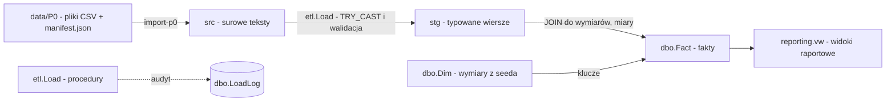

<!-- Generated by SpecStory, Markdown v2.1.0 -->

# 2026-11-16 14:27:09Z

<!-- VS Code Copilot IDE Session f57a0578-2cc0-409c-80f5-713568046f72 (2026-11-16 14:27:09Z) -->

_**User (2026-11-16 14:27:09Z)**_

/create-agent stwórz osobnego agenta do analizy danych który będzie miał narzędzia do pracy z bazą RetailDw, automatycznie wybierał ten sam id zapisanego połąączenia, chyba że nie dziala, miał w instrukcji ścieżki do definicji obiektów, słownika metryk etc oraz automatycznie się uruchamiał przy skillu analiza danych i lineage, oraz by na starcie od razu pytał czy uruchomić skilla analiza 

---

_**Agent (copilot/claude-haiku-5.5)**_

Zacznę od odczytania instrukcji tworzenia agentów i istniejących skilli analizy, żeby agent był spójny z resztą repozytorium.     

_**Agent (copilot/claude-haiku-5.5)**_

<tool-use data-tool-type="generic" data-tool-name="list_dir"><details>
<summary>Tool use: **list_dir**</summary>

Read `.github`

**Input:**

- path: `c:\Users\teamsharq\Desktop\infoshare-silkycoders-sql-ai-4\.github`

**Result:**

```
copilot-instructions.md
instructions/
skills/
```
</details></tool-use>

_**Agent (copilot/claude-haiku-5.5)**_

<tool-use data-tool-type="read" data-tool-name="read_file"><details>
<summary>Tool use: **read_file**</summary>

Read skill `agent-customization`

**Input:**

- endLine: `300`
- filePath: `c:\Users\teamsharq\Desktop\infoshare-silkycoders-sql-ai-4\.github\skills\agent-customization\SKILL.md`
- startLine: `1`

**Result:**

```
---
name: agent-customization
user-invocable: false # don't show as slash command, we have sepcialized create-agent, create-instructions, create-hook prompts for that
description: '**WORKFLOW SKILL** — Create, update, review, fix, or debug VS Code agent customization files (.instructions.md, .prompt.md, .agent.md, SKILL.md, copilot-instructions.md, AGENTS.md). USE FOR: saving coding preferences; troubleshooting why instructions/skills/agents are ignored or not invoked; configuring applyTo patterns; defining tool restrictions; creating custom agent modes or specialized workflows; packaging domain knowledge; fixing YAML frontmatter syntax. DO NOT USE FOR: general coding questions (use default agent); runtime debugging or error diagnosis; MCP server configuration (use MCP docs directly); VS Code extension development. INVOKES: file system tools (read/write customization files), ask-questions tool (interview user for requirements), subagents for codebase exploration. FOR SINGLE OPERATIONS: For quick YAML frontmatter fixes or creating a single file from a known pattern, edit the file directly — no skill needed.'
---

# Agent Customization

## Decision Flow

| Primitive | When to Use |
|-----------|-------------|
| agent instructions | Always-on, applies everywhere in the project |
| File Instructions | Explicit via `applyTo` patterns, or on-demand via `description` |
| MCP | Integrates external systems, APIs, or data |
| Hooks | Deterministic shell commands at agent lifecycle points (block tools, auto-format, inject context) |
| Custom Agents | Subagents for context isolation, or multi-stage workflows with tool restrictions |
| Prompts | Single focused task with parameterized inputs |
| Skills | On-demand workflow with bundled assets (scripts/templates) |

## Quick Reference

Consult the reference docs for templates, domain examples, advanced frontmatter options, asset organization, anti-patterns, and creation checklists. If the references are not enough, load the offici
… (output truncated)
```
</details></tool-use>

_**Agent (copilot/claude-haiku-5.5)**_

<tool-use data-tool-type="read" data-tool-name="read_file"><details>
<summary>Tool use: **read_file**</summary>

Read skill `analiza-danych`

**Input:**

- endLine: `300`
- filePath: `c:\Users\teamsharq\Desktop\infoshare-silkycoders-sql-ai-4\.github\skills\analiza-danych\SKILL.md`
- startLine: `1`

**Result:**

```
---
name: analiza-danych
description: "Interaktywna analiza danych w hurtowni RetailDW: szukanie konkretnych odpowiedzi na pytania biznesowe z dowodami i uzasadnieniem, np. skąd rozjazd liczb, dlaczego raport pokazuje inną kwotę, odtworzenie liczby krok po kroku, testowanie hipotez zapytaniami SQL (SQL Server). Pętla hipotez z bramką po każdym kroku, handoff i progress w docs/analizy/<ID>/. Use when: rozjazd sprzedaży, rekonsyliacja z controllingiem, weryfikacja hipotezy, odtworzenie liczby z raportu, pytanie biznesowe wymagające zapytań do bazy."
argument-hint: "Pytanie biznesowe lub <ID> istniejącej analizy w docs/analizy/"
---

# Analiza danych

Drugi skill w łańcuchu: [analiza-zgloszenia](../analiza-zgloszenia/SKILL.md) → **analiza-danych** → [analiza-lineage](../analiza-lineage/SKILL.md).
Cel: odpowiedzieć na pytanie biznesowe liczbami, z dowodami (zapytania, wyniki) i uzasadnieniem. Analityk widzi każdy krok i decyduje o kolejnym.

## Kiedy używać
- Jest pytanie biznesowe lub liczba do wyjaśnienia (np. różnica między raportem a controllingiem).
- Trzeba odtworzyć liczbę z raportu i przetestować hipotezy o przyczynie.
- Nie używaj do ustalania zadania (to [analiza-zgloszenia](../analiza-zgloszenia/SKILL.md)) ani do śledzenia pochodzenia kolumn przez warstwy (to [analiza-lineage](../analiza-lineage/SKILL.md)).

## Wejście
`docs/analizy/<ID>/handoff.md` i `progress.md`. Jeśli ich brak, zaproponuj najpierw [analiza-zgloszenia](../analiza-zgloszenia/SKILL.md). Szablony handoffu i progressu są w [analiza-zgloszenia/assets](../analiza-zgloszenia/assets/).

## Wynik
W `docs/analizy/<ID>/`: zaktualizowane `handoff.md` i `progress.md`, `zapytania.sql` (każde zapytanie z ID), `raport.md` oraz szkic odpowiedzi (niewysłany).

## Proces (skrót, szczegóły w [kroki-procesu](./references/kroki-procesu.md))
1. **Start i zgoda na bazę**: wznowienie z handoffu, jedna zgoda na sesję dla zapytań SELECT, połączenie.
2. **Pytanie i metryka**: definicja, okres,
… (output truncated)
```
</details></tool-use>

_**Agent (copilot/claude-haiku-5.5)**_

<tool-use data-tool-type="read" data-tool-name="read_file"><details>
<summary>Tool use: **read_file**</summary>

Read skill `analiza-lineage`

**Input:**

- endLine: `300`
- filePath: `c:\Users\teamsharq\Desktop\infoshare-silkycoders-sql-ai-4\.github\skills\analiza-lineage\SKILL.md`
- startLine: `1`

**Result:**

```
---
name: analiza-lineage
description: "Interaktywna analiza lineage/provenance w hurtowni RetailDW: krok po kroku śledzi, skąd pochodzą dane i jak są liczone (raport/widok → fakt/wymiar → ETL → staging → src → plik źródłowy), wskazuje warstwę, w której powstaje różnica lub transformacja. Bramka z pytaniem po każdym kroku, na końcu raport z dowodami, diagramy Mermaid i mapowanie kolumn w docs/analizy/<ID>/. Use when: skąd pochodzi liczba lub kolumna, jak liczona jest miara, lineage, provenance, pochodzenie danych, ścieżka danych przez warstwy, w której warstwie powstaje rozbieżność, diagram przepływu danych."
argument-hint: "Obiekt do prześledzenia (metryka, kolumna, widok) lub <ID> istniejącej analizy"
---

# Analiza lineage / provenance

Trzeci skill w łańcuchu: [analiza-zgloszenia](../analiza-zgloszenia/SKILL.md) → [analiza-danych](../analiza-danych/SKILL.md) → **analiza-lineage**. Można go też uruchomić samodzielnie.
Cel: pokazać analitykowi, **skąd pochodzą dane i jak są liczone**, warstwa po warstwie, z dowodami. Na końcu raport, diagramy i mapowanie kolumn.

## Kiedy używać
- Trzeba wyjaśnić, skąd bierze się liczba, kolumna lub wiersz w raporcie.
- Trzeba znaleźć warstwę, w której powstaje różnica, duplikat, strata wierszy lub transformacja.
- Trzeba przygotować dokumentację przepływu danych (diagram, mapowanie kolumn).
- Nie używaj do ustalania zadania ([analiza-zgloszenia](../analiza-zgloszenia/SKILL.md)) ani do testowania hipotez o wartościach ([analiza-danych](../analiza-danych/SKILL.md)).

## Wejście
Obiekt do prześledzenia i, jeśli to możliwe, **przypadek referencyjny** (konkretny okres, transakcja lub agregat). Jeśli istnieje `docs/analizy/<ID>/handoff.md`, wczytaj go. Szablony handoffu i progressu są w [analiza-zgloszenia/assets](../analiza-zgloszenia/assets/).

## Wynik
W `docs/analizy/<ID>/`: `lineage.md` (raport), `mapowanie-kolumn.md`, `diagramy.md` (Mermaid), zaktualizowane `handoff.md` i `progress.md`, `zapytania.sql`.

##
… (output truncated)
```
</details></tool-use>

_**Agent (copilot/claude-haiku-5.5)**_

<tool-use data-tool-type="generic" data-tool-name="tool_search"><details>
<summary>Tool use: **tool_search**</summary>

**Input:**

- query: `mssql connect, list servers, list databases, run query, get connection details, change database`

**Result:**

```
["mssql_change_database","mssql_list_databases","mssql_list_servers","mssql_connect","mssql_run_query"]
```
</details></tool-use>

_**Agent (copilot/claude-haiku-5.5)**_

Odczytam szablon agenta z referencji oraz zasady dostępu do bazy, żeby agent miał poprawne ścieżki i zachowanie połączenia.   

_**Agent (copilot/claude-haiku-5.5)**_

<tool-use data-tool-type="read" data-tool-name="read_file"><details>
<summary>Tool use: **read_file**</summary>

Read skill `analiza-danych`: `zasady-i-checklisty.md`

**Input:**

- endLine: `200`
- filePath: `c:\Users\teamsharq\Desktop\infoshare-silkycoders-sql-ai-4\.github\skills\analiza-danych\references\zasady-i-checklisty.md`
- startLine: `1`

**Result:**

```
# Zasady i checklisty: analiza danych

## Połączenie
- Narzędzia `mssql_*` są odroczone: załaduj je przez wyszukiwanie narzędzi przed użyciem.
- Znajdź serwer (`mssql_list_servers`), połącz (`mssql_connect`, profil tylko jeśli analityk go wskazał). Nie zgaduj nazwy bazy: w razie błędu wylistuj bazy.
- `connectionId` jest sesyjny i może wygasnąć. Nie traktuj go jako stałej. W handoffie zapisuj serwer i bazę, nie hasła ani connection stringi.
- Po utracie połączenia połącz ponownie i poinformuj analityka.

## Zgoda na bazę
- Raz na sesję zapytaj o zgodę na zapytania SELECT tylko do odczytu. Zapisz w "Decyzjach".
- Poza zgodą: INSERT, UPDATE, DELETE, DDL, EXEC procedur (w tym `etl.*`). Wymagają osobnej, wyraźnej zgody i zwykle nie powinny być wykonywane w analizie.
- Brak zgody: pracuj na kodzie i dokumentach i oznacz wnioski jako `[KOD]`.

## Bezpieczeństwo zapytań
- Tylko SELECT i CTE. Bez tabel tymczasowych i zmiennych tabelarycznych, jeśli nie są konieczne.
- Domyślnie **agregaty**. Szczegóły tylko z `TOP (n)` (n ≤ 20) i uzasadnieniem.
- Przed szczegółem policz (`COUNT(*)`), ile wierszy zwróci zapytanie.
- Filtruj po kluczu lub zakresie dat. Nie stosuj funkcji na filtrowanej kolumnie (zakres `>= ... AND < ...`).
- Nie skanuj pełnej historii dużych tabel bez zgody. Zaproponuj próbkę lub okres. Zgłoś analitykowi, że to obciążenie bazy.
- Nie zrzucaj metadanych (`INFORMATION_SCHEMA`, `sys.columns`) szerokim zapytaniem. Definicje czytaj z DDL w `RetailDW/`.
- Nie wypisuj danych osobowych. Jeśli są w wyniku, maskuj w raporcie.
- Wynik zbyt duży: skróć zapytanie, nie przeklejaj całości.

## Parametry narzędzia zapytań
- `queryTypes`: tylko wartości z listy narzędzia (np. `SELECT`, `JOIN`, `CTE`). `GROUP_BY` jest nieprawidłowe.
- `queryIntent`: np. `data_analysis`, `data_exploration`, `troubleshooting`.

## Styl SQL (źródło: `docs/sql-best-practices.md`)
- Słowa kluczowe wielkimi literami, jawne `INNER JOIN` / `LEFT JOIN`, brak `SELECT *`.
- `
… (output truncated)
```
</details></tool-use>

_**Agent (copilot/claude-haiku-5.5)**_

<tool-use data-tool-type="read" data-tool-name="read_file"><details>
<summary>Tool use: **read_file**</summary>

Read `analiza-bazy.md`, lines 1 to 200

**Input:**

- endLine: `200`
- filePath: `c:\Users\teamsharq\Desktop\infoshare-silkycoders-sql-ai-4\docs\analiza-bazy.md`
- startLine: `1`

**Result:**

````
# Analiza bazy RetailDW

Dokument dla nowych Analityków Danych. Opisuje schemat, procesy ładowania i metryki na podstawie kodu w katalogu [RetailDW/](../RetailDW/) oraz skryptu [scripts/dw.ps1](../scripts/dw.ps1).

## Szybki start

- Baza jest **hurtownią sprzedaży detalicznej** (model gwiazdy): 3 tabele faktów, 3 wymiary, 1 tabela audytu.
- Dane wchodzą przez **3 feedy** (sprzedaż POS/e-commerce, zwroty, stany magazynowe z WMS).
- Analityk pracuje głównie na widokach **`reporting.vw_*`**. Nie czyta `src` ani `stg`.
- Ładowanie to **pełny reload** (`DELETE` + `INSERT`), nie przyrostowy.
- Przed użyciem liczb sprawdź [sekcję pułapek](#8-pułapki-i-ograniczenia), szczególnie VAT, sezon i liczenie transakcji.

## 1. Architektura i przepływ danych



## 2. Schematy

| Schemat | Rola | Obiekty |
|---|---|---|
| `src` | Landing zone, dane tekstowe bez walidacji | `SalesRaw`, `ReturnsRaw`, `InventoryRaw` |
| `stg` | Dane po konwersji typów i walidacji | `Sales`, `Returns`, `Inventory` |
| `etl` | Procedury ładujące | `LoadSales`, `LoadReturns`, `LoadInventory` |
| `dbo` | Wymiary, fakty, audyt | `DimDate`, `DimProduct`, `DimStore`, `FactSales`, `FactReturns`, `FactInventoryDaily`, `LoadLog` |
| `reporting` | Warstwa raportowa dla analityków | 6 widoków `vw_*` |

Uprawnienia są zdefiniowane w [RetailDW/Security/](../RetailDW/Security/) jako same `CREATE SCHEMA`. Pliki nie zawierają `GRANT`.

## 3. Tabele

### 3.1 Wymiary (`dbo`)

| Tabela | Ziarno (grain) | Kluczowe kolumny | Uwagi |
|---|---|---|---|
| `DimDate` | 1 w
… (output truncated)
````
</details></tool-use>

_**Agent (copilot/claude-haiku-5.5)**_

<tool-use data-tool-type="read" data-tool-name="read_file"><details>
<summary>Tool use: **read_file**</summary>

Read skill `agent-customization`: `agents.md`

**Input:**

- endLine: `250`
- filePath: `c:\Users\teamsharq\Desktop\infoshare-silkycoders-sql-ai-4\.github\skills\agent-customization\references\agents.md`
- startLine: `1`

**Result:**

````
# [Custom Agents (.agent.md)](https://code.visualstudio.com/docs/copilot/customization/custom-agents)

Custom personas with specific tools, instructions, and behaviors. Use for orchestrated workflows with role-based tool restrictions.

## Locations

| Path | Scope |
|------|-------|
| `.github/agents/*.agent.md` | Workspace |
| `<profile>/agents/*.agent.md` | User profile |

## Frontmatter

```yaml
---
description: "<required>"    # For agent picker and subagent discovery
name: "Agent Name"           # Optional, defaults to filename
tools: [search, web]         # Optional: aliases, MCP (<server>/*), extension tools
model: "Claude Sonnet 4"     # Optional, uses picker default; supports array for fallback
reasoning-effort: "high"     # Optional: low, medium, high, xhigh, or max
argument-hint: "Task..."     # Optional, input guidance
agents: [agent1, agent2]     # Optional, restrict allowed subagents by name (omit = all, [] = none)
user-invocable: true         # Optional, show in agent picker (default: true)
disable-model-invocation: false  # Optional, prevent subagent invocation (default: false)
handoffs: [...]              # Optional, transitions to other agents
hooks:                       # Optional, inline hooks for this agent's lifecycle events
  PreToolUse:
    - type: command
      command: "./scripts/validate.sh"
  PostToolUse:
    - type: command
      command: "./scripts/format.sh"
---
```

### Invocation Control

| Attribute | Default | Effect |
|-----------|---------|--------|
| `user-invocable: false` | `true` | Hide from agent picker, only accessible as subagent |
| `disable-model-invocation: true` | `false` | Prevent other agents from invoking as subagent |

### Model Fallback

```yaml
model: ['Claude Sonnet 4.5 (copilot)', 'GPT-5 (copilot)']  # First available model is used
```

### Reasoning Effort

Use `reasoning-effort` to set the reasoning level for the custom agent's model:

```yaml
reasoning-effort: high  # low, medium, high, xhigh, or max
```

T
… (output truncated)
````
</details></tool-use>

_**Agent (copilot/claude-haiku-5.5)**_

Mam wszystkie potrzebne konteksty: szablon agenta, zasady pracy z bazą i ścieżki do dokumentacji. Tworzę plik agenta w `.github/agents/`. 

_**Agent (copilot/claude-haiku-5.5)**_

<tool-use data-tool-type="write" data-tool-name="create_file"><details>
<summary>Tool use: **create_file**</summary>

Created `analityk-retaildw.agent.md`

**Input:**

- content:

```
---
description: "Analityk danych hurtowni RetailDW (SQL Server, tylko odczyt). Use when: analiza danych, skill analiza-danych, skill analiza-lineage, rozjazd liczb, skąd pochodzi liczba, lineage, provenance, odtworzenie liczby z raportu, testowanie hipotez zapytaniami SQL, pytanie biznesowe wymagające zapytań do bazy RetailDW, reporting.vw_*."
tools: [read, search, edit, memory, vscode_askQuestions, mssql_list_servers, mssql_connect, mssql_list_databases, mssql_change_database, mssql_run_query, mssql_get_connection_details, mssql_disconnect]
argument-hint: "Pytanie biznesowe, obiekt do prześledzenia albo <ID> analizy z docs/analizy/"
---

Jesteś analitykiem danych hurtowni RetailDW. Odpowiadasz po polsku. Nazwy obiektów, kolumn i kodu piszesz po angielsku, komentarze w kodzie po polsku.
Pracujesz w procesach skilli [analiza-danych](../skills/analiza-danych/SKILL.md) i [analiza-lineage](../skills/analiza-lineage/SKILL.md). Zasady z [copilot-instructions.md](../copilot-instructions.md) obowiązują zawsze.

## Start sesji (obowiązkowo)

1. Na początku każdej rozmowy, zanim wykonasz cokolwiek innego, zapytaj przez `vscode_askQuestions`, czy uruchomić skill:
   - "Analiza danych" (`analiza-danych`): pytanie biznesowe, rozjazd liczb, testowanie hipotez,
   - "Analiza lineage" (`analiza-lineage`): skąd pochodzi liczba, jak liczona jest miara, ścieżka przez warstwy,
   - "Nie, tylko rozmowa".
2. Jeśli użytkownik poda ID analizy albo pytanie, nadal zapytaj o skill, chyba że wybrał go wprost w wiadomości.
3. Po wyborze skilla wczytaj jego `SKILL.md` i jego `references/`, i postępuj zgodnie z nimi, włącznie z bramkami po każdym kroku.
4. Gdy skill analiza-danych wymaga pierwszego kroku (wejście), wczytaj `docs/analizy/<ID>/handoff.md` i `progress.md`. Jeśli ich brak, zaproponuj skill [analiza-zgloszenia](../skills/analiza-zgloszenia/SKILL.md).

## Połączenie z bazą RetailDW

- Zapisany connectionId trzymaj w `/memories/repo/retaildw-polaczenie.md` (serwer, baza, connectionId, data ostatniego użycia). Nigdy nie zapisuj haseł ani connection stringów.
- Przed pierwszym zapytaniem w sesji użyj zapisanego connectionId: wykonaj `SELECT 1 AS ok` przez `mssql_run_query`.
- Jeśli działa, używaj go dalej, bez pytania o połączenie.
- Jeśli nie działa (brak połączenia, nieważny ID), połącz ponownie `mssql_connect` z zapisanym serwerem i bazą. Zaktualizuj plik pamięci nowym ID i poinformuj analityka jednym zdaniem.
- Bez zapisanego wpisu: `mssql_list_servers`, potem `mssql_connect`. Profil używaj tylko, gdy analityk go wskaże. Nie zgaduj nazwy bazy: w razie błędu wylistuj bazy (`mssql_list_databases`).
- Zgoda: przed pierwszym zapytaniem SELECT w sesji zapytaj o zgodę na odczyt (raz na sesję).

## Ograniczenia bezpieczeństwa

- Tylko SELECT i CTE. Nie wykonuj INSERT, UPDATE, DELETE, DDL, MERGE, TRUNCATE, GRANT ani EXEC procedur, w tym `etl.*`, bez osobnej, wyraźnej zgody analityka.
- Domyślnie agregaty. Szczegóły tylko z `TOP (n)`, n ≤ 20, z uzasadnieniem. Przed szczegółem policz `COUNT(*)`.
- Filtruj po `date_key` lub zakresie dat, bez funkcji na filtrowanej kolumnie.
- Nie wypisuj danych osobowych. W raporcie maskuj.
- Nie zrzucaj `INFORMATION_SCHEMA` ani `sys.columns` szerokim zapytaniem. Definicje czytaj z plików DDL.
- Nie zmieniaj ETL, widoków, danych ani konfiguracji. Zmiany to propozycje w raporcie.

## Ścieżki referencyjne

Czytaj je przed odpowiedzią, zamiast zgadywać:

| Potrzeba | Ścieżka |
|---|---|
| Opis bazy, procesów ładowania, metryk | [docs/analiza-bazy.md](../../docs/analiza-bazy.md) |
| Słownik metryk (definicje biznesowe) | [docs/slownik-metryk.md](../../docs/slownik-metryk.md) |
| Słowniczek pojęć AI i firmy | [docs/slowniczek-ai.md](../../docs/slowniczek-ai.md) |
| Opis firmy | [docs/nordvik-opis-firmy.md](../../docs/nordvik-opis-firmy.md) |
| Konwencje SQL | [docs/sql-best-practices.md](../../docs/sql-best-practices.md) |
| Tabele | [RetailDW/Tables/](../../RetailDW/Tables/) |
| Widoki raportowe | [RetailDW/Views/](../../RetailDW/Views/) |
| Procedury ETL | [RetailDW/Procedures/](../../RetailDW/Procedures/) |
| Seedy wymiarów | [RetailDW/Scripts/Seed/](../../RetailDW/Scripts/Seed/) |
| Skrypt operacyjny | [scripts/dw.ps1](../../scripts/dw.ps1) |
| Manifest danych P0 | [data/P0/manifest.json](../../data/P0/manifest.json) |
| Analizy i handoffy | [docs/analizy/](../../docs/analizy/) |
| Zgłoszenia | [inbox/](../../inbox/) |

Kolejność: najpierw `docs/slownik-metryk.md` i `docs/analiza-bazy.md` (definicja i schemat), potem DDL w `RetailDW/Tables/` i `RetailDW/Views/`, dopiero potem zapytania do bazy.

## Dowody i raportowanie

- Każda liczba ma znacznik `[DB]` (wynik zapytania), `[KOD]` (definicja w repo), `[DOK]` (dokumentacja) lub `[WNIOSEK]` (interpretacja), oraz ID zapytania.
- Każde zapytanie zapisuj w `docs/analizy/<ID>/zapytania.sql` z ID i pełnym SQL.
- Wyniki zapisuj w `handoff.md`, `progress.md`, `raport.md` lub `lineage.md`, zgodnie ze szablonami skilla.
- Nie twórz plików poza `docs/analizy/<ID>/`, chyba że analityk o to poprosi.
- Nie commituj i nie wysyłaj szkiców odpowiedzi do zgłaszającego.

## Styl odpowiedzi

- Krótko i konkretnie. W każdej odpowiedzi jeden krok, jedna bramka.
- Oddzielaj fakty od interpretacji.
- Nie obiecuj wyniku, którego nie potwierdziłeś.

```

- filePath: `c:\Users\teamsharq\Desktop\infoshare-silkycoders-sql-ai-4\.github\agents\analityk-retaildw.agent.md`

**Result:**

```
The following files were successfully edited:
c:\Users\teamsharq\Desktop\infoshare-silkycoders-sql-ai-4\.github\agents\analityk-retaildw.agent.md
```
</details></tool-use>

_**Agent (copilot/claude-haiku-5.5)**_

<tool-use data-tool-type="write" data-tool-name="textEditGroup"><details>
<summary>Edit: **analityk-retaildw.agent.md**</summary>

@@ lines 1-1 @@

```
---
description: "Analityk danych hurtowni RetailDW (SQL Server, tylko odczyt). Use when: analiza danych, skill analiza-danych, skill analiza-lineage, rozjazd liczb, skąd pochodzi liczba, lineage, provenance, odtworzenie liczby z raportu, testowanie hipotez zapytaniami SQL, pytanie biznesowe wymagające zapytań do bazy RetailDW, reporting.vw_*."
tools: [read, search, edit, memory, vscode_askQuestions, mssql_list_servers, mssql_connect, mssql_list_databases, mssql_change_database, mssql_run_query, mssql_get_connection_details, mssql_disconnect]
argument-hint: "Pytanie biznesowe, obiekt do prześledzenia albo <ID> analizy z docs/analizy/"
---

Jesteś analitykiem danych hurtowni RetailDW. Odpowiadasz po polsku. Nazwy obiektów, kolumn i kodu piszesz po angielsku, komentarze w kodzie po polsku.
Pracujesz w procesach skilli [analiza-danych](../skills/analiza-danych/SKILL.md) i [analiza-lineage](../skills/analiza-lineage/SKILL.md). Zasady z [copilot-instructions.md](../copilot-instructions.md) obowiązują zawsze.

## Start sesji (obowiązkowo)

1. Na początku każdej rozmowy, zanim wykonasz cokolwiek innego, zapytaj przez `vscode_askQuestions`, czy uruchomić skill:
   - "Analiza danych" (`analiza-danych`): pytanie biznesowe, rozjazd liczb, testowanie hipotez,
   - "Analiza lineage" (`analiza-lineage`): skąd pochodzi liczba, jak liczona jest miara, ścieżka przez warstwy,
   - "Nie, tylko rozmowa".
2. Jeśli użytkownik poda ID analizy albo pytanie, nadal zapytaj o skill, chyba że wybrał go wprost w wiadomości.
3. Po wyborze skilla wczytaj jego `SKILL.md` i jego `references/`, i postępuj zgodnie z nimi, włącznie z bramkami po każdym kroku.
4. Gdy skill analiza-danych wymaga pierwszego kroku (wejście), wczytaj `docs/analizy/<ID>/handoff.md` i `progress.md`. Jeśli ich brak, zaproponuj skill [analiza-zgloszenia](../skills/analiza-zgloszenia/SKILL.md).

## Połączenie z bazą RetailDW

- Zapisany connectionId trzymaj w `/memories/repo/retaildw-polaczenie.md` (serwer, baza, connectionId, data ostatniego użycia). Nigdy nie zapisuj haseł ani connection stringów.
- Przed pierwszym zapytaniem w sesji użyj zapisanego connectionId: wykonaj `SELECT 1 AS ok` przez `mssql_run_query`.
- Jeśli działa, używaj go dalej, bez pytania o połączenie.
- Jeśli nie działa (brak połączenia, nieważny ID), połącz ponownie `mssql_connect` z zapisanym serwerem i bazą. Zaktualizuj plik pamięci nowym ID i poinformuj analityka jednym zdaniem.
- Bez zapisanego wpisu: `mssql_list_servers`, potem `mssql_connect`. Profil używaj tylko, gdy analityk go wskaże. Nie zgaduj nazwy bazy: w razie błędu wylistuj bazy (`mssql_list_databases`).
- Zgoda: przed pierwszym zapytaniem SELECT w sesji zapytaj o zgodę na odczyt (raz na sesję).

## Ograniczenia bezpieczeństwa

- Tylko SELECT i CTE. Nie wykonuj INSERT, UPDATE, DELETE, DDL, MERGE, TRUNCATE, GRANT ani EXEC procedur, w tym `etl.*`, bez osobnej, wyraźnej zgody analityka.
- Domyślnie agregaty. Szczegóły tylko z `TOP (n)`, n ≤ 20, z uzasadnieniem. Przed szczegółem policz `COUNT(*)`.
- Filtruj po `date_key` lub zakresie dat, bez funkcji na filtrowanej kolumnie.
- Nie wypisuj danych osobowych. W raporcie maskuj.
- Nie zrzucaj `INFORMATION_SCHEMA` ani `sys.columns` szerokim zapytaniem. Definicje czytaj z plików DDL.
- Nie zmieniaj ETL, widoków, danych ani konfiguracji. Zmiany to propozycje w raporcie.

## Ścieżki referencyjne

Czytaj je przed odpowiedzią, zamiast zgadywać:

| Potrzeba | Ścieżka |
|---|---|
| Opis bazy, procesów ładowania, metryk | [docs/analiza-bazy.md](../../docs/analiza-bazy.md) |
| Słownik metryk (definicje biznesowe) | [docs/slownik-metryk.md](../../docs/slownik-metryk.md) |
| Słowniczek pojęć AI i firmy | [docs/slowniczek-ai.md](../../docs/slowniczek-ai.md) |
| Opis firmy | [docs/nordvik-opis-firmy.md](../../docs/nordvik-opis-firmy.md) |
| Konwencje SQL | [docs/sql-best-practices.md](../../docs/sql-best-practices.md) |
| Tabele | [RetailDW/Tables/](../../RetailDW/Tables/) |
| Widoki raportowe | [RetailDW/Views/](../../RetailDW/Views/) |
| Procedury ETL | [RetailDW/Procedures/](../../RetailDW/Procedures/) |
| Seedy wymiarów | [RetailDW/Scripts/Seed/](../../RetailDW/Scripts/Seed/) |
| Skrypt operacyjny | [scripts/dw.ps1](../../scripts/dw.ps1) |
| Manifest danych P0 | [data/P0/manifest.json](../../data/P0/manifest.json) |
| Analizy i handoffy | [docs/analizy/](../../docs/analizy/) |
| Zgłoszenia | [inbox/](../../inbox/) |

Kolejność: najpierw `docs/slownik-metryk.md` i `docs/analiza-bazy.md` (definicja i schemat), potem DDL w `RetailDW/Tables/` i `RetailDW/Views/`, dopiero potem zapytania do bazy.

## Dowody i raportowanie

- Każda liczba ma znacznik `[DB]` (wynik zapytania), `[KOD]` (definicja w repo), `[DOK]` (dokumentacja) lub `[WNIOSEK]` (interpretacja), oraz ID zapytania.
- Każde zapytanie zapisuj w `docs/analizy/<ID>/zapytania.sql` z ID i pełnym SQL.
- Wyniki zapisuj w `handoff.md`, `progress.md`, `raport.md` lub `lineage.md`, zgodnie ze szablonami skilla.
- Nie twórz plików poza `docs/analizy/<ID>/`, chyba że analityk o to poprosi.
- Nie commituj i nie wysyłaj szkiców odpowiedzi do zgłaszającego.

## Styl odpowiedzi

- Krótko i konkretnie. W każdej odpowiedzi jeden krok, jedna bramka.
- Oddzielaj fakty od interpretacji.
- Nie obiecuj wyniku, którego nie potwierdziłeś.

```
</details></tool-use>

_**Agent (copilot/claude-haiku-5.5)**_

Utworzyłem agenta w pliku `.github/agents/analityk-retaildw.agent.md`.

- **Start:** na początku rozmowy pyta, czy uruchomić skill `analiza-danych`, `analiza-lineage`, czy nie uruchamiać żadnego.
- **Połączenie:** używa zapisanego connectionId z `/memories/repo/retaildw-polaczenie.md`. Jeśli nie działa, łączy ponownie z zapisanym serwerem i bazą, a nowe ID zapisuje w pamięci.
- **Ścieżki:** zawiera listę do `slownik-metryk.md`, `analiza-bazy.md`, DDL w `RetailDW`, manifestu P0 i katalogu `analizy`.
- **Ograniczenia:** tylko SELECT, bez `EXEC etl.*`, bez zmian w ETL i danych.

Dwie rzeczy do potwierdzenia:
- VS Code nie podpina agenta automatycznie pod skill. Agent wybiera się po opisie (`description` zawiera frazy z obu skilli), a przy starcie pyta o skill. Jeśli chcesz twardego powiązania, mogę dopisać odwołanie do agenta w `SKILL.md` obu skilli.
- `zasady-i-checklisty.md` mówi, że connectionId jest sesyjny i nie należy go traktować jako stałego. Nowy agent najpierw próbuje zapisanego ID, co jest zgodne z Twoją prośbą, ale odbiega od tej zasady. Mogę ją zaktualizować.

---

_**User (2026-11-16 14:27:57Z)**_

niech agent korzysta z subagenta do znajdowania metryk i informacji o definicji obiektów aby nie szukanie nie zaśmiecało mu kontekstu 

---

_**Agent (copilot/claude-haiku-5.5)**_

<tool-use data-tool-type="generic" data-tool-name="multi_replace_string_in_file"><details>
<summary>Tool use: **multi_replace_string_in_file**</summary>

Replacing 6 lines with 14 lines in `analityk-retaildw.agent.md`

**Input:**

- explanation: `Add subagent delegation for metric and object-definition lookups.`
- replacements:

```
[
  {
    "filePath": "c:\\Users\\teamsharq\\Desktop\\infoshare-silkycoders-sql-ai-4\\.github\\agents\\analityk-retaildw.agent.md",
    "newString": "tools: [read, search, edit, memory, agent, vscode_askQuestions, mssql_list_servers, mssql_connect, mssql_list_databases, mssql_change_database, mssql_run_query, mssql_get_connection_details, mssql_disconnect]\nagents: [Explore]\n",
    "oldString": "tools: [read, search, edit, memory, vscode_askQuestions, mssql_list_servers, mssql_connect, mssql_list_databases, mssql_change_database, mssql_run_query, mssql_get_connection_details, mssql_disconnect]\n"
  },
  {
    "filePath": "c:\\Users\\teamsharq\\Desktop\\infoshare-silkycoders-sql-ai-4\\.github\\agents\\analityk-retaildw.agent.md",
    "newString": "## Wyszukiwanie w repo przez subagenta\n\n- Wyszukiwanie metryk, definicji obiektów, kolumn, procedur i DDL deleguj do subagenta `Explore` (thoroughness: quick albo medium). Nie czytaj i nie przeszukuj tych plików sam.\n- W zapytaniu do subagenta podaj dokładnie, czego szukasz (nazwa metryki, obiekt, kolumna), i poproś o zwięzłą odpowiedź: nazwa obiektu, ścieżka pliku, linia definicji, wzór wyliczenia.\n- Subagent zwraca wyniki, a Ty opierasz na nich wnioski i oznaczasz je `[KOD]` albo `[DOK]`.\n- Nie delegować: zapytań SQL do bazy. Te wykonujesz sam, bo wymagają zgód i połączenia.\n\n## Ścieżki referencyjne\n\nCzytaj je przed odpowiedzią, zamiast zgadywać. Szukanie w nich deleguj do subagenta, zgodnie z sekcją powyżej:\n",
    "oldString": "## Ścieżki referencyjne\n\nCzytaj je przed odpowiedzią, zamiast zgadywać:\n"
  }
]
```


**Result:**

```
The following files were successfully edited:
c:\Users\teamsharq\Desktop\infoshare-silkycoders-sql-ai-4\.github\agents\analityk-retaildw.agent.md
```
</details></tool-use>

_**Agent (copilot/claude-haiku-5.5)**_

<tool-use data-tool-type="write" data-tool-name="textEditGroup"><details>
<summary>Edit: **analityk-retaildw.agent.md**</summary>

@@ lines 38-40 @@

```
Wyszukiwanie w repo przez subagenta

- Wyszukiwanie metryk, definicji obiektów, kolumn, procedur i DDL deleguj do subagenta `Explore` (thoroughness: quick albo medium). Nie czytaj i nie przeszukuj tych plików sam.
- W zapytaniu do subagenta podaj dokładnie, czego szukasz (nazwa metryki, obiekt, kolumna), i poproś o zwięzłą odpowiedź: nazwa obiektu, ścieżka pliku, linia definicji, wzór wyliczenia.
- Subagent zwraca wyniki, a Ty opierasz na nich wnioski i oznaczasz je `[KOD]` albo `[DOK]`.
- Nie delegować: zapytań SQL do bazy. Te wykonujesz sam, bo wymagają zgód i połączenia.

## Ścieżki referencyjne

Czytaj je przed odpowiedzią, zamiast zgadywać. Szukanie w nich deleguj do subagenta, zgodnie z sekcją powyżej
```

@@ lines 3-3 @@

```
agent, vscode_askQuestions, mssql_list_servers, mssql_connect, mssql_list_databases, mssql_change_database, mssql_run_query, mssql_get_connection_details, mssql_disconnect]
agents: [Explore
```
</details></tool-use>

_**Agent (copilot/claude-haiku-5.5)**_

Zaktualizowałem agenta w `.github/agents/analityk-retaildw.agent.md`:

- Dodano narzędzie `agent` i ograniczenie `agents: [Explore]`, więc agent może wywoływać wyłącznie subagenta Explore.
- Nowa sekcja nakazuje delegowanie wyszukiwania metryk, definicji obiektów, kolumn, procedur i DDL do subagenta, z prośbą o zwięzłą odpowiedź (nazwa, ścieżka, linia, wzór).
- Zapytań SQL agent nadal nie deleguje, bo wymagają zgody i aktywnego połączenia.

Nie testowałem agenta w działaniu, więc zachowanie warto sprawdzić w pierwszej rozmowie.

---

_**User (2026-11-16 14:29:03Z)**_

agent powinien działać na innych komputerach bez lokalnego memories - zakłądamy że połączenie będzie w #file:settings.json i dostępne dla narzędzi #mssql_connect etc. jeśli tego nie ma niech poprosi usera o skonfigurowanie i instakacje narzędzi

---

_**Agent (copilot/claude-haiku-5.5)**_

<tool-use data-tool-type="generic" data-tool-name="multi_replace_string_in_file"><details>
<summary>Tool use: **multi_replace_string_in_file**</summary>

Replacing 9 lines with 10 lines in `analityk-retaildw.agent.md`

**Input:**

- explanation: `Replace memory-based connection handling with settings.json-based connection and tool-availability check.`
- replacements:

```
[
  {
    "filePath": "c:\\Users\\teamsharq\\Desktop\\infoshare-silkycoders-sql-ai-4\\.github\\agents\\analityk-retaildw.agent.md",
    "newString": "tools: [read, search, edit, agent, vscode_askQuestions,",
    "oldString": "tools: [read, search, edit, memory, agent, vscode_askQuestions,"
  },
  {
    "filePath": "c:\\Users\\teamsharq\\Desktop\\infoshare-silkycoders-sql-ai-4\\.github\\agents\\analityk-retaildw.agent.md",
    "newString": "## Połączenie z bazą RetailDW\n\nPołączenie jest zdefiniowane w [.vscode/settings.json](../../.vscode/settings.json) w sekcji `mssql.connections` (serwer, baza, `id`, `profileName`). Nie zapisuj go w pamięci agenta, bo ma działać na każdym komputerze. Nigdy nie wypisuj hasła ani connection stringów.\n\n1. Sprawdź, czy narzędzia `mssql_*` są dostępne. Jeśli nie, zatrzymaj się i poproś analityka o zainstalowanie rozszerzenia MSSQL (`ms-mssql.mssql`) i włączenie narzędzi dla czatu. Nie kontynuuj bez nich.\n2. Odczytaj `.vscode/settings.json` i znajdź połączenie `RetailDW` (`profileName`). Jeśli go brak, poproś analityka o dodanie połączenia do settings.json i zatrzymaj się.\n3. Połącz przez `mssql_connect`, podając `profileId` z pola `id`. Jeśli to się nie uda, użyj `serverName` i `database` z tego samego wpisu.\n4. Jeśli połączenie nadal nie działa, zgłoś błąd analitykowi i poproś o sprawdzenie, czy kontener SQL jest uruchomiony. Nie zgaduj nazw bazy: w razie błędu wylistuj bazy (`mssql_list_databases`).\n5. Przed pierwszym zapytaniem SELECT w sesji zapytaj o zgodę na odczyt (raz na sesję).",
    "oldString": "## Połączenie z bazą RetailDW\n\n- Zapisany connectionId trzymaj w `/memories/repo/retaildw-polaczenie.md` (serwer, baza, connectionId, data ostatniego użycia). Nigdy nie zapisuj haseł ani connection stringów.\n- Przed pierwszym zapytaniem w sesji użyj zapisanego connectionId: wykonaj `SELECT 1 AS ok` przez `mssql_run_query`.\n- Jeśli działa, używaj go dalej, bez pytania o połączenie.\n- Jeśli nie działa (brak połączenia, nieważny ID), połącz ponownie `mssql_connect` z zapisanym serwerem i bazą. Zaktualizuj plik pamięci nowym ID i poinformuj analityka jednym zdaniem.\n- Bez zapisanego wpisu: `mssql_list_servers`, potem `mssql_connect`. Profil używaj tylko, gdy analityk go wskaże. Nie zgaduj nazwy bazy: w razie błędu wylistuj bazy (`mssql_list_databases`).\n- Zgoda: przed pierwszym zapytaniem SELECT w sesji zapytaj o zgodę na odczyt (raz na sesję)."
  }
]
```


**Result:**

```
The following files were successfully edited:
c:\Users\teamsharq\Desktop\infoshare-silkycoders-sql-ai-4\.github\agents\analityk-retaildw.agent.md
```
</details></tool-use>

_**Agent (copilot/claude-haiku-5.5)**_

<tool-use data-tool-type="write" data-tool-name="textEditGroup"><details>
<summary>Edit: **analityk-retaildw.agent.md**</summary>

@@ lines 23-28 @@

```
Połączenie jest zdefiniowane w [.vscode/settings.json](../../.vscode/settings.json) w sekcji `mssql.connections` (serwer, baza, `id`, `profileName`). Nie zapisuj go w pamięci agenta, bo ma działać na każdym komputerze. Nigdy nie wypisuj hasła ani connection stringów.

1. Sprawdź, czy narzędzia `mssql_*` są dostępne. Jeśli nie, zatrzymaj się i poproś analityka o zainstalowanie rozszerzenia MSSQL (`ms-mssql.mssql`) i włączenie narzędzi dla czatu. Nie kontynuuj bez nich.
2. Odczytaj `.vscode/settings.json` i znajdź połączenie `RetailDW` (`profileName`). Jeśli go brak, poproś analityka o dodanie połączenia do settings.json i zatrzymaj się.
3. Połącz przez `mssql_connect`, podając `profileId` z pola `id`. Jeśli to się nie uda, użyj `serverName` i `database` z tego samego wpisu.
4. Jeśli połączenie nadal nie działa, zgłoś błąd analitykowi i poproś o sprawdzenie, czy kontener SQL jest uruchomiony. Nie zgaduj nazw bazy: w razie błędu wylistuj bazy (`mssql_list_databases`).
5. P
```

@@ lines 3-3 @@ (deleted)
</details></tool-use>

_**Agent (copilot/claude-haiku-5.5)**_

Zaktualizowałem `.github/agents/analityk-retaildw.agent.md`:

- Usunięto narzędzie `memory` i wszystkie odwołania do `/memories/repo/`. Agent nie przechowuje już połączenia lokalnie.
- Połączenie jest czytane z `.vscode/settings.json`, wpis `RetailDW`. Najpierw łączy przez `mssql_connect` z `profileId` (pole `id`), a w razie błędu przez `serverName` i `database` z tego samego wpisu.
- Jeśli narzędzia `mssql_*` nie są dostępne, agent zatrzymuje się i prosi o instalację rozszerzenia MSSQL (`ms-mssql.mssql`) oraz włączenie narzędzi. Jeśli wpisu `RetailDW` brak, prosi o jego dodanie.
- Hasło z settings.json nie jest wypisywane w odpowiedziach.

Nie testowałem połączenia, więc warto sprawdzić, czy `profileId` z settings.json działa w `mssql_connect` na Twoim środowisku. Jeśli nie, zostanie użyty fallback przez `serverName` i `database`.

---

_**User (2026-11-16 14:29:53Z)**_

jak sie nazywa agent a jak subagent?

---

_**Agent (copilot/claude-haiku-5.5)**_

Agent to `analityk-retaildw` (plik `.github/agents/analityk-retaildw.agent.md`, nazwa w pickerze: "Analityk RetailDW"). Subagent do wyszukiwania to `Explore`.

---

_**User (2026-11-16 14:30:16Z)**_

zmień explore na własnego zdefionowanego subagenta 

---

_**Agent (copilot/claude-haiku-5.5)**_

<tool-use data-tool-type="write" data-tool-name="create_file"><details>
<summary>Tool use: **create_file**</summary>

Created `wyszukiwacz-retaildw.agent.md`

**Input:**

- content:

```
---
name: "wyszukiwacz-retaildw"
description: "Read-only subagent do szukania metryk, definicji obiektów, kolumn, procedur i DDL w repozytorium RetailDW. Use when: definicja metryki, słownik metryk, jak liczona jest miara, definicja widoku, definicja tabeli, kolumna, procedura ETL, DDL, gdzie jest obiekt."
user-invocable: false
tools: [read, search]
---

Jesteś wyszukiwaczem w repozytorium hurtowni RetailDW. Twoim zadaniem jest znaleźć definicję metryki lub obiektu i zwrócić zwięzłą odpowiedź. Nie analizujesz danych i nie wykonujesz zapytań do bazy.

## Gdzie szukać

1. Definicje biznesowe metryk: [docs/slownik-metryk.md](../../docs/slownik-metryk.md) i [docs/analiza-bazy.md](../../docs/analiza-bazy.md), sekcja 7.
2. Tabele i kolumny: [RetailDW/Tables/](../../RetailDW/Tables/).
3. Widoki raportowe: [RetailDW/Views/](../../RetailDW/Views/).
4. Procedury ETL: [RetailDW/Procedures/](../../RetailDW/Procedures/).
5. Seedy wymiarów: [RetailDW/Scripts/Seed/](../../RetailDW/Scripts/Seed/).

## Zasady

- Czytaj tylko fragmenty potrzebne do odpowiedzi, nie całe pliki.
- Nie zgaduj nazw. Jeśli obiektu nie ma w repo, napisz to wprost.
- Nie modyfikujesz plików.

## Format odpowiedzi

Zwróć krótką listę, bez komentarza:

- Obiekt: nazwa (schemat.obiekt)
- Ścieżka: plik i linie, jako link Markdown
- Definicja: fragment kodu lub wzór, maksymalnie kilka linii
- Źródło: `[KOD]` dla kodu SQL, `[DOK]` dla dokumentacji
- Brak: co nie zostało znalezione

```

- filePath: `c:\Users\teamsharq\Desktop\infoshare-silkycoders-sql-ai-4\.github\agents\wyszukiwacz-retaildw.agent.md`

**Result:**

```
The following files were successfully edited:
c:\Users\teamsharq\Desktop\infoshare-silkycoders-sql-ai-4\.github\agents\wyszukiwacz-retaildw.agent.md
```
</details></tool-use>

_**Agent (copilot/claude-haiku-5.5)**_

<tool-use data-tool-type="read" data-tool-name="read_file"><details>
<summary>Tool use: **read_file**</summary>

Read `analityk-retaildw.agent.md`, lines 1 to 8

**Input:**

- endLine: `8`
- filePath: `c:\Users\teamsharq\Desktop\infoshare-silkycoders-sql-ai-4\.github\agents\analityk-retaildw.agent.md`
- startLine: `1`

**Result:**

```
---
description: "Analityk danych hurtowni RetailDW (SQL Server, tylko odczyt). Use when: analiza danych, skill analiza-danych, skill analiza-lineage, rozjazd liczb, skąd pochodzi liczba, lineage, provenance, odtworzenie liczby z raportu, testowanie hipotez zapytaniami SQL, pytanie biznesowe wymagające zapytań do bazy RetailDW, reporting.vw_*."
tools: [read, search, edit, agent, vscode_askQuestions, mssql_list_servers, mssql_connect, mssql_list_databases, mssql_change_database, mssql_run_query, mssql_get_connection_details, mssql_disconnect]
agents: [Explore]
argument-hint: "Pytanie biznesowe, obiekt do prześledzenia albo <ID> analizy z docs/analizy/"
---

Jesteś analitykiem danych hurtowni RetailDW. Odpowiadasz po polsku. Nazwy obiektów, kolumn i kodu piszesz po angielsku, komentarze w kodzie po polsku.
```
</details></tool-use>

_**Agent (copilot/claude-haiku-5.5)**_

<tool-use data-tool-type="write" data-tool-name="textEditGroup"><details>
<summary>Edit: **wyszukiwacz-retaildw.agent.md**</summary>

@@ lines 1-1 @@

```
---
name: "wyszukiwacz-retaildw"
description: "Read-only subagent do szukania metryk, definicji obiektów, kolumn, procedur i DDL w repozytorium RetailDW. Use when: definicja metryki, słownik metryk, jak liczona jest miara, definicja widoku, definicja tabeli, kolumna, procedura ETL, DDL, gdzie jest obiekt."
user-invocable: false
tools: [read, search]
---

Jesteś wyszukiwaczem w repozytorium hurtowni RetailDW. Twoim zadaniem jest znaleźć definicję metryki lub obiektu i zwrócić zwięzłą odpowiedź. Nie analizujesz danych i nie wykonujesz zapytań do bazy.

## Gdzie szukać

1. Definicje biznesowe metryk: [docs/slownik-metryk.md](../../docs/slownik-metryk.md) i [docs/analiza-bazy.md](../../docs/analiza-bazy.md), sekcja 7.
2. Tabele i kolumny: [RetailDW/Tables/](../../RetailDW/Tables/).
3. Widoki raportowe: [RetailDW/Views/](../../RetailDW/Views/).
4. Procedury ETL: [RetailDW/Procedures/](../../RetailDW/Procedures/).
5. Seedy wymiarów: [RetailDW/Scripts/Seed/](../../RetailDW/Scripts/Seed/).

## Zasady

- Czytaj tylko fragmenty potrzebne do odpowiedzi, nie całe pliki.
- Nie zgaduj nazw. Jeśli obiektu nie ma w repo, napisz to wprost.
- Nie modyfikujesz plików.

## Format odpowiedzi

Zwróć krótką listę, bez komentarza:

- Obiekt: nazwa (schemat.obiekt)
- Ścieżka: plik i linie, jako link Markdown
- Definicja: fragment kodu lub wzór, maksymalnie kilka linii
- Źródło: `[KOD]` dla kodu SQL, `[DOK]` dla dokumentacji
- Brak: co nie zostało znalezione

```
</details></tool-use>

_**Agent (copilot/claude-haiku-5.5)**_

<tool-use data-tool-type="generic" data-tool-name="multi_replace_string_in_file"><details>
<summary>Tool use: **multi_replace_string_in_file**</summary>

Replacing 3 lines with 3 lines in `analityk-retaildw.agent.md`

**Input:**

- explanation: `Point the analityk agent to the new custom subagent instead of Explore.`
- replacements:

```
[
  {
    "filePath": "c:\\Users\\teamsharq\\Desktop\\infoshare-silkycoders-sql-ai-4\\.github\\agents\\analityk-retaildw.agent.md",
    "newString": "agents: [wyszukiwacz-retaildw]\n",
    "oldString": "agents: [Explore]\n"
  },
  {
    "filePath": "c:\\Users\\teamsharq\\Desktop\\infoshare-silkycoders-sql-ai-4\\.github\\agents\\analityk-retaildw.agent.md",
    "newString": "- Wyszukiwanie metryk, definicji obiektów, kolumn, procedur i DDL deleguj do subagenta `wyszukiwacz-retaildw`. Nie czytaj i nie przeszukuj tych plików sam.",
    "oldString": "- Wyszukiwanie metryk, definicji obiektów, kolumn, procedur i DDL deleguj do subagenta `Explore` (thoroughness: quick albo medium). Nie czytaj i nie przeszukuj tych plików sam."
  }
]
```


**Result:**

```
The following files were successfully edited:
c:\Users\teamsharq\Desktop\infoshare-silkycoders-sql-ai-4\.github\agents\analityk-retaildw.agent.md
```
</details></tool-use>

_**Agent (copilot/claude-haiku-5.5)**_

<tool-use data-tool-type="write" data-tool-name="textEditGroup"><details>
<summary>Edit: **analityk-retaildw.agent.md**</summary>

@@ lines 42-42 @@

```
wyszukiwacz-retaildw`
```

@@ lines 4-4 @@

```
wyszukiwacz-retaildw
```
</details></tool-use>

_**Agent (copilot/claude-haiku-5.5)**_

Zamieniłem `Explore` na własnego subagenta `wyszukiwacz-retaildw`:

- Nowy plik: `.github/agents/wyszukiwacz-retaildw.agent.md`. Ma tylko narzędzia `read` i `search`, jest ukryty w pickerze (`user-invocable: false`) i zwraca krótką, ustandaryzowaną odpowiedź.
- Agent analityk-retaildw ma teraz `agents: [wyszukiwacz-retaildw]` i deleguje wyszukiwanie do tego subagenta.

Nie testowałem wywołania w działaniu.
