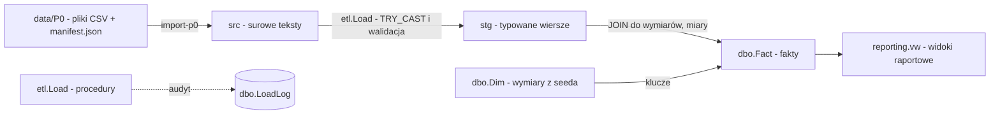
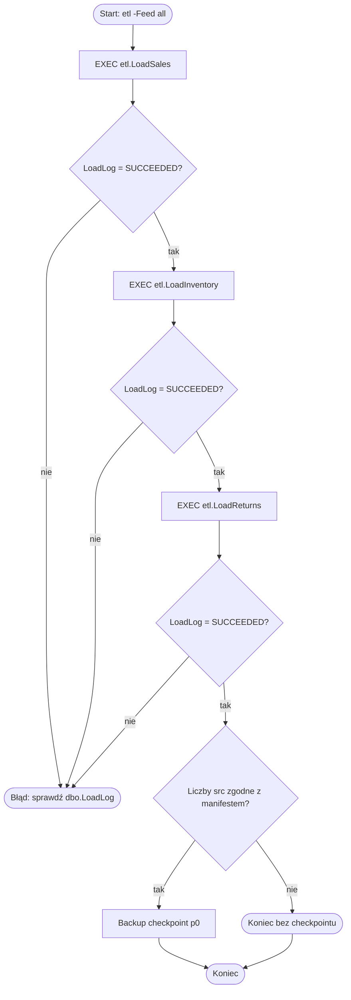
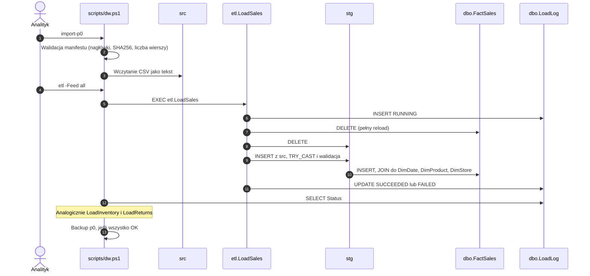

# Analiza bazy RetailDW

Dokument dla nowych Analityków Danych. Opisuje schemat, procesy ładowania i metryki na podstawie kodu w katalogu [RetailDW/](../RetailDW/) oraz skryptu [scripts/dw.ps1](../scripts/dw.ps1).

## Szybki start

- Baza jest **hurtownią sprzedaży detalicznej** (model gwiazdy): 3 tabele faktów, 3 wymiary, 1 tabela audytu.
- Dane wchodzą przez **3 feedy** (sprzedaż POS/e-commerce, zwroty, stany magazynowe z WMS).
- Analityk pracuje głównie na widokach **`reporting.vw_*`**. Nie czyta `src` ani `stg`.
- Ładowanie to **pełny reload** (`DELETE` + `INSERT`), nie przyrostowy.
- Przed użyciem liczb sprawdź [sekcję pułapek](#8-pułapki-i-ograniczenia), szczególnie VAT, sezon i liczenie transakcji.

## 1. Architektura i przepływ danych



## 2. Schematy

| Schemat | Rola | Obiekty |
|---|---|---|
| `src` | Landing zone, dane tekstowe bez walidacji | `SalesRaw`, `ReturnsRaw`, `InventoryRaw` |
| `stg` | Dane po konwersji typów i walidacji | `Sales`, `Returns`, `Inventory` |
| `etl` | Procedury ładujące | `LoadSales`, `LoadReturns`, `LoadInventory` |
| `dbo` | Wymiary, fakty, audyt | `DimDate`, `DimProduct`, `DimStore`, `FactSales`, `FactReturns`, `FactInventoryDaily`, `LoadLog` |
| `reporting` | Warstwa raportowa dla analityków | 6 widoków `vw_*` |

Uprawnienia są zdefiniowane w [RetailDW/Security/](../RetailDW/Security/) jako same `CREATE SCHEMA`. Pliki nie zawierają `GRANT`.

## 3. Tabele

### 3.1 Wymiary (`dbo`)

| Tabela | Ziarno (grain) | Kluczowe kolumny | Uwagi |
|---|---|---|---|
| `DimDate` | 1 wiersz = 1 dzień | `DateKey` (yyyymmdd, PK), `Date`, `YearMonth`, `IsoYear`, `IsoWeek`, `YearWeek`, `Season`, `IsWeekend` | Kalendarz ISO. `Season` to sezon handlowy (patrz niżej). Zakres: 2024-12-01 do 2026-12-31 (761 dni). |
| `DimProduct` | 1 wiersz = 1 SKU | `ProductKey` (PK), `SKU` (unikalny), `StyleCode`, `StyleName`, `Department`, `Category`, `Color`, `Size`, `ListPrice`, `UnitCost`, `IsActive` | SKU to wariant styl + kolor + rozmiar. Model liczysz po `StyleCode`. |
| `DimStore` | 1 wiersz = 1 sklep lub kanał online | `StoreKey` (PK), `StoreCode` (unikalny), `City`, `Region`, `Channel` (STORE/ONLINE), `Format`, `SalesAreaM2`, `OpenedDate`, `RemodelDate` | 6 wierszy z seeda (5 sklepów + `S-ONL-01`). `SalesAreaM2` to powierzchnia **bieżąca**, NULL dla online. |

Seedy są w [RetailDW/Scripts/Seed/](../RetailDW/Scripts/Seed/). Są uruchamiane przez `setup`, nie przez ETL.

Sezony w `DimDate.Season`:

| Miesiące | Sezon | Przykład |
|---|---|---|
| luty - lipiec | `SS` + rok (SS = wiosna/lato) | `SS26` |
| sierpień - grudzień | `AW` + rok (AW = jesień/zima) | `AW26` |
| styczeń | `AW` + **poprzedni** rok | 2026-01-15 → `AW25` |

### 3.2 Fakty (`dbo`)

| Tabela | Ziarno | Miary | Klucze obce | Indeksy |
|---|---|---|---|---|
| `FactSales` | 1 wiersz = 1 linia paragonu (SKU w transakcji) | `Quantity`, `UnitPrice`, `DiscountAmount`, `GrossAmount`, `NetAmount`, `UnitCost` | DateKey, ProductKey, StoreKey | po `DateKey` (INCLUDE), `ProductKey`, `TransactionNo` |
| `FactReturns` | 1 wiersz = 1 linia zwrotu | `Quantity`, `ReturnAmount` (dodatnia, brutto), `ReturnReason` | DateKey, ProductKey, StoreKey | po `DateKey` |
| `FactInventoryDaily` | 1 wiersz = dzień / SKU / sklep, stan na koniec dnia | `StockQuantity` | DateKey, ProductKey, StoreKey | po `DateKey` |

`FactInventoryDaily` to **snapshot**, nie log ruchów. Dwa kolejne wiersze to dwa stany, a ich różnica nie jest transakcją.

Miary w `FactSales`:

- `GrossAmount = Quantity * UnitPrice - DiscountAmount` (brutto, z VAT)
- `NetAmount = GrossAmount / 1.23` (netto, bez VAT)
- `UnitCost` jest kopiowany z `DimProduct` w czasie ładowania.

### 3.3 Audyt (`dbo`)

| Tabela | Rola |
|---|---|
| `LoadLog` | 1 wiersz na każde uruchomienie procedury `etl.Load*`. Kolumny: `PackageName`, `StartedAt`, `FinishedAt`, `Status` (RUNNING / SUCCEEDED / FAILED), `RowsRead`, `RowsLoaded`, `RowsRejected`, `ErrorMessage`. |

### 3.4 Tabele pośrednie

| Warstwa | Tabela | Ziarno | Różnica względem źródła |
|---|---|---|---|
| `src` | `SalesRaw`, `ReturnsRaw`, `InventoryRaw` | 1 wiersz = 1 wiersz pliku | Wszystkie kolumny to `NVARCHAR`. Brak walidacji. Kolumny `SourceFile` i `ExtractedAt` (audyt pochodzenia). |
| `stg` | `Sales`, `Returns`, `Inventory` | 1 wiersz = poprawny wiersz źródła | Typy są poprawne (`INT`, `DATE`, `DECIMAL`). Wiersze, których nie da się przekonwertować, nie trafiają tu wcale. |

Ładowanie P0 zapisuje do `src`, a `stg` jest wypełniany dopiero przez procedury.

## 4. Widoki raportowe (`reporting`)

| Widok | Ziarno | Do czego | Źródło |
|---|---|---|---|
| `vw_SalesDaily` | dzień / sklep / dział / kategoria | Bazowy widok dzienny. Rollup po `YearMonth` lub `YearWeek`. | FactSales |
| `vw_SalesWeekly` | tydzień ISO / kanał / region / dział / kategoria | Raport poniedziałkowy (tydzień Pn-Nd). | FactSales |
| `vw_MarginAnalysis` | miesiąc / styl | Przegląd marży merchandisingu. | FactSales |
| `vw_StoreScorecard` | miesiąc / sklep (bez online) | Wyniki sklepów: przychód, koszyk, produktywność na m2. | FactSales |
| `vw_StockAvailability` | dzień / sklep / dział / kategoria | Dostępność asortymentu. | FactInventoryDaily |
| `vw_ProductPerformance` | SKU (cały okres) | Scorecard SKU: sprzedaż, zwroty, stan, sell-through. | FactSales, FactReturns, FactInventoryDaily |

## 5. Procedury

| Procedura | Wejście | Wyjście | Kroki |
|---|---|---|---|
| `etl.LoadSales` | `src.SalesRaw` | `stg.Sales` → `dbo.FactSales` | 1) Konwersja i walidacja. 2) Lookup kluczy w wymiarach i wyliczenie miar. |
| `etl.LoadReturns` | `src.ReturnsRaw` | `stg.Returns` → `dbo.FactReturns` | Ten sam wzorzec. |
| `etl.LoadInventory` | `src.InventoryRaw` | `stg.Inventory` → `dbo.FactInventoryDaily` | Ten sam wzorzec. |

Wspólne cechy wszystkich trzech procedur:

- Wpis w `LoadLog` na początku i aktualizacja na końcu (`SUCCEEDED` albo `FAILED` z `ERROR_MESSAGE()`).
- Pełny reload: najpierw `DELETE` z faktu i z `stg`, potem `INSERT`. Procedura jest idempotentna w sensie wyniku.
- Odrzucone wiersze: `RowsRejected = RowsRead - RowsLoaded`.
- Warunki walidacji w `stg`: wymagane pola nie są NULL i konwersje (`TRY_CAST`) się udają. Dla sprzedaży dodatkowo `LineNumber`, `Quantity`, `UnitPrice`.
- Lookup w wymiarach to `INNER JOIN`. Wiersz bez pasującej daty, SKU lub sklepu znika po cichu i trafia tylko do liczby odrzuconych.

## 6. Proces ETL

### 6.1 Kolejność uruchamiania

1. `setup`: uruchamia lokalny SQL Server, tworzy schemat V0 (13 tabel) i seeduje wymiary.
2. `import-p0`: wczytuje 3 pliki CSV z [data/P0/](../data/P0/) do `src`. Przed importem sprawdza manifest: nagłówki, liczbę wierszy i SHA256. Wymaga pustych tabel `src`. **Nie uruchamia ETL.**
3. `etl -Feed all`: uruchamia `etl.LoadSales`, `etl.LoadInventory`, `etl.LoadReturns` w tej kolejności. Każda procedura musi zakończyć się `SUCCEEDED` w `LoadLog`, inaczej skrypt przerywa.
4. Po udanym `all` skrypt tworzy checkpoint `p0` (backup), jeśli liczby wierszy w `src` zgadzają się z manifestem.
5. `verify`: wypisuje liczby obiektów, wymiarów, wierszy w warstwach i ostatnie uruchomienia.

Dane P0 (z [manifest.json](../data/P0/manifest.json)):

| Plik | Tabela źródłowa | Wiersze |
|---|---|---|
| `sales.csv` | `src.SalesRaw` | 191 225 |
| `inventory.csv` | `src.InventoryRaw` | 82 956 |
| `returns.csv` | `src.ReturnsRaw` | 13 750 |

### 6.2 Diagram przepływu (flow)



### 6.3 Diagram sekwencji (sequence)



## 7. Metryki

Wszystkie metryki liczone są w widokach `reporting`. Nie ma w bazie metryk zwrotów w ujęciu procentowym (np. stopy zwrotów).

| Metryka | Definicja | Gdzie |
|---|---|---|
| Units | `SUM(Quantity)` | vw_Sales*, vw_MarginAnalysis, vw_ProductPerformance |
| Transactions | `COUNT(DISTINCT TransactionNo)` | vw_SalesDaily, vw_SalesWeekly, vw_StoreScorecard |
| GrossAmount | `SUM(GrossAmount)`, z VAT i po rabacie | vw_SalesDaily, vw_SalesWeekly |
| DiscountAmount | `SUM(DiscountAmount)` | vw_SalesDaily, vw_SalesWeekly |
| NetRevenue / NetAmount | `SUM(NetAmount)`, netto (= brutto / 1,23) | wszystkie widoki sprzedaży |
| CostAmount | `SUM(Quantity * UnitCost)` | vw_SalesDaily, vw_SalesWeekly, vw_MarginAnalysis |
| GrossMargin | `NetAmount - CostAmount` | vw_MarginAnalysis |
| GrossMarginPct | `100 * GrossMargin / NetAmount` (NULL, gdy NetAmount = 0) | vw_MarginAnalysis |
| AvgBasketValue | `NetRevenue / Transactions` | vw_StoreScorecard |
| UnitsPerTransaction | `Units / Transactions` | vw_StoreScorecard |
| NetRevenuePerM2 | `NetRevenue / SalesAreaM2` | vw_StoreScorecard |
| SkuCount | `COUNT(*)` wierszy stanu | vw_StockAvailability |
| SkuInStock | liczba wierszy z `StockQuantity > 0` | vw_StockAvailability |
| AvailabilityPct | `100 * SkuInStock / SkuCount` | vw_StockAvailability |
| UnitsReturned / ReturnAmount | `SUM(Quantity)`, `SUM(ReturnAmount)` | vw_ProductPerformance |
| StockOnHand | stan z ostatniego dnia snapshotu (`MAX(DateKey)`) | vw_ProductPerformance |
| UnitsSoldSeason | sprzedaż od pierwszego dnia feedu stanów | vw_ProductPerformance |
| SellThroughPct | `100 * UnitsSoldSeason / (UnitsSoldSeason + StockOnHand)` | vw_ProductPerformance |

## 8. Pułapki i ograniczenia

Lista rzeczy, które najczęściej prowadzą do błędnych wniosków.

### Ładowanie i jakość danych

- **Brak transakcji w procedurach ETL.** `DELETE` i `INSERT` są wykonywane osobno. Gdy krok 2 się nie powiedzie, fakt może zostać pusty albo częściowy, a `LoadLog` ma `FAILED`. Przed raportowaniem zawsze sprawdź status w `LoadLog`.
- **`RowsRejected` nie mówi, dlaczego.** Liczba łączy błędy konwersji (wiersz nie wchodzi do `stg`) i brak dopasowania w wymiarach (wiersz odpada w JOIN). Przyczyny trzeba sprawdzić samemu w `src`.
- **Brak unikalności w faktach.** `FactSales` nie ma unikalności na (`TransactionNo`, `LineNumber`). `FactInventoryDaily` nie ma unikalności na (dzień, SKU, sklep). Duplikaty w feedzie przechodzą bez błędu i zawyżają sumy.
- **Brak SKU w `DimProduct`** oznacza, że cały wiersz sprzedaży znika z raportu. Wymiary są uzupełniane z seeda, a nie z feedu.

### Miary i interpretacja

- **Stała stawka VAT 23%.** `NetAmount = GrossAmount / 1.23` dla wszystkich pozycji. Jeśli w asortymencie są inne stawki, netto będzie zaniżone lub zawyżone.
- **`Transactions` nie sumuje się w rollupach.** Transakcja z dwoma działami jest liczona w obu. Suma po kategoriach jest większa niż liczba transakcji. Liczbę transakcji licz na poziomie, na którym jej potrzebujesz.
- **`NetRevenuePerM2` używa bieżącej powierzchni.** `DimStore.SalesAreaM2` to stan obecny, więc wyniki historyczne po remodelingu (np. `S-KRK-01`, `RemodelDate` 2026-04-01) są przeliczone na nową powierzchnię.
- **`CostAmount` używa kosztu z momentu ładowania.** Pełny reload przelicza `UnitCost` na aktualny koszt z `DimProduct`, więc koszt historyczny nie jest zachowany.
- **`vw_MarginAnalysis` nie odejmuje zwrotów.** Marża jest brutto ze sprzedaży. Zwroty nie są powiązane z liniami sprzedaży (łączą się tylko tekstem `TransactionNo`).
- **Słowo „sezon” w `vw_ProductPerformance` znaczy co innego niż `DimDate.Season`.** Tam „sezon” to okres od pierwszego dnia feedu stanów (`MIN(DateKey)` z `FactInventoryDaily`). Stany są zbierane tylko od tego momentu, więc `SellThroughPct` liczy sprzedaż w tym samym okresie, co stan.
- **`StockOnHand` to stan z jednego dnia.** Bierzemy `MAX(DateKey)` z całego feedu. SKU bez wiersza w tym dniu ma 0, nawet jeśli wcześniej miało stan.
- **`FactInventoryDaily` to snapshot.** Nie sumuj stanów w czasie, bo otrzymasz wielokrotność tego samego towaru. Do stanu używaj wartości z konkretnego dnia.

### Zakres danych

- `DimDate` obejmuje 2024-12-01 do 2026-12-31. Daty spoza tego zakresu odpadną w ETL.
- Stany magazynowe są tylko dla bieżącego sezonu. Dla wcześniejszych dat nie ma wierszy, więc brak dostępności nie oznacza braku asortymentu.

## 9. Szybkie zapytania startowe

```sql
-- Sprzedaż netto i marża per miesiąc
SELECT YearMonth, SUM(NetRevenue) AS NetRevenue, SUM(GrossMargin) AS GrossMargin
FROM reporting.vw_MarginAnalysis
GROUP BY YearMonth
ORDER BY YearMonth;

-- Ostatnie uruchomienia ETL
SELECT TOP (10) LoadId, PackageName, Status, RowsRead, RowsLoaded, RowsRejected
FROM dbo.LoadLog
ORDER BY LoadId DESC;
```

Uruchamianie lokalnie: `scripts/dw.ps1` (np. `verify`, `etl -Feed all`). Pełna lista komend: `scripts/dw.ps1` bez parametrów pokazuje pomoc.
